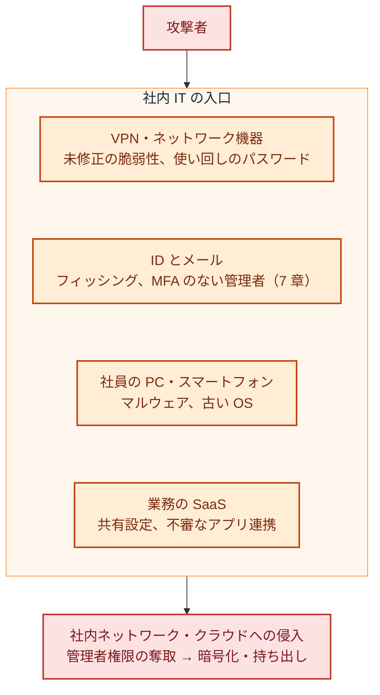

:::message
**最近のニュースから**

**ランサムウェアの入口は、社内 IT にあることが多い**: 警察庁の 2026 年上半期の報告によると、被害組織へのアンケートで、ランサムウェアの侵入経路は VPN 機器が約 5 割を占めました。攻撃者は、未修正の脆弱性や漏えいした認証情報を使って入り込み、管理者権限を奪い、セキュリティ対策を無効にし、バックアップを探してから暗号化します。

アサヒグループの事案では、攻撃者は拠点のネットワーク機器を経由してデータセンターに侵入したとされています。自社サービスのコードではなく、社員が使う VPN やネットワーク機器が入口です。
:::

7 章の ID に続いて、この章では社内 IT の残りの入口を扱います。社員の PC とスマートフォン、メール、VPN やネットワーク機器、業務で使う SaaS です。

## 社内 IT の入口

色の意味: 赤＝攻撃者と被害、オレンジ＝社内 IT の入口。ID は 7 章で扱ったので、この章では残りの入口をそれぞれどう守るかを扱います。

## 社員の PC

| やること | ポイント |
|---|---|
| OS とソフトを最新に保つ | 自動更新を有効にし、更新されていない端末を一覧で把握する。IPA の 6 か条の 1 つめでもある |
| ウイルス対策と EDR | ウイルス対策ソフトは最低限。不審な動きを検知して止める EDR があると、侵入後の動きに気づける。EDR を止められたら通知が来るようにしておく（アスクルの事案では、攻撃者が EDR などを無効化した） |
| 端末を管理する（MDM） | 会社の端末を一覧で把握し、設定（画面ロック、ディスクの暗号化、OS の更新）を配る。紛失したときに遠隔で消去できるようにする |
| ディスクを暗号化する | 紛失・盗難に備える |
| 画面ロックと試行回数を設定する | PC のログオンとスマートフォンのロック解除には 6 文字以上の PIN かパスワードを使い、失敗が続いたら端末をロックするか待ち時間を延ばす（★3 の 4-1-4）。MDM で設定を配る |
| サポートが切れた OS とソフトを使わない | サポート終了の時期を一覧で把握し、終了前に入れ替える。やむを得ず使い続けるなら、インターネットとの通信を断つなどの対策をとる（★3 の 4-4-4） |
| 社員に管理者権限を持たせない | 必要なときだけ申請して使う |
| 入れてよいソフトを決める | 許可していないソフトウェアを入れられないようにするか、見つけて削除する。USB メモリなどの自動実行は無効にする（★3 の 4-4-1）。MDM や EDR の機能で配れることが多い |
| 退職・交換のときに回収する | 端末を回収し、データを消去してから再利用・廃棄する。MDM の一覧から外れた端末がないか確かめる |

### EDR は「入れて終わり」にしない

EDR は、この章の対策の中で、入れた後の運用で効果が一番変わる道具です。

- **すべての端末に入っているか**: MDM の端末一覧と、EDR の管理画面の端末一覧を突き合わせ、EDR が入っていない端末や、しばらく報告が来ていない端末を見つける。アスクルの事案では、EDR が入っていないサーバーがあった
- **止められたら気づけるか**: 攻撃者は、暗号化の前に EDR を止めようとする。EDR の停止やアンインストール、報告の途絶を通知するように設定する
- **アラートを誰が見るか**: EDR のアラートは、夜間や休日にも出る。誰がいつ見るか、自社で見られないときに誰に任せるかを決める（15 章）

## スマートフォン

メールやチャットをスマートフォンで見るなら、それも会社のデータを持つ端末です。

| やること | ポイント |
|---|---|
| 私物を使わせるかを決める | 会社が配るか、私物を使わせるか（BYOD）を決める |
| 条件をつける | 画面ロック、OS の更新、紛失時の連絡を、業務で使う条件にする |
| 会社のデータだけを消せるようにする | 私物を使わせるなら、MDM のアプリ管理などで、会社のアプリとデータだけを管理し、紛失や退職のときに消せるようにする |

## メール

| やること | ポイント |
|---|---|
| 送信ドメイン認証を設定する | 自社のドメインに SPF・DKIM・DMARC を設定し、自社になりすましたメールを受け取り側が見分けられるようにする。Gmail は 2024 年 2 月から、1 日 5,000 通を超えて送る送信者に、この 3 つの設定を求めている |
| DMARC のポリシーを段階的に強める | 最初は `p=none`（監視だけ）で始め、レポートで正規の送信元を確かめてから、`quarantine`、`reject` に進める |
| ビジネスメール詐欺に備える | 振込先の変更や急な送金の依頼は、メール以外の手段（電話など）で確認する手順を経理と決めておく。10 大脅威の組織編にも入っている |
| メールの自動転送を制限する | 乗っ取られたアカウントで、外部への自動転送が設定されることがある。外部への自動転送は原則禁止にする |

## VPN・ネットワーク機器

警察庁の報告では、ランサムウェアの侵入経路の約半分が VPN 機器でした。VPN 機器やファイアウォール、ルーターは、インターネットに直接さらされているのに、**誰が管理しているかあいまいで、更新が後回しになりがち** です。

| やること | ポイント |
|---|---|
| 機器の一覧と管理者を決める | 拠点ごとの VPN 機器、ファイアウォール、ルーター、リモートデスクトップの入口を洗い出し、それぞれの管理者（社内か委託先か）を決める。機器ごとに製造元・モデル・保守事業者を台帳にし、拠点ごとのネットワークの所在地と用途を構成図にまとめる（★3 の 3-1-2） |
| 更新を期限内に当てる | 重大な脆弱性の修正は、リリースから 14 日以内に当てる（SCS 評価制度 ★3 の評価基準。インターネットとの境界の機器も対象）。悪用が確認されている脆弱性は、もっと早く |
| MFA を必須にする | VPN のログインにも MFA を使う。委託先の保守用アカウントも例外にしない |
| 管理画面を外に出さない | 機器の管理画面をインターネットに公開しない。接続元を絞る。初期の管理パスワードは必ず変える |
| 不正な通信に気づき、止める | 社内ネットワークの境界（UTM、ファイアウォールの IPS 機能など）か端末（EDR など）で、不正な通信をリアルタイムに検知・遮断し、通知を受ける（★3 の 5-1-1）。オフィスのネットワークを持たない会社では、端末の EDR がこの役割を担う |
| 使っていないものを止める | 使われていない VPN のアカウント、古い機器、開けたままのリモートデスクトップを止める |
| 長期的には置き換えを検討する | 社内ネットワークに入れる VPN から、ID と端末の状態で 1 つずつアクセスを許すゼロトラスト型のアクセス（19 章）への移行を、機器の更新時期に合わせて検討する |

注意喚起で VPN 機器の脆弱性が悪用されていると分かったら、**修正を当てる前に入られていなかったか** も確かめます（17 章）。

## 業務の SaaS

| やること | ポイント |
|---|---|
| SaaS の一覧と管理者 | 部署ごとに契約しているものも含めて一覧にし、それぞれの管理者を決める（5 章の委託先管理）。SSO できるかどうかも書いておく（7 章） |
| 共有設定を見直す | 「リンクを知っている全員」への共有や、社外への共有の既定値を見直す。IPA の 6 か条の「共有設定を見直そう！」にあたる |
| アプリ連携を管理する | 社員が勝手に同意した OAuth アプリ（外部のアプリに、メールやファイルへのアクセスを許すもの）を点検し、同意できるアプリを管理者が制限する |
| SaaS が止まったときの代わりを決める | メール配信やチャットが止まったときの代わりの手段（16 章の事業継続） |
| 退職時の持ち出しに気づく | 内部不正による情報漏えいは 10 大脅威の 7 位。退職が決まった人の大量ダウンロードや、個人のアカウントへの共有を、SaaS の監査ログやアラートで確かめられるようにする |

## PC と SaaS のデータを戻せるようにする

AWS のバックアップは 9 章で扱いますが、社員の PC と業務の SaaS にも、失うと困るデータがあります。

- **PC**: 業務のファイルは PC の中だけに置かず、会社のストレージ（SaaS）に置くルールにする。PC が壊れたり暗号化されたりしても、端末を入れ替えれば仕事を続けられる状態を目指す
- **SaaS**: SaaS に置いたデータは、SaaS 側の障害や誤削除、乗っ取りで失われることがある。重要なデータは、ごみ箱や版の保持期間、管理者による復元の手段を確かめ、足りなければバックアップの手段を用意する
- **戻せるかを試す**: 年に 1 回は、消したファイルを実際に戻してみる。戻す手順を知っている人が 1 人だけ、という状態を避ける

## レベル別の進め方

| レベル | やること |
|---|---|
| Lv1 | OS の自動更新、ウイルス対策、VPN 機器の一覧と最新化、振込先変更の確認手順 |
| Lv2 | スマートフォンのルール、MDM とディスクの暗号化と画面ロック、SPF・DKIM・DMARC（`p=none` から）、境界の機器の更新を 14 日以内、境界か端末での不正な通信の検知・遮断、入れてよいソフトの制限、SaaS の一覧と共有設定の見直し、PC と SaaS のデータの置き場所と復元の手段の確認 |
| Lv3 | EDR を全端末に（止められたら通知。境界の機器がなければ、★3 のために Lv2 で入れる）、DMARC を `quarantine` 以上に、OAuth アプリの同意の制限、退職時の持ち出しの確認 |
| Lv4 | 端末の状態を条件にしたアクセス制御、VPN からゼロトラスト型のアクセスへの移行、SaaS の設定を継続的に点検する仕組み |

細かい判定は、4 章のチェックシート（B. ID と社内 IT）を使います。

## よくある落とし穴

- **ネットワーク機器の持ち主がいない**: 導入した委託先との保守契約が切れ、誰も更新していない機器がよくあります。一覧を作る段階で、持ち主を決めます。
- **EDR を入れただけ**: 入っていない端末がある、止められても気づかない、アラートを誰も見ていない、のどれかが起きがちです。端末一覧との突き合わせと、アラートの見方（15 章）を決めます。
- **SaaS は事業者が守ってくれると思い込む**: SaaS の基盤は事業者が守りますが、誰に何を共有するか、どのアプリに連携を許すか、データを戻せるかは、使う側の設定と運用で決まります。
