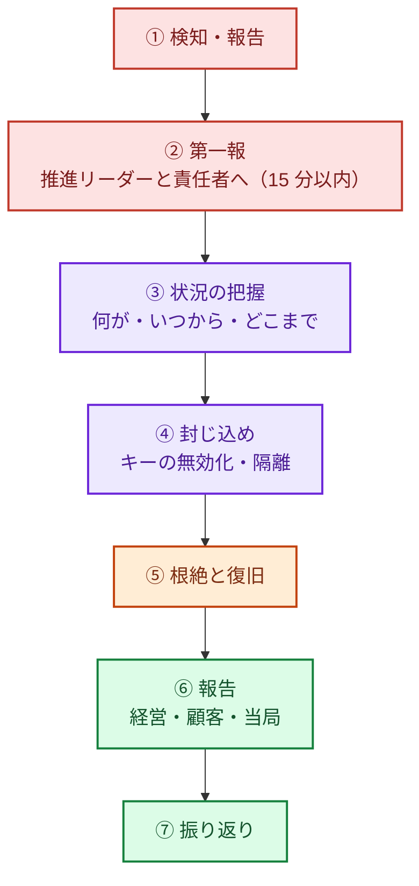

:::message
**最近のニュースから**

**アサヒとアスクルの対応（2025 年）**: アサヒグループは、システムが止まった後も紙やファクスで受注を続け、事業を止めない道を選びました。アスクルは、攻撃の手口や初動対応を時系列でまとめた報告書を公表し、多要素認証の全面適用、全サーバーへの EDR 導入と 24 時間監視、バックアップの強化などの再発防止策を示しました。

**GMO インターネットの事案（2026 年 10 月）**: 「お名前.com デスクトップクラウド」への不正アクセスでは、攻撃者とみられる者が約 80 億円を要求し、情報の公開を予告して実際に公開しました。真偽の分からない情報が拡散するなかで、企業がどう発信するかが問われました。同社は要求に応じないことを表明し、経営トップが謝罪したと報じられています。

止まったときに何で代替し、誰が判断し、誰が外に何を伝えるか。
:::

どれだけ備えても、インシデントは起きます。前の 15 章では、知らせに気づき、インシデントとして扱うかを決めるところまでを扱いました。そのときに被害を広げないかどうかは、**最初の数時間に誰が何をするか** を平時に決めてあるかで決まります。この章では、その後の初動の手順、外への発信、止まったときの代わりの手段（事業継続）、シナリオ別のプレイブック、訓練を扱います。何が起きたのかを調べる「侵害調査」は、次の 17 章で扱います。

## 最低限の初動手順（Lv1〜Lv2）

1. **第一報は早く、不完全でよい**: 「おかしい」と思ったら、確証がなくても 15 分以内に推進リーダーに連絡する。報告した人を責めない
2. **証拠を壊さない**: 慌ててインスタンスを削除しない。スナップショットを取り、ネットワークから隔離する（詳しくは 17 章）
3. **認証情報を止める**: 漏えいが疑われるキー・トークン・パスワードを無効化する
4. **記録をとる**: 時刻と、誰が何をしたかを、チャットのスレッドなどに残す
5. **外部に相談する**: 自社だけで判断できないときは、契約している専門会社に加えて、JPCERT/CC（インシデント対応の依頼・相談）、IPA（技術的な相談・届出）、警察（都道府県警察のサイバー犯罪相談窓口）に相談する。連絡先は平時に連絡網に書いておく
6. **発信の窓口を一本にする**: 攻撃者が SNS などで犯行声明や真偽不明の情報を流すことがあります。社外への発信は広報と責任者に一本化し、確認できた事実だけを、定期的に更新して出します。身代金の要求には、経営として応じない方針を平時に決めておきます
7. **報告義務を確認する**: 個人情報の漏えい（またはそのおそれ）がある場合、個人情報保護委員会への報告と本人への通知が必要になることがあります。取引先との契約上の報告義務も確認します

## 何を、いつ、誰に伝えるか

被害の情報を外にどう出すかは、経済産業省などの検討会がまとめた「**サイバー攻撃被害に係る情報の共有・公表ガイダンス**」（2024 年 3 月）が参考になります。被害の情報を「何のために」「どのような情報を」「どのタイミングで」「誰に対して」共有・公表するかを、Q&A 形式で整理しています。

- **共有**（非公開）: 攻撃の手口などの技術情報を、JPCERT/CC や調査会社、業界の情報共有の枠組みに渡し、他社の被害を防ぐ。被害組織が特定されない形に加工して共有することもできる
- **公表**（一般向け）: 顧客や取引先に被害が及ぶおそれがあるときは、分かっている事実を、分からないことは分からないと明示して出す。調査の進捗に合わせて第 2 報、第 3 報と更新する

平時にこのガイダンスを読み、公表文のひな型と、公表を判断する人（責任者・広報・法務）を決めておくと、当日の迷いが減ります。

社内向けにも、次のものを平時に用意しておきます（どれも SCS 評価制度 ★3 の要求事項 6-1-1 に含まれます）。

- **報告フォーマット**: 第一報（速報）と、調査が進んだ後の報告の書式。サイバーセキュリティ経営ガイドラインの付録 C が、整理すべき項目のひな型になる（17 章）
- **報告・共有のルート**: 社内の誰に、どの順で伝えるか。関係当局や所管省庁、取引先への報告ルートも含める
- **事例の共有**: 年 1 回以上と、社内外で重大なインシデントが起きたときに、事例と対応策を社内で共有する。他社の事例（2 章）を題材にしてもよい

## 止まったときの代わりの手段（事業継続）

ランサムウェアや SaaS の停止では、復旧までに数週間から数か月かかることがあります。その間も事業を続けられるかどうかは、平時に「止まったら、どうやって続けるか」を決めてあるかで変わります。アサヒグループが紙やファクスで受注を続けたのは、その一例です。

| 決めておくこと | 例 |
|---|---|
| 止まると一番困る業務 | 受注、出荷、請求、顧客からの問い合わせ |
| その業務が頼っているシステムと SaaS | 基幹システム、EC サイト、メール配信、チャット、IdP |
| 代わりの手段 | 紙・電話・ファクスでの受付、別の SaaS や別リージョンへの切り替え、手作業での出荷 |
| 誰が切り替えを判断するか | 事業部門の責任者とセキュリティ責任者 |
| どこまで止まったら諦めて切り替えるか | 「24 時間戻らなければ代替に切り替える」など |
| 復旧の順番 | どのシステムから戻すか（目標復旧時間＝RTO の短い順） |

事業継続上重要なシステムについて、目標復旧レベルを決め、待機系や人手による業務継続の準備をしておくことは、SCS 評価制度 ★3 の要求事項（7-1-1）でもあります。この本では Lv2 で決めておくものとして扱います。

すでに BCP（事業継続計画）がある会社なら、自然災害を想定した BCP に「サイバー攻撃でシステムが使えない」場合を加えるのが早道です。経営ガイドラインの指示 8 も、制御系を含めた BCP との連携を求めています（3 章）。

バックアップから戻す具体的な準備（別アカウントへの保管、消せない設定、復元テスト）は、9 章の「ログとバックアップを『消されない場所』に置く」で扱います。

## 用意しておくプレイブック（Lv3）

| シナリオ | 初動の要点 |
|---|---|
| AWS の認証情報の漏えい | キーの無効化、CloudTrail で不正な操作の確認、作られたリソースの削除、請求の確認 |
| AWS アカウントの乗っ取り | ルートの保護、SCP による封じ込め、AWS サポートへの連絡 |
| ランサムウェア | ネットワークからの切り離し、バックアップの無事の確認、復旧の判断、警察・専門会社への相談 |
| GitHub のシークレット漏えい | キーの無効化、利用ログの確認、履歴からの削除 |
| 悪性パッケージの混入 | 影響したビルドと環境の特定、CI と開発者 PC の認証情報のローテーション |
| AI エージェントの暴走・乗っ取り | エージェントの停止、エージェントの認証情報の無効化、実行ログの確認 |
| 使っている SaaS の停止・侵害 | 代替手段への切り替え、SaaS に預けていたデータの影響確認、顧客への連絡 |
| 攻撃者による脅迫・情報公開の予告 | 発信窓口の一本化、警察・専門家への相談、公開された情報の真偽確認 |
| 社員アカウントの乗っ取り（フィッシング） | セッションの無効化、パスワードと MFA の再設定、メール転送ルールの確認 |

## 訓練

| レベル | 訓練 | ねらい |
|---|---|---|
| Lv2 | 初動手順と連絡網を関係者に説明し、連絡網を実際に回してみる（30 分ほど） | 連絡先が古い、夜間に誰もつかまらない、といった穴を見つける。SCS 評価制度 ★3 でも、インシデント対応の教育・訓練が求められている |
| Lv3 | 年 1 回、上のシナリオから 1 つ選んで机上訓練（シナリオを読み上げ、各自が何をするかを話し合う。1〜2 時間） | 手順の穴（権限がなくて操作できない、判断する人が決まっていない、など）を見つける |
| Lv3 | 年 1 回、復旧訓練（重要なシステムを、バックアップから実際に戻してみる） | 目標復旧時間内に戻せるか、手順書どおりに戻せるかを確かめる（9 章の復元テストと組み合わせる） |
| Lv4 | 代替手段への切り替えまで含めた訓練、攻撃を想定した GameDay | 事業部門も含めて、止まったときの動きを確かめる |

訓練のあとは、見つかった穴を直し、手順書と連絡網を更新します。訓練は「うまくできたか」ではなく「穴が見つかったか」で評価します。
