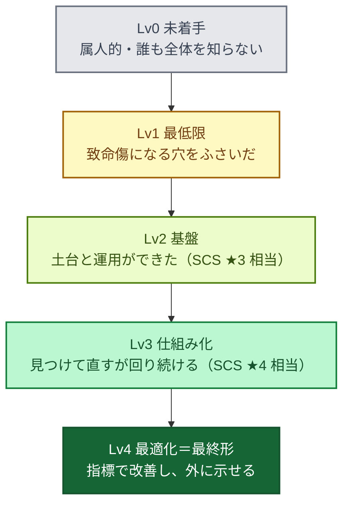
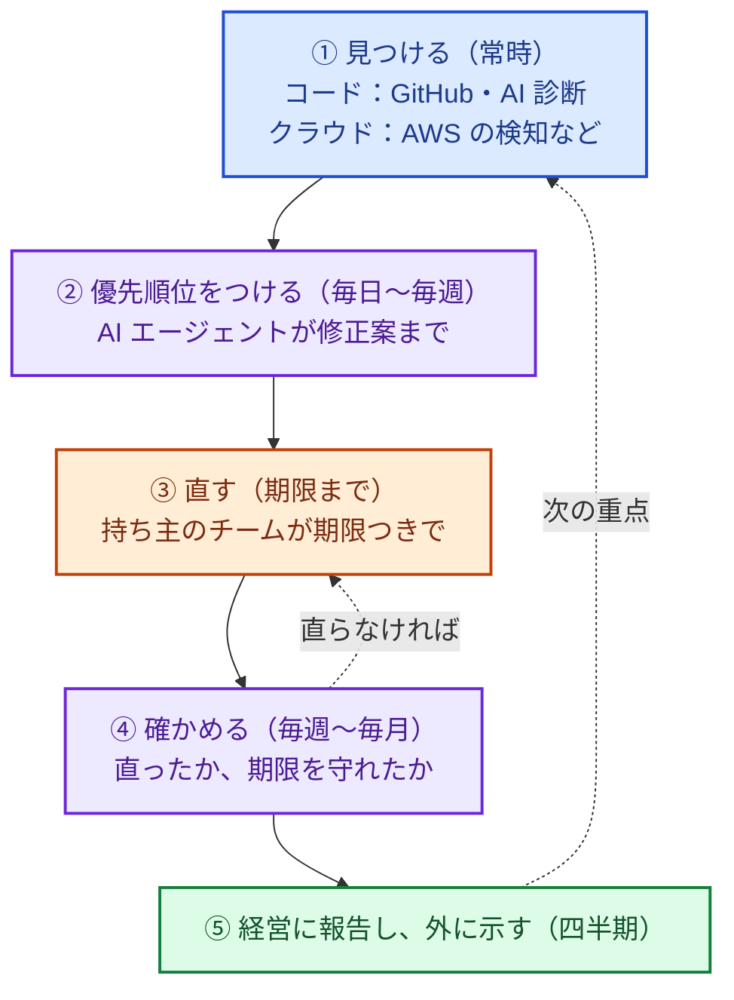

## ある日の会議で

たとえば、こんな場面を想像してみてください。

> ランサムウェアで大手企業の出荷が止まり、クラウドサービスが止まり、数百万件規模の情報漏えいが毎週のように報じられる。そんなニュースが続いたある日の経営会議の終わりぎわ、役員にこう聞かれました。
>
> 「毎週のように、どこかがやられているね。**うちは、大丈夫なの？**」
>
> GuardDuty は有効にしてある。GitHub の検知も入れた。AWS の診断も一度やった。
>
> それなのに、言葉に詰まりました。
>
> 「大丈夫」と言える根拠がない。かといって「大丈夫じゃない」と言うなら、何が足りなくて、いくらかけて、いつまでに何をすればいいのかを説明しなければならない。AI が脆弱性を大量に見つける時代になったというニュースも気になる。取引先からは ISMS や新しい評価制度について聞かれ始めているのに、それにも答えられない。

専任のセキュリティチームがない会社で、最初にセキュリティを任された人なら、似た場面に覚えがあるかもしれません（この場面は、よくある状況をもとにした架空のものです）。

ニュースのおかげで、経営もセキュリティに関心を持っています。予算や体制を求めるなら、今が好機です。ところが、いざ「何をすればいいのか」を考え始めると、手が止まります。やるべきことを並べると数百項目になり、ツールの営業も次々に来るからです。経済産業省や IPA のガイドライン、新しい評価制度（SCS 評価制度）、AWS の成熟度モデル、ベンダーの資料と、材料はたくさんあります。それでも、「自分の会社はいまどこにいて、次に何をすればいいのか」に直接答えてくれる資料は、なかなか見つかりません。

この本は、これらの材料を 1 つの基準にまとめ直し、その問いに答えられるようにするためのものです。

## 対象読者と、想定している会社

対象は、専任のセキュリティチームがない会社で、最初にセキュリティを任された人（兼務を含む）です。社員数は数十〜数百名を想定しています。

社員の ID・PC・メール・業務の SaaS といった社内 IT と、自社のサービスがあればその開発と運用の両方を扱います。クラウドは AWS、コードは GitHub を例にしますが、レベルの考え方、体制、インシデント対応、ロードマップは、ほかのクラウドやサービスでもそのまま使えます。セキュリティのツールがまだほとんど入っていなくても読めるように書いています。

## この本のゴール

この本では、セキュリティ体制の成熟度を 5 つのレベルで表します。

このレベルは、公的な認証ではなく、この本独自の区分です。AWS セキュリティ成熟度モデルの 4 つのフェーズ（易しくて効果の大きい対策から順に並べたもの）に「未着手」を加えて 5 段階にし、Lv2 と Lv3 を、取引先に示す SCS 評価制度の★3・★4 にそろえました。由来と各レベルの定義は 3 章で説明します。

最終的に目指す Lv4 の姿は、次のとおりです。

色の意味: 青＝開発、紫＝優先順位づけ・確認、オレンジ＝修正、緑＝経営・報告。

このループは、1 周に四半期かけるものではありません。検知とコードのチェックは常に動き、検知結果は毎日〜毎週見て、重大度ごとの期限までに直します。四半期ごとにするのは、レベルの測り直しと経営への報告、次の重点の見直しだけです。

この「見つける → 直す → 確かめる」が人の手をなるべく使わずに回り、人は「何を受け入れ、どこに投資するか」の判断に集中している状態が、Lv4 の最終形です。数百名規模の会社なら、専任者は数名で、各部門の兼務者・AI エージェント・外部パートナーと一緒に回す形です。

ただし、どこまでやれば十分かは会社によって違い、すべての会社が Lv4 を目指す必要はありません。この本では、すべての会社の最低ラインを Lv2（SCS ★3 相当）とし、取引先の要求や預かっているデータによって Lv3（★4 相当）以上を目標にする、と考えます。自社の目標レベルの決め方は 3 章で説明します。

2025〜2026 年に何が起きたのか、なぜ今セキュリティが経営の話題になっているのかは、2 章で整理します。すぐに自社の状態を確かめたい人は、このまま下の簡易チェックに進んでください。

## 3 分でできる簡易チェック

まず、いまの現在地をざっくり測ってみましょう。次の 10 問に「はい / いいえ」で答えてください。**「だいたい」「一部だけ」は「いいえ」** です。

| # | 質問 | レベル |
|---|---|---|
| 1 | すべての AWS アカウントのルートユーザーに MFA があり、アクセスキーがない | Lv1 |
| 2 | メール、GitHub、AWS など主要なサービスで、MFA が全員に必須になっている | Lv1 |
| 3 | 全 AWS アカウント・全リージョンで CloudTrail と GuardDuty が有効で、重大な検知は誰かのチャットに届く | Lv1 |
| 4 | インシデントのとき、最初に誰に連絡し、どこに相談するかが決まっている | Lv1 |
| 5 | セキュリティの責任者が任命され、担当者の稼働（時間）が確保されている | Lv2 |
| 6 | 人の AWS へのアクセスは SSO（IAM Identity Center）経由で、IAM ユーザーのアクセスキーは原則ない | Lv2 |
| 7 | Security Hub や Wiz の検知結果を、毎週誰かが決まった時間に見ている | Lv2 |
| 8 | 脆弱性に重大度別の対応期限があり、期限を守れた割合を測っている | Lv3 |
| 9 | AI などによる脆弱性診断が、年 1 回ではなく、コードの変更に合わせて継続的に回っている | Lv3 |
| 10 | インシデント対応の訓練（机上訓練など）を、この 1 年以内に行った | Lv3 |

**判定のしかた**

- 1〜4 に 1 つでも「いいえ」がある →Lv0
- 1〜4 がすべて「はい」→Lv1
- 1〜7 がすべて「はい」→Lv2
- 1〜10 がすべて「はい」→Lv3 以上

ツールを入れていても、Lv0 や Lv1 になることはよくあります。この質問のほとんどは、ツールの有無ではなく、設定が全体に行き渡っているか、誰かが見て直しているかを聞いているからです（6 章）。

## レベル別・おすすめの読み方

| 判定 | まず読む章 | そのあと |
|---|---|---|
|Lv0| 4 章（現在地チェックシート）→ 5 章（体制とルール）→ 16 章（最初の 90 日） | 7 章（社内 IT）と 8 章（AWS）の Lv1 の項目から手を付ける |
|Lv1| 6 章（ツールの役割分担マップ）→ 7 章（社内 IT）→ 8 章（AWS の土台） | 3 章（基準とレベル）で、★3 や ISMS への道筋を確認する |
|Lv2| 12 章（AI による脆弱性診断）→ 5 章（脆弱性の対応期限＝SLA） | 13 章（AI のリスク）で、AI エージェントの権限を見直す |
|Lv3 以上| 3 章（この本のレベル）→ 16 章（最終形） | 18 章の資料で、他社の取り組みと比べる |
| 「うちも入られていないか」が気になる | 15 章（侵害調査） | 8 章でログの保管を見直す |
| 「入られたら、どう動くか」が気になる | 14 章（インシデント対応） | 15 章で、調査に必要なログと調査会社を確認する |
| 経営に危機感を共有したい | 2 章（なぜ今なのか） | 4 章のチェックシートと合わせて、現在地を報告する |
| 用語や考え方から押さえたい | 17 章（付録: 基礎知識）→ 3 章（基準とレベル） | 4 章のチェックシートで、現在地を測る |

## この本の構成

| 部 | 章 | 内容 |
|---|---|---|
| 第 1 部 現在地を知る | 2 | なぜ今なのか ― 2025〜2026 年に起きたこと |
| | 3 | 何を基準にするか ― ガイドライン、SCS 評価制度、この本のレベル |
| | 4 | 現在地チェックシート（領域 × 5 レベル） |
| 第 2 部 体制と地図をつくる | 5 | 体制とルール ― 誰が責任を持ち、誰が直すか |
| | 6 | ツールの役割分担マップ ― 何を、どの順番で入れ、どう回すか |
| 第 3 部 守りを固める | 7 | 社内 IT を守る ― ID・PC・メール・VPN・SaaS |
| | 8 | AWS の土台をつくる ― Organizations・Security Hub・GuardDuty |
| | 9 | AWS 全体を定期的に健康診断する ― SATv2 |
| | 10 | クラウドのリスクに優先順位をつける ― Wiz |
| | 11 | コードと開発プロセスを守る ― GitHub |
| | 12 | アプリの脆弱性を AI で見つけて直す ― Takumi と Claude Security |
| | 13 | AI を使う・作るときのリスクと対策 |
| 第 4 部 有事に備え、計画する | 14 | インシデント対応 ― 初動、発信、事業継続、訓練 |
| | 15 | 侵害調査 ― すでに入られていないか、入られたら何を調べるか |
| | 16 | ロードマップと最終形（一人目の担当者の最初の 90 日を含む） |
| 付録 | 17 | 基礎知識・用語と、基準の詳細 |
| | 18 | 参考資料・最近の発表資料 |

第 2 部から第 4 部の各章の冒頭には、その章のテーマに関係する最近のニュースを、短いコラムとして置いています。

## 注意

- 文中の「Lv」はこの本独自の区分で、公的な認証や評価の結果を示すものではありません。
- 製品の機能・価格・提供状況や制度の詳細は、2026 年 11 月時点で確認できた情報をもとにしています。導入や対応の判断の前には、各社・各機関の公式情報を確認してください。
- 第 3 部では、役割ごとに代表的な製品を 1 つずつ選び、具体例として書いています。製品の比較や推薦ではなく、特定の会社の導入状況を示すものでもありません。同じ役割の他の製品でも、考え方はそのまま使えます。
