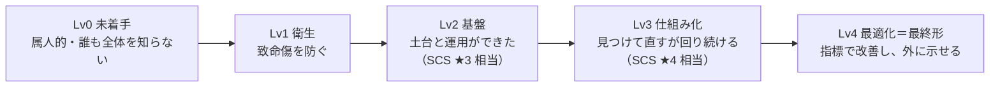
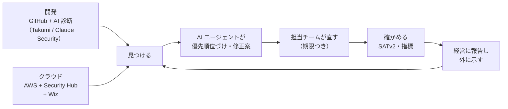

## ある日の会議で

> 経営会議の終わりぎわ、役員にこう聞かれました。
>
> 「最近、取引先がランサムウェアでやられたらしいね。**うちのセキュリティは、大丈夫なの？**」
>
> クラウドの設定を診断するツールは入れた。脆弱性を見つける AI のサービスも契約した。AWS の診断も一度やった。GitHub の検知も有効にしてある。
>
> それなのに、言葉に詰まりました。
>
> 「大丈夫」と言える根拠がない。かといって「大丈夫じゃない」と言うなら、何が足りなくて、いくらかけて、いつまでに何をすればいいのかを説明しなければならない。取引先からは ISMS や新しい評価制度について聞かれ始めているのに、それにも答えられない。

専任のセキュリティチームがない会社で、**最初にセキュリティを任された人** なら、似た場面に覚えがあるかもしれません。

セキュリティ対策には終わりがありません。やるべきことを並べると数百項目になり、ツールの営業も次々に来ます。「どこまでやれば十分なのか」という物差しがないまま、目の前の対応に追われることになりがちです。

この本は、その **物差し** を作るための本です。

:::message
**3 行で分かる、この本**

- **誰向け**: セキュリティ専任チームのない会社で、最初にセキュリティを任された人（兼務を含む）。
- **読むと**: 自社が **いまどのレベルにいて**、**次に何をすべきで**、**最終的にどんな姿を目指すのか** を、公的なガイドラインと成熟度モデルを根拠に説明できるようになります。
- **扱う道具**: AWS（Security Hub / GuardDuty ほか）、SATv2、Wiz、GitHub、Takumi byGMO、Claude Security。情報は **2026 年 11 月時点** のものです。
:::

## この本の立ち位置

この本は、筆者自身が「一人目の担当者」としてセキュリティ体制づくりを任されたときに、**自分のために作った地図** がもとになっています。

調べ始めて分かったのは、材料はたくさんあるのに、つながっていないということでした。

- 経済産業省と IPA は、経営者向け・中小企業向けのガイドラインや、新しい評価制度（SCS 評価制度）を出している
- AWS は、セキュリティ成熟度モデルや診断ツールを公開している
- ツールのベンダーは、それぞれの製品でできることを説明してくれる
- 勉強会やカンファレンスでは、各社の取り組みが発表されている

ところが、「**自分の会社はいまどこにいて、次に何をすればいいのか**」に答えてくれる資料は、なかなか見つかりませんでした。そこで、これらを 1 つの物差しにまとめ直したのがこの本です。

特定の会社の事例集ではありません。筆者の状況を出発点にしつつ、同じ立場の人が自社に当てはめて使えるように、一般化して書いています。

## 先に、ゴールを見せます

この本では、セキュリティ体制の成熟度を **5 つのレベル** で表します。

そして、最終的に目指す姿（Lv4）はこうです。

**見つける → 直す → 確かめる** が人の手をなるべく使わずに回り、人は「何を受け入れ、どこに投資するか」の判断に集中している。数百名規模の会社なら、専任者は数名で、各部門の兼務者・AI エージェント・外部パートナーと一緒に回している。それが、この本の考える **「十分」** です。

この本を読み終えると、上の 2 枚の図を使って、自社の現在地と次の一手を説明できるようになります。

## 3 分でできる簡易チェック

まず、いまの現在地をざっくり測ってみましょう。次の 10 問に「はい / いいえ」で答えてください。**「だいたい」「一部だけ」は「いいえ」** です。

| # | 質問 | レベル |
|---|---|---|
| 1 | すべての AWS アカウントのルートユーザーに MFA があり、アクセスキーがない | Lv1 |
| 2 | メール、GitHub、AWS など主要なサービスで、MFA が全員に必須になっている | Lv1 |
| 3 | 全 AWS アカウント・全リージョンで CloudTrail と GuardDuty が有効で、重大な検知は誰かのチャットに届く | Lv1 |
| 4 | インシデントのとき、最初に誰に連絡し、どこに相談するかが決まっている | Lv1 |
| 5 | セキュリティの責任者が任命され、担当者の稼働（時間）が確保されている | Lv2 |
| 6 | 人の AWS へのアクセスは SSO（IAM Identity Center）経由で、IAM ユーザーのアクセスキーは原則ない | Lv2 |
| 7 | Security Hub や Wiz の検知結果を、**毎週** 誰かが決まった時間に見ている | Lv2 |
| 8 | 脆弱性に重大度別の対応期限があり、期限を守れた割合を測っている | Lv3 |
| 9 | AI などによる脆弱性診断が、年 1 回ではなく、コードの変更に合わせて継続的に回っている | Lv3 |
| 10 | インシデント対応の訓練（机上訓練など）を、この 1 年以内に行った | Lv3 |

**判定のしかた**

- 1〜4 に 1 つでも「いいえ」がある → **Lv0**
- 1〜4 がすべて「はい」→ **Lv1**
- 1〜7 がすべて「はい」→ **Lv2**
- 1〜10 がすべて「はい」→ **Lv3 以上**

:::message
**ツールを入れていても、Lv0 や Lv1 になることはよくあります。** この簡易チェックの質問のほとんどは、ツールの有無ではなく「設定が全体に行き渡っているか」「誰かが見て、直しているか」を聞いています。ツールを入れたのに強くなった実感がないなら、その理由はたいていここにあります。この本の 6 章で詳しく扱います。
:::

## レベル別・おすすめの読み方

| 判定 | まず読む章 | そのあと |
|---|---|---|
| **Lv0** | 5 章（現在地チェックシート）→ 7 章（AWS の土台）→ 13 章（担当者としての動き方） | 14 章のロードマップで、最初の 3 か月の計画を立てる |
| **Lv1** | 6 章（ツールの役割分担マップ）→ 8 章（SATv2）→ 9 章（Wiz） | 3 章（ガイドライン）で、★3 や ISMS への道筋を確認する |
| **Lv2** | 11 章（AI による脆弱性診断）→ 13 章（脆弱性管理の SLA） | 12 章（AI のリスク）で、AI エージェントの権限を見直す |
| **Lv3 以上** | 4 章（Lv4 の完了の定義）→ 14 章（最終形） | 15 章の資料で、他社の取り組みと比べる |
| 用語や考え方から押さえたい | 2 章（基礎知識）→ 3 章 → 4 章 | 順番に読む |

## この本の構成

| 部 | 章 | 内容 |
|---|---|---|
| 第 1 部 物差しを持つ | 2 | セキュリティの基礎知識 |
| | 3 | 経産省・IPA のガイドラインと SCS 評価制度（ISMS の位置づけも） |
| | 4 | 成熟度モデルと、この本のレベル定義 |
| | 5 | 現在地チェックシート（7 領域 × 5 レベル） |
| 第 2 部 道具を組み合わせる | 6 | ツールの役割分担マップ ― 入れたのに回らないのはなぜか |
| | 7 | AWS の土台と Security Hub / GuardDuty |
| | 8 | SATv2 による定期的な健康診断 |
| | 9 | Wiz を優先順位づけの中心にする |
| | 10 | GitHub でコードとサプライチェーンを守る |
| | 11 | Takumi と Claude Security による AI 脆弱性診断 |
| 第 3 部 AI 時代の体制 | 12 | AI を使う・作るときのリスクと対策 |
| | 13 | 一人目の担当者としての動き方（体制・規程・インシデント対応・最初の 90 日） |
| | 14 | ロードマップと最終形 |
| 付録 | 15 | 参考資料・最近の発表資料 |

## 注意

- この本は、特定の会社の実際の状況を書いたものではありません。また、文中の「Lv」はこの本独自の区分で、公的な認証や評価の結果を示すものではありません。
- 製品の機能・価格・提供状況や制度の詳細は、変化が速いため 2026 年 11 月時点で確認できた情報をもとにしています。導入や対応の判断の前には、必ず各社・各機関の公式情報を確認してください。
- 第 2 部では、筆者が実際に組み合わせているツールを前提に書いています。同じ役割を持つ他の製品でも、考え方はそのまま使えます。
