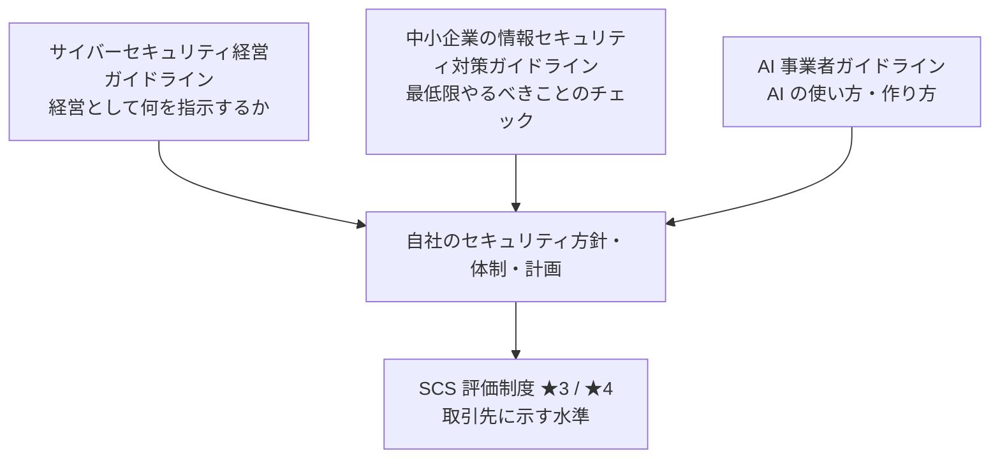

この章では、経済産業省と IPA（独立行政法人 情報処理推進機構）が公開しているガイドラインのうち、体制づくりの「物差し」になる 4 つを整理します。

| 資料 | 主な読者 | この本での使い方 |
|---|---|---|
| サイバーセキュリティ経営ガイドライン Ver3.0 | 経営者・CISO 相当 | 経営層に「何を指示すべきか」を説明する |
| 中小企業の情報セキュリティ対策ガイドライン 第4.0版 | 中小企業の経営者・担当者 | 最低限やるべきことを漏れなく押さえる |
| SCS 評価制度（★3〜★5） | サプライチェーンに属する全企業 | 取引先に示す「到達目標」にする |
| AI 事業者ガイドライン | AI を開発・提供・利用する事業者 | AI 利用のルールづくりの根拠にする（12 章） |

あわせて、取引先からよく求められる国際規格の認証 **ISMS（ISO/IEC 27001）** との関係も、この章の後半で整理します。

## サイバーセキュリティ経営ガイドライン Ver3.0

経済産業省と IPA が策定した、**経営者向け** のガイドラインです。最新版は 2023 年 3 月改訂の Ver3.0 です（2026 年 11 月時点で改訂版は確認できていません）。サイバーセキュリティを「IT 部門の問題」ではなく **経営課題** として扱うよう求めているのが特徴です。

### 経営者が認識すべき 3 原則

1. 経営者は、サイバーセキュリティリスクを経営リスクの 1 つとして認識し、リーダーシップを発揮して対策を進める
2. 自社だけでなく、ビジネスパートナーや委託先を含む **サプライチェーン全体** に目を配る
3. 平時・緊急時を問わず、社内外の関係者と積極的にコミュニケーションをとる

### 経営者が CISO 等に指示すべき重要 10 項目

| # | 項目 | 専任チームがない会社での具体例 |
|---|---|---|
| 1 | リスクの認識、組織全体での対応方針の策定 | セキュリティ基本方針を経営会議で決める |
| 2 | リスク管理体制の構築 | セキュリティ責任者（CISO 相当）と兼務チームを任命する |
| 3 | 資源（予算・人材等）の確保 | ツール予算と、兼務者の稼働（例: 20%）を確保する |
| 4 | リスクの把握と対応計画の策定 | リスク登録簿と年間ロードマップを作る |
| 5 | リスクに効果的に対応する仕組みの構築 | AWS・GitHub の標準設定、検知の仕組みを整える |
| 6 | PDCA サイクルによる対策の継続的改善 | 四半期ごとに現在地チェック（5 章）をして経営に報告する |
| 7 | インシデント発生時の緊急対応体制の整備 | 連絡網、初動手順、外部の支援先を決める |
| 8 | 被害に備えた事業継続・復旧体制の整備 | バックアップと復旧訓練、BCP との連携 |
| 9 | サプライチェーン全体の状況把握と対策 | 委託先・SaaS の管理、取引先からの要求への対応 |
| 10 | 情報の収集・共有・開示の促進 | 脅威情報の収集、取引先や業界との情報共有 |

:::message
**使い方のコツ**: この 10 項目を、そのまま「経営への定期報告のフォーマット」にすると便利です。各項目について「現状」「今期やること」「経営に決めてほしいこと」を 1 行ずつ書くだけで、経営層との会話が成り立つようになります。
:::

ガイドラインには、各項目の実践例をまとめた「プラクティス集」や、自社の状況を可視化する「サイバーセキュリティ経営可視化ツール」も用意されています。後者は、自己評価の結果をレーダーチャートで示してくれるので、最初の現状把握に使えます。

## 中小企業の情報セキュリティ対策ガイドライン 第4.0版

IPA が公開している、中小企業向けのガイドラインです。**2026 年 3 月 27 日に第4.0版** が公開されました（前の版は 2023 年 4 月の第3.1版）。サプライチェーン全体に被害が及ぶ攻撃が増えたことを受けて、サイバーセキュリティ対策の記述が増え、SCS 評価制度の考え方も反映されています。

社員数が数百名の会社は、法律上の「中小企業」に当たらない場合もありますが、このガイドラインは **「最低限やるべきこと」を漏れなく確かめるチェックリスト** として、規模を問わず使えます。

### 情報セキュリティ 5 か条（最初の一歩）

ガイドラインの最初のステップとして示されているのが、次の 5 か条です。

1. OS やソフトウェアは常に最新の状態にしよう
2. ウイルス対策ソフトを導入しよう
3. パスワードを強化しよう（いまなら **MFA を必ず有効にしよう** と読み替えるべきです）
4. 共有設定を見直そう（クラウドなら **公開設定・共有リンクの見直し** です）
5. 脅威や攻撃の手口を知ろう

### 付録の使い方

ガイドラインには、すぐに使える付録が付いています。代表的なものは次のとおりです（版によって構成が変わるため、最新版で確認してください）。

- **5 分でできる！情報セキュリティ自社診断**: 25 問ほどの簡単な診断。最初の現状把握に使う
- **情報セキュリティ基本方針・関連規程のサンプル**: 規程を一から書かずに、ひな型を自社向けに直す（13 章）
- **リスク分析シート**: 情報資産の洗い出しとリスク評価
- **クラウドサービス安全利用の手引き**: SaaS を使うときの確認事項

また、IPA の「**SECURITY ACTION**」は、中小企業が自らセキュリティ対策に取り組むことを宣言する制度です。一つ星（5 か条に取り組む）、二つ星（自社診断を行い、基本方針を定めて公開する）があります。

## SCS 評価制度（サプライチェーン強化に向けたセキュリティ対策評価制度）

この本で最も重要な「外からの物差し」です。

### 背景

大企業がしっかり対策していても、セキュリティの弱い取引先や委託先が攻撃され、そこからサプライチェーン全体が止まる事例が増えています。一方で、取引先から送られてくるセキュリティチェックシートは会社ごとに形式がバラバラで、受け取る側も答える側も大きな負担になっていました。

そこで経済産業省は、サプライチェーンに属する企業のセキュリティ対策の水準を、**★（星）の数** で示す共通の評価制度を作っています。

### ★の段階

| 段階 | 位置づけ | 評価のしかた（概要） |
|---|---|---|
| ★3 | すべてのサプライチェーン企業が最低限実装すべき **基礎的な** 対策 | 自己評価（専門家による確認を含む） |
| ★4 | サプライチェーン企業として標準的に目指すべき対策。★3 に加えて組織的・技術的な対策を求める | 第三者による評価 |
| ★5 | 到達点として目指すべき対策（国際的な標準等を踏まえた高度な水準） | 今後具体化 |

- 経済産業省は 2026 年 3 月 27 日に「制度構築方針」を公表し、**★3・★4 は 2026 年度末頃の制度開始（申請受付の開始）** を目指すとしています（運営基盤の整備状況により変更の可能性あり）。
- ★3・★4 の要求事項と評価基準は公開されており、2026 年 10 月時点で **Ver1.1** が経済産業省の制度ページに掲載されています。項目数は解説記事によって数え方が違うため、必ず公式の資料で確認してください。
- ★5 は 2026 年度以降に要求事項などを具体化する方針です。

### この本での SCS 評価制度の扱い

SCS 評価制度は、この本のレベルと次のように対応させます（詳しくは 4 章）。

- **Lv2（基盤）を固めたら ★3 を取れる状態** を目指す
- **Lv3（仕組み化）を固めたら ★4 の第三者評価に耐えられる状態** を目指す
- ★5 は、Lv4（最終形）の目標として意識する

取引先から「★3 を取っていますか」「★4 の取得予定は」と聞かれる日は近いと考え、**★3 の要求事項を自社のチェックリストに取り込んでおく** のがおすすめです。

:::message alert
**注意**: SCS 評価制度の詳細（要求事項、評価機関、有効期間、費用など）は、2026 年 11 月時点でまだ確定していない部分があります。この本の記述は概要にとどめているので、対応を計画する際は必ず経済産業省の制度ページの最新資料を確認してください。
:::

## 補足: ISMS（ISO/IEC 27001）との関係

取引先から「ISMS 認証は取っていますか」と聞かれることも多いはずです。この本は経産省・IPA の資料と SCS 評価制度を中心に据えていますが、ISMS との関係も押さえておきます。

### ISMS とは

**ISMS**（情報セキュリティマネジメントシステム）は、情報セキュリティを組織として管理する **仕組み** です。国際規格 **ISO/IEC 27001**（最新版は 2022 年版。日本では JIS Q 27001:2023）の要求を満たしていることを、第三者の審査機関が審査して認証します。

ISMS の特徴は、決まった対策の一覧を満たすことよりも、次のサイクルが回っていることを求める点です。

- 経営が方針を決め、適用範囲と責任を明確にする
- 情報資産とリスクを洗い出して評価し、対策を選ぶ（**リスクアセスメント**）
- 選んだ対策を運用し、記録を残す
- **内部監査** と **マネジメントレビュー**（経営による見直し）で改善する

対策の候補として、規格の附属書 A に **93 の管理策**（組織的・人的・物理的・技術的の 4 つに分類）が示されています。クラウドについては、追加の指針として ISO/IEC 27017 もあります。

### SCS 評価制度との違い

| | SCS 評価制度 | ISMS（ISO/IEC 27001） |
|---|---|---|
| 性格 | サプライチェーン企業が満たすべき **対策の水準** を★で示す | 情報セキュリティを管理する **仕組み** があることを認証する |
| 中身 | 具体的な要求事項と評価基準 | リスクに基づいて自社で対策を選ぶ |
| 評価 | ★3 は自己評価（専門家の確認を含む）、★4 は第三者評価 | 第三者の審査機関による審査（定期の審査あり） |
| 向いている使い方 | 取引先に「最低限の対策ができている」ことを示す | 全社的なセキュリティ管理の成熟を示す、海外取引 |

両者は対立するものではなく、**補い合う関係** です。SCS 評価制度の要求事項で「やるべき対策」の抜けをなくし、ISMS の仕組みで「それを回し続ける」ことを示す、と考えると整理しやすくなります。

### この本のレベルとの対応

| この本のレベル | ISMS から見た状態 |
|---|---|
| Lv1 | まだ ISMS の準備段階。致命的な穴をふさいでいる |
| **Lv2** | 方針・体制・資産の一覧・リスク登録簿・規程がそろい、**ISMS 構築の土台** ができた状態 |
| **Lv3** | 対策が仕組みとして回り、SLA・訓練・委託先管理などの **記録（証跡）** が残っている。内部監査とマネジメントレビューを加えれば、**認証審査に臨める** 状態 |
| Lv4 | 指標による改善が回り、ISMS の「継続的改善」を実態として示せる状態 |

ISMS の認証を目指す場合も、まずはこの本の Lv2 まで進めてから、適用範囲の決定、リスクアセスメントの手法、適用宣言書（どの管理策を採用するかの一覧）など、ISMS 固有の準備に取りかかるのが近道です。最初から ISMS の文書づくりに入ると、文書はあるのに実態が伴わない状態になりがちです。

## AI 事業者ガイドライン

総務省と経済産業省が策定した、AI を **開発・提供・利用** する事業者向けのガイドラインです。2024 年 4 月に第1.0版、2025 年 3 月に第1.1版が公表され、2026 年 3 月にも AI エージェントやフィジカル AI を踏まえた更新が行われています。

AI を業務で使うだけの会社でも「AI 利用者」として、社内の AI 利用ルール（何を入力してよいか、出力をどう確かめるか、など）を決めることが求められます。12 章で、このガイドラインと OWASP の資料を組み合わせた具体的なルールづくりを扱います。

## 4 つのガイドラインの関係

- **経営ガイドライン** で「経営として何を決めるか」を押さえ
- **中小企業ガイドライン** で「最低限の対策」の漏れをなくし
- **AI 事業者ガイドライン** で AI の使い方を整え
- その結果を **SCS 評価制度** の★として外に示す

という流れで使うと、それぞれの資料の役割がはっきりします。
