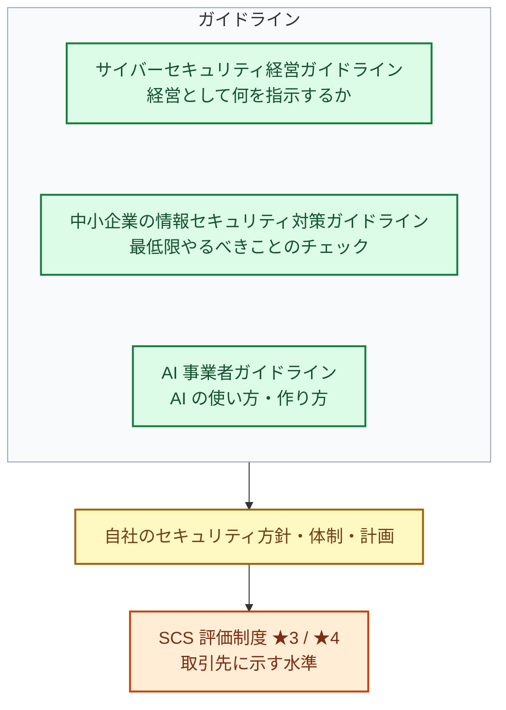
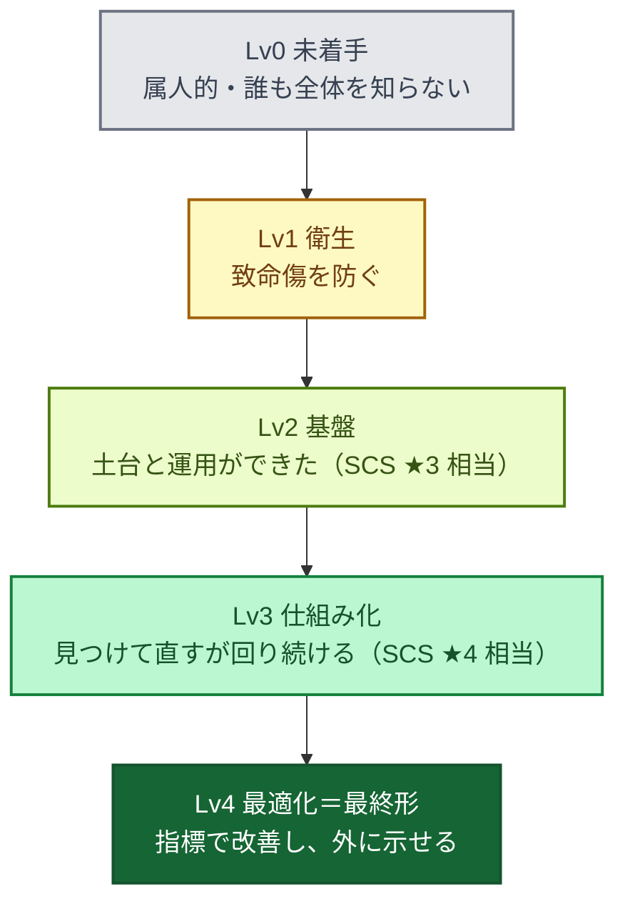

「どこまでやれば十分か」に答えるには、物差しが必要です。この章では、前半で経済産業省と IPA（独立行政法人 情報処理推進機構）のガイドラインと SCS 評価制度（取引先に示す、外からの物差し）を、後半で成熟度モデル（段階を測る物差し）を整理します。最後に、この本で使う **Lv0〜Lv4** のレベルと、各レベルの「完了の定義」を決めます。

体制づくりの物差しになるガイドラインは、次の 4 つです。

| 資料 | 主な読者 | この本での使い方 |
|---|---|---|
| サイバーセキュリティ経営ガイドライン Ver3.0 | 経営者・CISO 相当 | 経営層に「何を指示すべきか」を説明する |
| 中小企業の情報セキュリティ対策ガイドライン 第4.0版 | 中小企業の経営者・担当者 | 最低限やるべきことを漏れなく押さえる |
| SCS 評価制度（★3〜★5） | サプライチェーンに属する全企業 | 取引先に示す「到達目標」にする |
| AI 事業者ガイドライン | AI を開発・提供・利用する事業者 | AI 利用のルールづくりの根拠にする（13 章） |

あわせて、取引先からよく求められる国際規格の認証 **ISMS（ISO/IEC 27001）** との関係も整理します。

## サイバーセキュリティ経営ガイドライン Ver3.0

経済産業省と IPA が策定した、**経営者向け** のガイドラインです。最新版は 2023 年 3 月改訂の Ver3.0 です（2026 年 11 月時点で改訂版は確認できていません）。サイバーセキュリティを「IT 部門の問題」ではなく **経営課題** として扱うよう求めているのが特徴です。

### 経営者が認識すべき 3 原則

1. 経営者は、サイバーセキュリティリスクが自社のリスクマネジメントにおける重要課題であることを認識し、自らのリーダーシップのもとで対策を進める（担当幹部として CISO 等を任命する）
2. 自社だけでなく、国内外の拠点、ビジネスパートナーや委託先を含む **サプライチェーン全体** の対策に目を配る
3. 平時・緊急時のいずれにおいても、関係者と積極的にコミュニケーションをとる

### 経営者が CISO 等に指示すべき重要 10 項目

| # | 項目 | 専任チームがない会社での具体例 |
|---|---|---|
| 1 | リスクの認識、組織全体での対応方針の策定 | セキュリティ基本方針を経営会議で決める |
| 2 | リスク管理体制の構築 | セキュリティ責任者（CISO 相当）と兼務チームを任命する |
| 3 | 資源（予算・人材等）の確保 | ツール予算と、兼務者の稼働（例: 20%）を確保する |
| 4 | リスクの把握とリスク対応に関する計画の策定 | リスク登録簿（リスクの一覧表。5 章）と年間ロードマップを作る。サイバー保険などのリスク移転も選択肢に入れ、対応後に残るリスク（残留リスク）を記録する |
| 5 | リスクに効果的に対応する仕組みの構築 | AWS・GitHub の標準設定、検知の仕組みを整える |
| 6 | PDCA サイクルによる対策の継続的改善 | 四半期ごとに現在地チェック（4 章）をして経営に報告する |
| 7 | インシデント発生時の緊急対応体制の整備 | 連絡網、初動手順、外部の支援先、公表の判断と手順を決め、演習する |
| 8 | 被害に備えた事業継続・復旧体制の整備 | バックアップと復旧訓練、BCP との連携 |
| 9 | サプライチェーン全体の状況把握と対策 | 委託先・SaaS の管理、取引先からの要求への対応 |
| 10 | 情報の収集・共有・開示の促進 | JPCERT/CC・IPA の注意喚起の収集、取引先や業界との情報共有、被害情報の共有・公表の方針 |

:::message
**使い方のコツ**: この 10 項目を、そのまま「経営への定期報告のフォーマット」にすると便利です。各項目について「現状」「今期やること」「経営に決めてほしいこと」を 1 行ずつ書くだけで、経営層との会話が成り立つようになります。
:::

ガイドラインには、各項目の実践例をまとめた「プラクティス集」や、自社の状況を可視化する「サイバーセキュリティ経営可視化ツール」も用意されています。後者は、自己評価の結果をレーダーチャートで示してくれるので、最初の現状把握に使えます。

## 中小企業の情報セキュリティ対策ガイドライン 第4.0版

IPA が公開している、中小企業向けのガイドラインです。**2026 年 3 月 27 日に第4.0版** が公開されました（前の版は 2023 年 4 月の第3.1版）。第4.0版は、SCS 評価制度の基本的な考え方に沿った内容に見直され、最初に取り組む対策が 5 か条から 6 か条になりました。

社員数が数百名の会社は、法律上の「中小企業」に当たらない場合もありますが、このガイドラインは **「最低限やるべきこと」を漏れなく確かめるチェックリスト** として、規模を問わず使えます。

### 情報セキュリティ 6 か条（最初の一歩）

ガイドラインの最初のステップとして示されているのが、次の 6 か条です。第3.1版までは 5 か条でしたが、第4.0版で「バックアップを取ろう！」が加わりました。ランサムウェアの被害が増えたことを考えると、自然な追加です。

1. OS やソフトウェアは常に最新の状態にしよう！
2. ウイルス対策ソフトを導入しよう！
3. パスワードを強化しよう！（解説編でも、多要素認証やパスキーの利用が勧められています。いまなら **MFA を必ず有効にしよう** と読み替えるべきです）
4. 共有設定を見直そう！（クラウドなら **公開設定・共有リンクの見直し** です）
5. バックアップを取ろう！
6. 脅威や攻撃の手口を知ろう！

### 付録の使い方

ガイドラインには、すぐに使える付録が 8 つ付いています。特に役立つのは、**5 分でできる自社診断**（付録 3。最初の現状把握に）、**基本方針と関連規程のサンプル**（付録 2・5。規程を一から書かずに済む。5 章）、**インシデント対応の手引き**（付録 8。初動の手順のひな型に。14 章）です。

また、IPA の「**SECURITY ACTION**」は、中小企業が自らセキュリティ対策に取り組むことを宣言する制度です。一つ星（6 か条に取り組む）、二つ星（自社診断で対策状況を把握し、情報セキュリティ基本方針を定めて外部に公開する）があります。

## SCS 評価制度（サプライチェーン強化に向けたセキュリティ対策評価制度）

この本で最も重要な「外からの物差し」です。

### 背景

大企業がしっかり対策していても、セキュリティの弱い取引先や委託先が攻撃され、そこからサプライチェーン全体が止まる事例が増えています。一方で、取引先から送られてくるセキュリティチェックシートは会社ごとに形式がバラバラで、受け取る側も答える側も大きな負担になっていました。

そこで経済産業省は、サプライチェーンに属する企業のセキュリティ対策の水準を、**★（星）の数** で示す共通の評価制度を作っています。

### ★の段階

| 段階 | 位置づけ | 評価のしかた（概要） |
|---|---|---|
| ★3 | すべてのサプライチェーン企業が最低限実装すべき **基礎的な** 対策 | 自己評価（専門家による確認を含む） |
| ★4 | サプライチェーン企業として標準的に目指すべき対策。★3 に加えて組織的・技術的な対策を求める | 第三者による評価 |
| ★5 | 到達点として目指すべき対策（国際的な標準等を踏まえた高度な水準） | 今後具体化 |

制度の要点を表にまとめます（2026 年 11 月時点）。

| 項目 | 内容 |
|---|---|
| 公表と運営 | 経済産業省と国家サイバー統括室が 2026 年 3 月 27 日に「制度構築方針」を公表。運営（スキームオーナー）は IPA |
| 対象 | 企業の **IT 基盤**（クラウド環境を含む）。工場などの制御（OT）システムや、取引先に納める製品そのものは直接の対象ではない。企業どうしを競わせる「格付け」でもない |
| 要求事項 | **7 つの大分類**（ガバナンスの整備、取引先管理、リスクの特定、攻撃等の防御、攻撃等の検知、インシデントへの対応、インシデントからの復旧）に、**43 の要求事項・153 の評価基準**。★3 はこのうち 26 の要求事項・81 の評価基準、★4 はすべて（2026 年 10 月 28 日の Ver1.1 で数えたもの） |
| 評価のしかた | ★3 は「専門家確認付き自己評価」。専門家は、情報処理安全確保支援士、公認情報セキュリティ監査人、CISSP、CISM、CISA、ISO 27001 主任審査員などの資格を持ち、所定の研修を受けた人。**社内の情報システム担当者が確認するだけでは足りない**。★4 は第三者による評価 |
| 任意かどうか | **任意**。★を求めるかどうかは取引先との契約で決まる。特定の製品（EDR や資産管理システムなど）の導入も求めていない |
| 開始時期 | ★3・★4 の登録申請は **2027 年 3 月に受付開始** の予定。★4 の評価機関や専門家の登録は 2026 年 12 月下旬以降に公表予定。★5 は 2026 年度以降に具体化 |
| 有効期間と費用 | 有効期間は ★3 が 1 年、★4 が 3 年。登録料は ★3 が 2 万円（2028 年 3 月末までは 1 万円）、★4 が 6 万円。★4 は別に第三者評価の費用がかかる |
| 中小企業向けの支援 | ★の取得を支援する「サイバーセキュリティお助け隊サービス（新類型）」の実証事業が 2026 年 9 月に開始 |

評価基準はかなり具体的です。たとえば ★3 でも、**Critical / High（CVSS 7.0 以上）の脆弱性を直すアップデートは、リリースから 14 日以内に適用する** ことが求められています（PC・サーバーの OS とミドルウェア、インターネットとの境界にあるネットワーク機器などが対象）。重要な機密情報を扱うクラウドサービスや、インターネット経由の管理者アクセスには多要素認証を使うこと、バックアップごとにリストア手順書を作ることも、★3 の評価基準に入っています。

### ★3 の要求事項と、この本の章

★3 の 26 の要求事項を大分類ごとにまとめ、この本のどの章で扱っているかを示します。★3 を目指すときの読み順の目安にしてください。

| 大分類 | ★3 の主な要求事項 | この本の章 |
|---|---|---|
| 1. ガバナンスの整備 | セキュリティ推進の担当部署と責任・権限、守秘義務のルール、セキュリティ対応方針 | 5 章（体制・規程） |
| 2. 取引先管理 | 取引先とのビジネス・システム上の関係の把握、機密情報の取扱いの明確化、インシデント時の他社との役割・責任 | 5 章（委託先・SaaS の管理） |
| 3. リスクの特定 | 情報機器・OS・ソフトウェアとネットワークの把握、外部情報サービス（SaaS など）の管理、機密区分に応じた情報の管理 | 4 章（チェックシート）、6 章（ツールの棚卸し）、7 章（社内 IT）、8 章 |
| 4. 攻撃等の防御 | ID の発行・削除の手続、認証の強度（多要素認証）、パスワードとアクセス権のルール、インシデント対応の教育・訓練、バックアップ、安全な構成、パッチの適用、マルウェア対策、ネットワーク境界の防護 | 7 章（社内 IT）、8 章（AWS）、11 章（GitHub）、5 章（教育）、14 章（訓練） |
| 5. 攻撃等の検知 | ネットワーク接続・データ転送の監視 | 8 章（GuardDuty など）、10 章（Wiz） |
| 6. インシデントへの対応 | インシデント対応の手順と体制 | 14 章 |
| 7. インシデントからの復旧 | 事業上重要なシステムの復旧の準備（目標復旧時間内にバックアップから戻せることの確認） | 8 章（バックアップ）、14 章 |

★4 で加わるのは、社内ルールと法令の点検、サイバー攻撃の監視・分析体制、経営層への定期報告を伴う推進計画、取引先の対策状況の把握、脆弱性の管理体制、全要員への教育、データの暗号化、ログの取得と定期レビュー、機器やソフトウェアの挙動の監視などです。この本の Lv3 の内容と重なります。

### この本での SCS 評価制度の扱い

SCS 評価制度は、この本のレベル（この章の後半で定義します）と次のように対応させます。

- **Lv2（基盤）を固めたら ★3 を取れる状態** を目指す
- **Lv3（仕組み化）を固めたら ★4 の第三者評価に耐えられる状態** を目指す
- ★5 は、Lv4（最終形）の目標として意識する

取引先から「★3 を取っていますか」「★4 の取得予定は」と聞かれる日は近いと考え、**★3 の要求事項を自社のチェックリストに取り込んでおく** のがおすすめです。FAQ でも、★を取るかどうかとは別に、要求事項と評価基準を共通のチェックリストとして使う方法が挙げられています。

:::message alert
**注意**
- **制度を引き合いにした営業に注意**: 「評価を取得していないと商取引が規制される」「今すぐ取得しないと入札から除外される」といった勧誘が報告されており、経済産業省が 2026 年 4 月に注意喚起を出しています。制度は任意で、特定の製品の導入も必須ではありません。
- **詳細はまだ動いている**: 評価機関、手続き、評価ガイドなどは、これから順に公表されます。対応を計画するときは、IPA の公式サイトと経済産業省の制度ページの最新資料を確かめてください。
:::

## 補足: ISMS（ISO/IEC 27001）との関係

取引先から「ISMS 認証は取っていますか」と聞かれることも多いはずです。**ISMS** は、情報セキュリティを組織として管理する **仕組み** があることを、第三者の審査機関が認証する制度です（国際規格 ISO/IEC 27001）。SCS 評価制度が「満たすべき対策の水準」を示すのに対し、ISMS は「リスクに基づいて対策を選び、回し続ける仕組み」を求めます。経済産業省も、両者を相互補完的な制度と位置づけています。ISMS の中身と SCS 評価制度との違いは、付録の 17 章にまとめました。

この本のレベルとの対応は、次のとおりです。

| この本のレベル | ISMS から見た状態 |
|---|---|
| Lv1 | まだ ISMS の準備段階。致命的な穴をふさいでいる |
| **Lv2** | 方針・体制・資産の一覧・リスク登録簿・規程がそろい、**ISMS 構築の土台** ができた状態 |
| **Lv3** | 対策が仕組みとして回り、脆弱性の対応期限（SLA）・訓練・委託先管理などの **記録（証跡）** が残っている。内部監査とマネジメントレビューを加えれば、**認証審査に臨める** 状態 |
| Lv4 | 指標による改善が回り、ISMS の「継続的改善」を実態として示せる状態 |

ISMS の認証を目指す場合も、まずはこの本の Lv2 まで進めてから、適用範囲の決定、リスクアセスメントの手法、適用宣言書（どの管理策を採用するかの一覧）など、ISMS 固有の準備に取りかかるのが近道です。最初から ISMS の文書づくりに入ると、文書はあるのに実態が伴わない状態になりがちです。

## AI 事業者ガイドライン

総務省と経済産業省の、AI を **開発・提供・利用** する事業者向けのガイドラインです。2026 年 3 月 31 日に第1.2版が公表され、AI エージェントに関する事項が追記されました。AI を業務で使うだけの会社でも、社内の AI 利用ルールを決めることが求められます。具体的なルールづくりは 13 章で扱います。

## 4 つのガイドラインの関係

- **経営ガイドライン** で「経営として何を決めるか」を押さえ
- **中小企業ガイドライン** で「最低限の対策」の漏れをなくし
- **AI 事業者ガイドライン** で AI の使い方を整え
- その結果を **SCS 評価制度** の★として外に示す

という流れで使うと、それぞれの資料の役割がはっきりします。

## 代表的な成熟度モデル

### AWS セキュリティ成熟度モデル（v2）

AWS が公開している、AWS 上のセキュリティ対策を段階的に進めるためのモデルです（現在は v2）。対策を **4 つのフェーズ** と **10 のカテゴリ** で整理しています。フェーズの分け方は、「実装の易しさと費用対効果」と「セキュリティを高める効果」で決められています。

| フェーズ | 意味 | 例 |
|---|---|---|
| **Quick Wins** | 手間が小さく効果が大きい。多くの組織で 1〜2 週間未満でできる | セキュリティ連絡先、MFA とルートの保護、GuardDuty・CloudTrail、S3 のパブリックアクセスブロック |
| **Foundational** | 手間はかかるが、とても重要 | SCP によるガードレール、一時的な認証情報、マルチアカウント構成、バックアップ |
| **Efficient** | セキュリティを効率よく管理する | IaC、最小権限の見直し、脅威モデリング、机上演習 |
| **Optimized** | さらに進んだ取り組み | ゼロトラストアクセス、レッドチーム、設定の逸脱の自動修正、カオスエンジニアリング |

カテゴリは、ガバナンス、ID とアクセス管理、脅威検知、データ保護、インシデント対応など 10 個です。各フェーズの具体的な対策は 8 章で扱います。

このモデルの良いところは、**「易しくて効果の大きいものから順に」** 並んでいることです。専任チームがない会社でも、上から順にやれば迷わずに進められます。

ほかにも、NIST CSF 2.0 のティア、OWASP SAMM（ソフトウェア開発向け）、CIS Controls の実装グループなどの成熟度モデルがあります。この本のレベルとの対応に使っているので、付録の 17 章で紹介します。

## この本のレベル定義: Lv0〜Lv4

上のモデルはそれぞれ切り口が違うので、そのままでは「自社はいまどこか」を一言で言いにくいです。そこでこの本では、次の 5 段階に整理し直します。

| レベル | 一言でいうと | 状態 | 対応するモデル（17 章） |
|---|---|---|---|
| **Lv0 未着手** | 属人的 | 対策は個人の判断任せ。誰が責任者か決まっていない。AWS アカウントや SaaS の全体像を誰も把握していない | NIST ティア1 |
| **Lv1 衛生** | 致命傷を防ぐ | 「やられたら終わり」の穴をふさいだ状態。MFA、ルートユーザーの保護、検知の有効化、公開設定の点検が済んでいる | AWS Quick Wins / CIS IG1 / IPA 6 か条 |
| **Lv2 基盤** | 土台ができた | 責任者と兼務チームが決まり、ルールと標準構成がある。ログ・検知・バックアップが全アカウントに行き渡り、検知結果を誰かが見ている | AWS Foundational / NIST ティア2〜3 / **SCS ★3** |
| **Lv3 仕組み化** | 回り続ける | 開発プロセスに診断が組み込まれ、脆弱性や検知結果が期限（SLA）つきで処理される。自動修復や AI による診断・修正が回っている。訓練をしている | AWS Efficient / NIST ティア3 / **SCS ★4** |
| **Lv4 最適化（最終形）** | 自律的に改善する | 指標で状態を測り、経営に報告し、継続的に改善している。セキュリティが事業の信頼（売り）になっている。AI エージェントが一次対応を担い、人は判断と改善に集中している | AWS Optimized / NIST ティア4 / SCS ★5 を意識 |

### レベルを上げるときの原則

1. **飛び級しない**: Lv1 が終わっていないのに Lv3 のツール（高度な CNAPP や AI 診断）を入れても、検知結果を処理する人と仕組みがないので、アラートが積み上がるだけになります。
2. **領域ごとにレベルは違ってよい**: 「AWS は Lv2 だが、GitHub は Lv1、組織は Lv1」というように、領域ごとにレベルを測ります。4 章のチェックシートは領域別になっています。
3. **全体のレベルは一番低い領域で決まる**: 攻撃者は一番弱いところを狙います。突出して強い領域を作るより、弱い領域を底上げするほうが効果的です。
4. **一度上がっても下がる**: アカウントが増えたり、新しいツールを入れたりすると、レベルは簡単に下がります。だから四半期ごとに測り直します。

## 各レベルの「完了の定義」

レベルが上がったと言えるかどうかは、4 章のチェックシートで判定します。ここでは、各レベルの代表的な条件だけを示します。

| レベル | 代表的な条件 |
|---|---|
| **Lv1 完了** | 全員に MFA、ルートユーザーの保護、全アカウント・全リージョンで CloudTrail と GuardDuty、意図しない公開の点検、VPN 機器の最新化、インシデント時の連絡先 |
| **Lv2 完了**（★3 相当） | 責任者と兼務チームの任命、基本方針・規程・リスク登録簿、SSO と組織的なアカウント管理、ログとバックアップを別アカウントに、検知結果を毎週見る、重大な更新を 14 日以内、インシデント対応の手順と訓練、委託先との取り決め |
| **Lv3 完了**（★4 相当） | すべての検知結果に対応期限（SLA）と達成率、開発プロセスに組み込まれた診断と AI による修正案、自動修復、プレイブックと机上訓練・復旧訓練、委託先の定期評価、AI エージェントの権限管理 |
| **Lv4 完了**（最終形） | 指標による経営報告、設計段階の脅威モデリング、AI エージェントによる一次対応、定期的なペネトレーションテスト、取り組みの開示、規模に合った専任体制 |

:::message
**最終形は「大きなセキュリティ部門」ではありません。** 数百名規模の会社なら、専任者が数名、各部門に兼務のセキュリティチャンピオン、そして AI エージェントと外部パートナーが組み合わさった形が現実的な最終形です。16 章で具体的な姿を描きます。
:::
