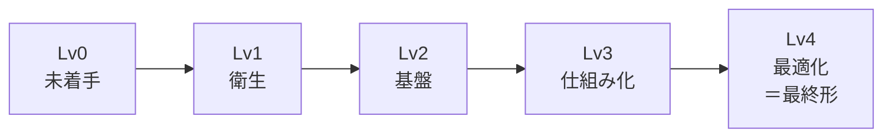

「どこまでやれば十分か」に答えるための道具が **成熟度モデル** です。この章では、代表的な成熟度モデルを紹介したうえで、この本で使う **Lv0〜Lv4** のレベルを定義します。

## 代表的な成熟度モデル

### AWS セキュリティ成熟度モデル（v2）

AWS が公開している、AWS 上のセキュリティ対策を段階的に進めるためのモデルです（2024 年 11 月に v2 が公開）。対策を **4 つのフェーズ** と **10 のカテゴリ** で整理しています。

| フェーズ | 意味 | 例 |
|---|---|---|
| **Quick Wins**（すぐできること） | 手間が小さく効果が大きい。1〜2 週間ほどで実施できる | ルートユーザーの MFA、GuardDuty の有効化、S3 のパブリックアクセスブロック、セキュリティ連絡先の登録 |
| **Foundational**（基盤） | 手間はかかるが、セキュリティの土台になる | マルチアカウント構成、IAM Identity Center による SSO、ログの集約、バックアップ |
| **Efficient**（効率化） | クラウドのセキュリティを効率よく統治する | 自動修復、IaC のスキャン、インシデント対応の自動化 |
| **Optimized**（最適化） | 継続的な改善 | 脅威モデリングの定着、カオスエンジニアリング、セキュリティ指標による改善 |

10 のカテゴリは、セキュリティガバナンス、セキュリティ保証、ID とアクセス管理、脅威検知、脆弱性管理、インフラ保護、データ保護、アプリケーションセキュリティ、インシデント対応、レジリエンス（回復力）です。

このモデルの良いところは、**「易しくて効果の大きいものから順に」** 並んでいることです。専任チームがない会社でも、上から順にやれば迷わずに進められます。

### NIST CSF 2.0 のティア

2 章で紹介した NIST CSF 2.0 には、組織のリスク管理の厳密さを示す 4 つの **ティア**（段階）があります。

| ティア | 名前 | 状態 |
|---|---|---|
| 1 | 部分的（Partial） | 場当たり的に対応している |
| 2 | リスク情報を活用（Risk Informed） | リスクを意識しているが、組織全体の方針にはなっていない |
| 3 | 繰り返し可能（Repeatable） | 方針が承認され、組織全体で一貫して運用されている |
| 4 | 適応（Adaptive） | 過去の経験や指標をもとに、継続的に改善している |

### OWASP SAMM

ソフトウェア開発のセキュリティに特化した成熟度モデルです。ガバナンス、設計、実装、検証、運用の 5 つの業務機能について、成熟度を 0〜3 で評価します。プロダクト開発のセキュリティ（10 章・11 章）を深めるときの物差しになります。

### CIS Controls v8.1 の実装グループ

米国 CIS が公開している、優先度つきの対策集です。組織の規模とリスクに応じて **IG1（最低限の衛生）→ IG2 → IG3** と段階が分かれています。IG1 は「どの組織でも最低限やるべき 56 の対策」とされ、Lv1 の確認に使えます。

## この本のレベル定義: Lv0〜Lv4

上のモデルはそれぞれ切り口が違うので、そのままでは「自社はいまどこか」を一言で言いにくいです。そこでこの本では、次の 5 段階に整理し直します。

| レベル | 一言でいうと | 状態 | 対応するモデル |
|---|---|---|---|
| **Lv0 未着手** | 属人的 | 対策は個人の判断任せ。誰が責任者か決まっていない。AWS アカウントや SaaS の全体像を誰も把握していない | NIST ティア1 |
| **Lv1 衛生** | 致命傷を防ぐ | 「やられたら終わり」の穴をふさいだ状態。MFA、ルートユーザーの保護、検知の有効化、公開設定の点検が済んでいる | AWS Quick Wins / CIS IG1 / IPA 5 か条 |
| **Lv2 基盤** | 土台ができた | 責任者と兼務チームが決まり、ルールと標準構成がある。ログ・検知・バックアップが全アカウントに行き渡り、検知結果を誰かが見ている | AWS Foundational / NIST ティア2〜3 / **SCS ★3** |
| **Lv3 仕組み化** | 回り続ける | 開発プロセスに診断が組み込まれ、脆弱性や検知結果が期限（SLA）つきで処理される。自動修復や AI による診断・修正が回っている。訓練をしている | AWS Efficient / NIST ティア3 / **SCS ★4** |
| **Lv4 最適化（最終形）** | 自律的に改善する | 指標で状態を測り、経営に報告し、継続的に改善している。セキュリティが事業の信頼（売り）になっている。AI エージェントが一次対応を担い、人は判断と改善に集中している | AWS Optimized / NIST ティア4 / SCS ★5 を意識 |

### レベルを上げるときの原則

1. **飛び級しない**: Lv1 が終わっていないのに Lv3 のツール（高度な CNAPP や AI 診断）を入れても、検知結果を処理する人と仕組みがないので、アラートが積み上がるだけになります。
2. **領域ごとにレベルは違ってよい**: 「AWS は Lv2 だが、GitHub は Lv1、組織は Lv1」というように、領域ごとにレベルを測ります。5 章のチェックシートは領域別になっています。
3. **全体のレベルは一番低い領域で決まる**: 攻撃者は一番弱いところを狙います。突出して強い領域を作るより、弱い領域を底上げするほうが効果的です。
4. **一度上がっても下がる**: アカウントが増えたり、新しいツールを入れたりすると、レベルは簡単に下がります。だから四半期ごとに測り直します。

## 各レベルの「完了の定義」

レベルを上がったと言えるかどうかは、次の「完了の定義」で判断します。

### Lv1 完了の定義

- [ ] すべての AWS アカウントのルートユーザーに MFA が設定され、アクセスキーがない
- [ ] 社員が使う主要なサービス（Google Workspace / Microsoft 365、GitHub、AWS など）で MFA が必須になっている
- [ ] 全 AWS アカウント・全リージョンで GuardDuty と CloudTrail が有効
- [ ] 意図しない公開（S3、セキュリティグループの 0.0.0.0/0、公開スナップショットなど）を一度点検し、直した
- [ ] SATv2 などで一度、AWS 全体の健康診断をした（8 章）
- [ ] GitHub でシークレットスキャンとプッシュ保護が有効
- [ ] インシデントが起きたときの連絡先（社内・外部）が決まっている

### Lv2 完了の定義

- [ ] セキュリティ責任者と兼務チームが任命され、稼働が確保されている
- [ ] セキュリティ基本方針と主要な規程がある（13 章）
- [ ] AWS は Organizations / Control Tower で管理され、新しいアカウントにも自動で標準設定が入る
- [ ] 人のアクセスは IAM Identity Center（SSO）経由で、長期のアクセスキーを原則使っていない
- [ ] ログが専用アカウントに集約され、改ざんできない形で保管されている
- [ ] Security Hub（または Wiz）で検知結果を集約し、**毎週誰かが見ている**
- [ ] 重要なデータのバックアップがあり、少なくとも一度は復旧を試した
- [ ] GitHub の組織設定（SSO、ブランチ保護 / ルールセット、Dependabot）が標準化されている
- [ ] SCS 評価制度 ★3 の要求事項を自己評価し、満たしている

### Lv3 完了の定義

- [ ] 脆弱性と検知結果に **重大度別の対応期限（SLA）** があり、達成率を測っている
- [ ] PR ごとに SAST / SCA / シークレット検出、IaC スキャンが走る
- [ ] AI による脆弱性診断（Takumi / Claude Security など）が定期的・継続的に回り、修正案まで出ている（11 章）
- [ ] 重大な設定ミスの一部は自動で修復される
- [ ] インシデント対応手順があり、年 1 回以上の机上訓練をしている
- [ ] 委託先・SaaS の評価が定期的に行われている
- [ ] AI 利用ルールがあり、AI エージェントの権限が管理されている（12 章）
- [ ] SCS 評価制度 ★4 相当の第三者評価に耐えられる証跡がある

### Lv4 完了の定義（最終形）

- [ ] セキュリティ指標（SLA 達成率、検知から対応までの時間、カバー率など）を定期的に経営に報告している
- [ ] 新しいプロダクトや機能には、設計段階で脅威モデリングが行われる
- [ ] AI エージェントが検知のトリアージや修正 PR の作成といった一次対応を担い、人は判断・改善・例外対応に集中している
- [ ] 外部のペネトレーションテストやレッドチーム演習を定期的に行い、結果を改善に回している
- [ ] セキュリティへの取り組みを、取引先や顧客に対して積極的に開示している（トラストセンターなど）
- [ ] 専任チーム（または専任者 + 外部パートナー）が、自社の規模に合った形で存在している

:::message
**最終形は「大きなセキュリティ部門」ではありません。** 数百名規模の会社なら、専任者が数名、各部門に兼務のセキュリティチャンピオン、そして AI エージェントと外部パートナーが組み合わさった形が現実的な最終形です。14 章で具体的な姿を描きます。
:::
