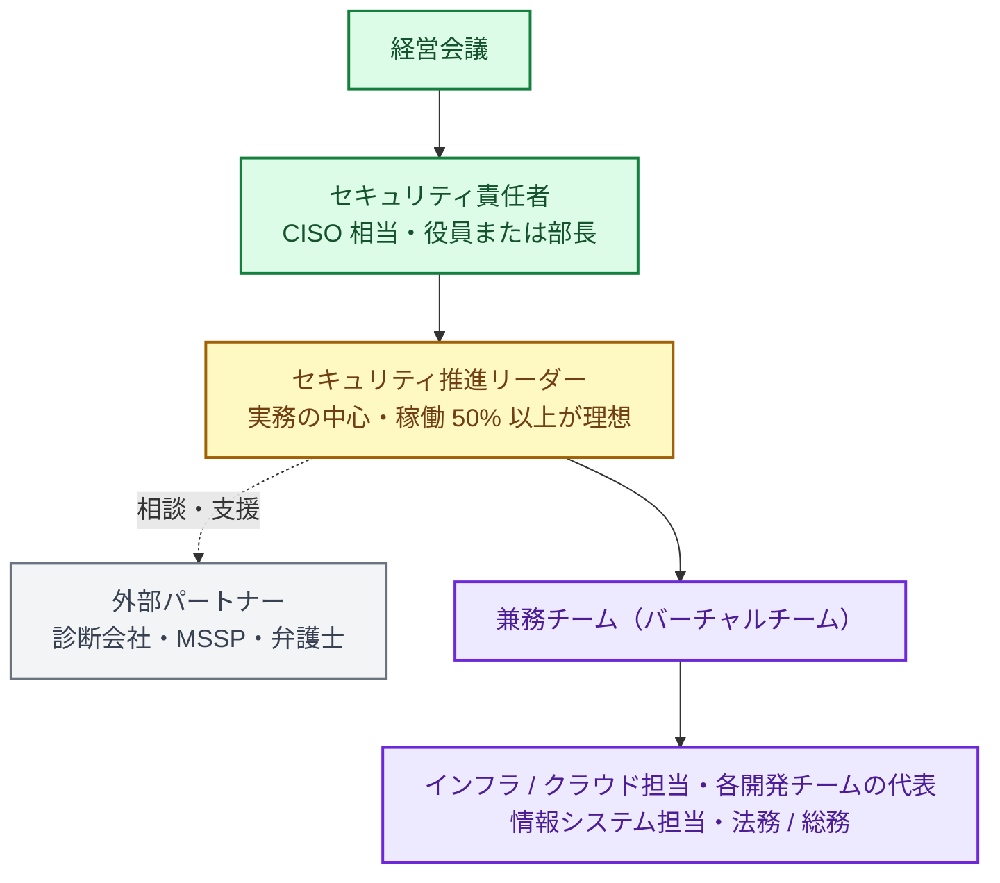

:::message
**最近のニュースから**

**能動的サイバー防御（2026 年 10 月）**: 関連法の中核部分が施行され、基幹インフラ事業者にはインシデントの報告が義務づけられました。

**ブラストメールの停止（2026 年 10 月）**: メール配信 SaaS が不正アクセスを受けて止まり、利用していた団体のメールマガジンも止まりました。使っている SaaS が止まったときの代わりの手段も、自社の事業継続の一部です。

報告義務への備えも、止まった SaaS の代わりの手段も、ツールではなく **体制とルール** の話です。
:::

第 2 部では、道具の話に入る前に、それを回す **体制** と全体の地図を作ります。ツールをいくら入れても、誰が責任を持ち、誰が見て、誰が直すかが決まっていなければ、セキュリティは良くなりません。現在地チェックシート（4 章）で Lv1・Lv2 の最初に並んでいるのも、責任者の任命や稼働の確保です。この章では、専任チームのない会社が現実的に作れる体制とルールを整理します。

## 体制: 専任チームなしで始める形

### 最初の形（Lv1〜Lv2）

| 役割 | 担うこと |
|---|---|
|セキュリティ責任者（CISO 相当） | 方針と予算を決め、経営に報告し、リスクの受容を判断する。経営ガイドラインの「経営者が指示する相手」 |
|推進リーダー| ロードマップを作り、チェックシートで現在地を測り、兼務チームを動かす。この本の読者|
|兼務チーム| 各領域の対策の実行と、検知結果の一次対応 |
|外部パートナー| 脆弱性診断、24 時間の監視（MSSP / MDR、AWS 部分は AWS Security Incident Response も選択肢。15 章）、インシデント時の調査、法的な助言 |

体制の考え方は、経済産業省と IPA の「サイバーセキュリティ体制構築・人材確保の手引き」が詳しく扱っています。経営ガイドラインの指示 2（管理体制の構築）と指示 3（資源の確保）を実践するための手引きで、「やるべきこと」を洗い出し、**セキュリティ統括機能**（会社全体のセキュリティを取りまとめる機能）を決め、各部門の責任を明確にする、という順で進め方が示されています。

手引きは、セキュリティ統括機能の置き方を、形態（独立した部門を置く「専門組織型」か、委員会と情報システム部門などで分担する「委員会型」か）と範囲（本社に集める「集権型」か、事業部門や子会社にも置く「連邦型」か）の組み合わせで整理しています。専任チームのない会社の最初の形は、委員会型・集権型に近いものです。上の図の推進リーダーと兼務チームが、その実務を担います。

### 決めておくべきこと

- **稼働の確保**: 兼務者の稼働を「空いた時間で」にすると、必ず後回しになります。「毎週火曜の午後はセキュリティの時間」のように、時間で確保して経営の承認をとります。
- **週次のレビュー**: 30 分でよいので、クラウド（Security Hub、CNAPP を使っていればその画面）とコード（GitHub）の新しい重大な検知結果を見る場を毎週持ちます。
- **意思決定のルール**: 「Critical の脆弱性が見つかったら、誰の判断でリリースを止められるか」を決めておきます。

### 最終形（Lv4）

数百名規模の会社では、次のような形が現実的な最終形です。

- 専任のセキュリティ担当が 2〜4 名（クラウド / プロダクト / コーポレート IT の各領域）
- 各開発チームにセキュリティチャンピオン（兼務）がいて、チーム内の一次対応を担う
- 検知のトリアージや修正案の作成は AI エージェントが担い、人は判断・例外対応・改善に集中する
- 24 時間の監視や高度な調査は外部パートナーに任せる

専任者が数十人いる大企業のような組織を目指す必要はありません。

## ルール（規程）

一から書かず、IPA の「[中小企業の情報セキュリティ対策ガイドライン](https://www.ipa.go.jp/security/keihatsu/sme/guideline/)」付録 5 の「情報セキュリティ関連規程（サンプル）」を自社向けに直すのが早道です。第4.0版の規程サンプルは SCS 評価制度に沿って見直されていて、末尾に、規程のどこが ★3・★4 のどの要求事項に当たるかの対応表が付いています。

| 文書 | 内容 | 目標レベル |
|---|---|---|
| 情報セキュリティ基本方針 | 会社としての方針。経営が承認する（1 ページ） | Lv2 |
| 人的対策のルール | 守秘義務（入社時の誓約、退職時の返却）、教育 | Lv2 |
| 情報資産の管理ルール | 機密区分と表示・取扱方法、資産の台帳（付録 6 の資産管理台帳が使える）、自社が接続している外部システムの一覧 | Lv2 |
| AI 利用ガイドライン | 14 章のひな型 | Lv1〜Lv2 |
| アクセス管理規程 | アカウントの発行・削除の申請と承認、権限の棚卸し、MFA、パスワードの設定と保管 | Lv2 |
| インシデント対応手順 | 16 章 | Lv2 |
| クラウド利用規程 | AWS の標準構成、SaaS の導入手順 | Lv2 |
| 委託先管理規程 | 委託先・SaaS の評価と契約 | Lv2 |
| 脆弱性管理規程 | 重大な更新を 14 日以内に当てるルール（Lv2）、重大度別の対応期限（SLA）と例外の扱い（Lv3） | Lv2〜Lv3 |
| 物理的対策のルール | サーバ室や機密情報を扱う部屋への入室の管理、クリアデスク、機器の廃棄 | Lv2（オフィスやサーバ室がある場合） |

守れない規程は、監査や事故のときに「規程があったのに守っていなかった」という不利な証拠になります。最初は短く書き、運用しながら育てます。

## ★3 のための文書と記録

SCS 評価制度の ★3 は、ルールを決めることに加えて、**関係者に周知し、実施した記録を残し、年 1 回以上点検する** ことを多くの要求事項で求めています（20 章）。ルールを作るたびに考えるより、1 年の流れとしてまとめておくと、取りこぼしが減ります。

**入社・社外の人の受入れのとき**
- 守秘義務のルールの説明、インシデント時の対応の教育、ID の申請と承認
- 記録: 誓約書、受講の記録、ID の申請書

**異動・退職のとき**
- 権限の変更・ID の削除、機密情報と機器の回収
- 記録: ID の削除の記録、回収の記録

**毎週・四半期・半年**
- 毎週: 検知結果のレビュー（6 章）。記録: 議事メモ
- 四半期: 現在地チェック（4 章）と経営への報告。記録: 報告資料
- 半年に 1 回: ID と権限の棚卸し。記録: 棚卸しの結果

**年 1 回**
- 体制と連絡先リストの点検
- 基本方針と規程の見直しと、全員への周知
- 機密区分のルールと、機器・ソフトの管理ルールが守られているかの点検
- 委託先・SaaS と、自社が接続している外部システムの見直し
- インシデント時の体制と連絡先の点検
- インシデント対応の教育・訓練と、その内容の点検、復旧の訓練（16 章）
- 記録: 点検の記録、規程の改訂履歴、周知の記録、受講と訓練の記録

**そのつど**
- 方針や規程を改めたときの周知、重大なインシデントが社内外で起きたときの事例の共有、攻撃の兆しの知らせが届いたときの判断（15 章）
- 記録: 周知の記録、共有した資料、知らせへの判断の記録

記録は、置き場所を 1 つ（共有フォルダや Wiki のページ）に決めておきます。★3 の自己評価や専門家の確認のときに、この置き場所がそのまま証跡になります。

## リスク登録簿

**リスク登録簿** は、自社のリスクと、それぞれをどう扱うと決めたかの一覧表です。表計算ソフトの 1 枚で十分です。

| 列 | 書くこと |
|---|---|
| リスク | 何が起きると困るか（例: 本番の AWS アカウントの乗っ取り、委託先経由の侵入、ランサムウェアによる受注停止） |
| 影響と起こりやすさ | 大・中・小の 3 段階くらいで |
| 対応 | 低減（対策する）、回避（やめる）、移転（保険や委託）、受容（あえて何もしない）のどれか（19 章） |
| 対策と期限 | 低減するなら、何をいつまでに |
| 判断した人と日付 | 特に「受容」は、責任者が判断したことを残す |
| 次の見直し | 半年後、1 年後など |

最初は、経営と話して聞いた「何が起きたら一番困るか」（18 章の最初の 30 日）から 10 件ほど書けば十分です。4 章のチェックシート（A. 組織・ガバナンスの Lv2）にある「リスク登録簿」は、この表のことです。

## 脆弱性管理の SLA

見つかった脆弱性や設定ミスに **重大度別の対応期限**（SLA）を決めます。まず Lv2 では、SCS 評価制度 ★3 と同じく OS・ミドルウェア・ネットワーク機器の重大な更新を 14 日以内に当てることから始め、Lv3 で、すべての検知結果に重大度別の期限をつけて達成率を測るところまで広げます。期限の例です。

| 重大度 | 例 | 対応期限 |
|---|---|---|
| Critical | インターネットから悪用できる、既に悪用が確認されている（CISA KEV に載っているなど） | 72 時間以内（緩和策を含む） |
| High | 認証後に悪用できる重大な脆弱性、機密データにつながる設定ミス | 14 日以内 |
| Medium | 条件つきで悪用できるもの | 60 日以内 |
| Low | 影響が小さいもの | 次の定期対応 / 受容を検討 |

SCS 評価制度の ★3 では、Critical / High（CVSS 7.0 以上）の脆弱性を直すアップデートは、リリースから **14 日以内** に適用することが求められています（3 章）。上の表の High の期限は、これに合わせています。期限内に適用できないときは、適用までのあいだリスクを下げる対策をとることも求められます。

期限内に直せないものは、**例外申請**（理由、緩和策、期限、承認者）として記録します。これが 19 章の「受容の記録」です。

## 脆弱性情報を集め、影響を確かめる

SLA の期限は「リリースから」数えるので、そもそも修正や注意喚起が出たことに気づけなければ始まりません。2 章の「Black October」のように重大な脆弱性の公表が重なったときに、「うちは使っているのか」をすぐに答えられるようにしておきます。

**1. 情報を受け取る場所を 1 つ決める**

次のような情報源の RSS やメールを、セキュリティ用のチャットチャンネル 1 つに集めます。

- [JPCERT/CC の注意喚起](https://www.jpcert.or.jp/at/)、[IPA の「重要なセキュリティ情報」](https://www.ipa.go.jp/security/security-alert/index.html)、[JVN](https://jvn.jp/)（国内の脆弱性情報ポータル）
- [CISA の KEV](https://www.cisa.gov/known-exploited-vulnerabilities-catalog)（悪用が確認された脆弱性のカタログ）。載ったものは、この章の SLA で Critical として扱う
- 使っている製品のベンダーのセキュリティ情報（VPN 機器、ファイアウォール、主要な SaaS、OS、ミドルウェア）

全部を読む必要はありません。週次レビュー（6 章）で、自社に関係しそうなものだけを拾います。

**2. 「使っているか」を引ける一覧を持つ**

影響を確かめる速さは、一覧があるかどうかで決まります。

| 対象 | 一覧の作り方 |
|---|---|
| ネットワーク機器・VPN | 機器の一覧と、ファームウェアのバージョン（8 章） |
| サーバー・コンテナの OS とパッケージ | Amazon Inspector や CNAPP のインベントリ（9・11 章） |
| アプリの依存ライブラリ | GitHub の依存関係グラフと Dependabot、リリースごとの SBOM（12 章） |
| SaaS | SaaS の一覧と管理者（8 章） |

**3. 流れを決めておく**

情報を見つけたら、「影響を受けるか確かめる → 受けるなら持ち主に割り振り、SLA の期限をつける → 悪用が確認されているなら、修正の前に入られていないかも確かめる（17 章）」という順で動きます。誰が影響を確かめるかを、週次レビューの担当と同じ人にしておくと迷いません。

SCS 評価制度では、脆弱性情報の情報源・頻度・対応の判断基準を定めて記録することは、★4 の要求事項「3-2-1 脆弱性の管理体制」に入っています（[SCS-620 解説書](https://www.ipa.go.jp/security/scs/rcu1hd0000007a2i-att/SCS-620-handbook-v1.0.pdf)）。★3 で求められるのは、その前提になる 14 日以内の更新（4-4-4）です。ただ、情報に気づけなければ 14 日の期限も守れないので、Lv2 のうちから始めておきます。

## 委託先・SaaS の管理

自社がサプライチェーンの一部として評価される（SCS 評価制度）のと同じく、自社も委託先や SaaS を評価する必要があります。

- **導入時**: 取り扱うデータの重要度に応じて、確認の深さを変える。重要なデータを預けるなら、第三者認証（ISMS、SOC 2 など）、SCS 評価制度の★、セキュリティチェックシートで確認する
- **契約**: 事故時の報告義務と、インシデント時の役割分担、機密情報の取扱い、契約終了時のデータの返却・削除とアクセス権の回収、再委託の制限を入れる（どれも SCS 評価制度の要求事項にあります）
- **責任の境界**: システム管理を委託する場合は、自社でやる部分と委託する部分の境界をはっきりさせる。境界があいまいだと、どちらも見ていない場所が生まれます。委託先に起因する被害への補償（契約やサイバー保険）も検討します
- **定期**: 年 1 回、重要な委託先と SaaS を見直す。使っていない SaaS は解約し、アカウントを削除する

## 教育

- **全社員**: 入社時と年 1 回の教育（フィッシング、AI 利用ルール、事故時の報告）と、標的型メール訓練。インシデント時の対応の教育は、資料を配るだけでなく e ラーニングか集合形式で行い、誰がいつ受けたかを記録する（★3 の 4-2-2）
- **開発者**: セキュアコーディングと、AI コーディングエージェントの安全な使い方
- **経営層**: 年 1 回、10 大脅威と自社の現在地の報告をかねた勉強会
- **セキュリティ以外の部門の人**: 経営ガイドラインと「体制構築・人材確保の手引き」は、事業部門・管理部門・デジタル部門の人が、自分の仕事に必要なセキュリティの知識を身につける「プラス・セキュリティ」を勧めています。兼務チームのメンバーには、まずこの考え方で学んでもらうのが現実的です

## 経営への報告

四半期ごとに、次の 1 枚で報告します。

| 項目 | 内容 |
|---|---|
| 現在地 | 4 章のチェックシートの領域別レベルと、次のレベルの達成率（前回比） |
| 主な成果 | 今期上げたレベルと、その中身 |
| 指標 | 重大な検知結果の件数と推移、SLA 達成率、SATv2 / Security Hub の推移 |
| インシデント | 発生件数と概要 |
| 次の四半期 | 次の一手（上げるレベルと、やること） |
| 経営に決めてほしいこと | 予算、人員、リスクの受容 |

予算を求めるときは、次の 4 点を 1 枚にまとめます。

1. **何に**: 例「全社員の PC に EDR を入れる」
2. **いくら**: 初期費用と月額、必要な工数
3. **何が良くなるか**: チェックシートのどの項目が埋まり、どのレベルに上がるか。SCS 評価制度の★や取引先の要求にどう効くか
4. **やらないと何が起きるか**: 2 章の事例や、インシデントが起きたときの費用（18 章の「費用と工数の目安」）と比べる
