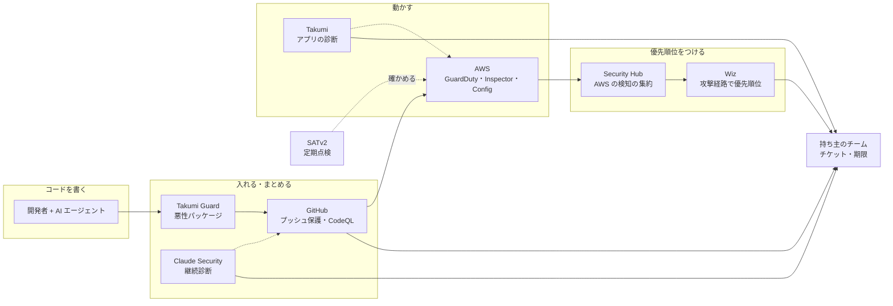

:::message
**最近のニュースから**

**アスクル（2025 年 10 月）** の調査報告によると、攻撃者は侵入後に **EDR などの対策ソフトを無効化** し、数か月かけてサーバー間を移動したうえでランサムウェアを展開しました。報告書は被害拡大の背景として、特権 ID の管理の不備や **監視の死角** を挙げています。

対策ツールは「入っている」だけでは不十分で、全体に行き渡っているか、止められたら気づけるか、誰が見ているかまで含めて初めて機能します。この章のテーマそのものです。
:::

第 2 部では、具体的な道具の使い方を扱います。その前にこの章で、**ツールの全体の地図** を描いておきます。

「ツールは入れたのに、強くなった実感がない」というのは、一人目の担当者がとてもよく陥る状態です。原因はたいてい、ツールの性能ではなく **組み合わせ方と運用** にあります。

## 入れたのに回らない、5 つの理由

| # | 症状 | 原因 |
|---|---|---|
| 1 | アラートが数千件あり、誰も見ていない | 検知結果を **誰が・いつ・どの順で** 見るかが決まっていない |
| 2 | 同じ問題が、複数のツールから別々に報告される | ツールの **役割が重なっていて**、どれを正とするか決めていない |
| 3 | 一部のアカウントやリポジトリにしか入っていない | 新しい環境に **自動で行き渡る仕組み** がない |
| 4 | 見つかった問題が直らない | 直すのは開発チームなのに、**持ち主に届いていない**、期限もない |
| 5 | 経営に成果を説明できない | **前と比べてどう良くなったか** を測っていない |

ツールを増やしても、この 5 つは解決しません。逆に、ツールが増えるほど 1 と 2 は悪化します。

## 6 つの道具と、それぞれの持ち場

この本では、次の組み合わせを前提にします。

| 道具 | 持ち場 | 一言でいうと | 章 |
|---|---|---|---|
| **AWS 標準**（Organizations、IAM Identity Center、CloudTrail、Config、GuardDuty、Inspector、**Security Hub**） | AWS の土台と脅威の検知 | 「AWS の中の警報装置と、その配線」 | 8 |
| **SATv2** | AWS 全体の定期点検 | 「年に数回の健康診断」 | 9 |
| **Wiz** | クラウドのリスクの優先順位づけ | 「どれから直すべきかを決める司令塔」 | 10 |
| **GitHub**（Secret Protection、Code Security、Dependabot、ルールセット） | コードと開発プロセスの守り | 「コードの入口の門番」 | 11 |
| **Takumi byGMO** | アプリケーションの診断と、パッケージの守り（Guard） | 「外から攻める診断員と、部品の検品係」 | 12 |
| **Claude Security** | コードベースの継続的な診断と修正 | 「コードを読み続けるレビュアー」 | 12 |

補足として、AWS Security Agent（AI によるペネトレーションテスト）に 10 章で、AWS Security Incident Response（検知の一次対応と調査の支援）に 14 章で触れます。

## 開発からクラウドまでの流れで見る

ポイントは、すべての検知結果が最終的に **「持ち主のチーム」** に、期限つきで届くことです。ツールはそこに至るまでの「見つける」「絞る」部分を担当します。

## 重なりを整理する

役割が重なっている部分は、**どちらを正とするか** を決めておきます。決めておかないと、同じ問題を 2 回処理したり、どちらも見ていなかったりします。

| 重なり | この本での決め方 |
|---|---|
| Security Hub と Wiz（クラウドの設定ミス・脆弱性） | **優先順位づけと開発チームへの割り振りは Wiz を正** にする。Security Hub は AWS の検知の集約と、GuardDuty の脅威検知・自動修復の起点として使う |
| Inspector と Wiz（ワークロードの脆弱性） | 一覧と優先順位は Wiz で見る。Inspector は Security Hub 側の情報源として残す |
| CodeQL と Claude Security / Takumi（コードの脆弱性） | **PR ごとの定型チェックは CodeQL**、パターンにない脆弱性（認可の不備、業務ロジック）の発見は **Claude Security / Takumi** と分ける |
| Claude Security と Takumi（AI による診断） | **コードを読む継続診断は Claude Security**、**動いているアプリへの診断（ブラックボックス）と報告書は Takumi** と分ける（10 章） |
| Dependabot と Takumi Guard（依存パッケージ） | **既知の脆弱性は Dependabot**、**悪性パッケージのブロックは Takumi Guard** |
| SATv2 と Security Hub / Wiz（AWS の設定点検） | 常時の点検は Security Hub / Wiz。SATv2 は **別の目による定期点検** と、改善の推移を示すための記録 |

:::message
**この表は、組み合わせが違っても作れます。** 大事なのは、どのツールを使うかより「重なりごとに、正とするものを 1 つ決めて書いておく」ことです。この表を社内の Wiki に置き、新しいツールを入れるたびに更新します。
:::

## 抜けを確かめる

逆に、どのツールもカバーしていない領域もあります。ツールでは埋まらない部分は、ルールと運用で埋めます。

| 領域 | 抜けやすいこと | 埋め方 | 章 |
|---|---|---|---|
| ID | IdP 側の設定（MFA の方式、退職者の処理） | 入社・退職の手順、権限の棚卸し | 8・14 |
| 社員の PC | マルウェア対策、OS 更新、紛失 | EDR と端末管理（MDM）。この本では詳しく扱わない | — |
| SaaS | 業務で使っている SaaS の設定と共有 | SaaS の一覧と、委託先管理 | 14 |
| 人 | フィッシング、AI への機密情報の入力 | 教育、AI 利用ガイドライン | 13・14 |
| 復旧 | バックアップから本当に戻せるか | 復旧テスト、訓練 | 8・14 |
| 調査 | すでに入られていないかの確認、事件後に何が起きたかを調べるためのログ | ログの長期保管、平時の侵害調査、調査会社の事前選定 | 15 |
| 外への説明 | 取引先への回答、★や ISMS | 規程と証跡の整備 | 4・14 |

## 回すための 3 つの約束

ツールの組み合わせが決まったら、最低限、次の 3 つを決めます。これがないと、どんなに良いツールでも「入れたのに回らない」に戻ります。

1. **週次レビュー**: 毎週 30 分、新しく出た重大な検知結果を見る時間を、カレンダーに固定する。見る画面は Wiz（クラウド）と GitHub / Claude Security（コード）に絞る
2. **持ち主と期限**: 検知結果は、AWS アカウントやリポジトリの持ち主のチームに割り振り、重大度別の期限（12 章の SLA）をつける
3. **四半期の測定**: 4 章のチェックシートと SATv2 の件数推移で、前の四半期と比べる。結果を経営に 1 枚で報告する

## 導入済みのツールを「棚卸し」する

最後に、いまのツールの使われ方を点検する表です。ツールごとに埋めてみると、どこが「入れただけ」になっているかが分かります。

| 確認項目 | AWS 標準 | SATv2 | Wiz | GitHub | Takumi | Claude Security |
|---|---|---|---|---|---|---|
| 対象の全体（全アカウント / 全リポジトリ）に入っているか | | | | | | |
| 新しい環境に自動で入るか | | | | | | |
| 結果を見る人と頻度が決まっているか | | | | | | |
| 結果が持ち主に届くか | | | | | | |
| 期限と達成率を測っているか | | | | | | |
| 他のツールとの重なりを整理したか | | | | | | |

「いいえ」が多いツールから、第 2 部の該当する章を読んでください。
