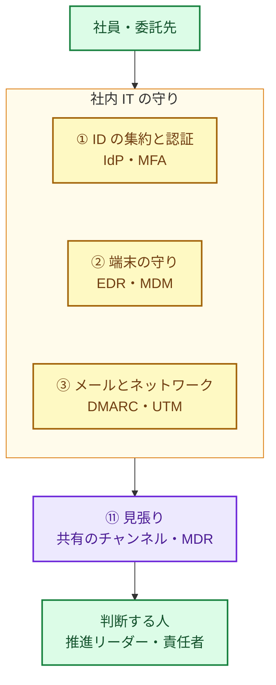
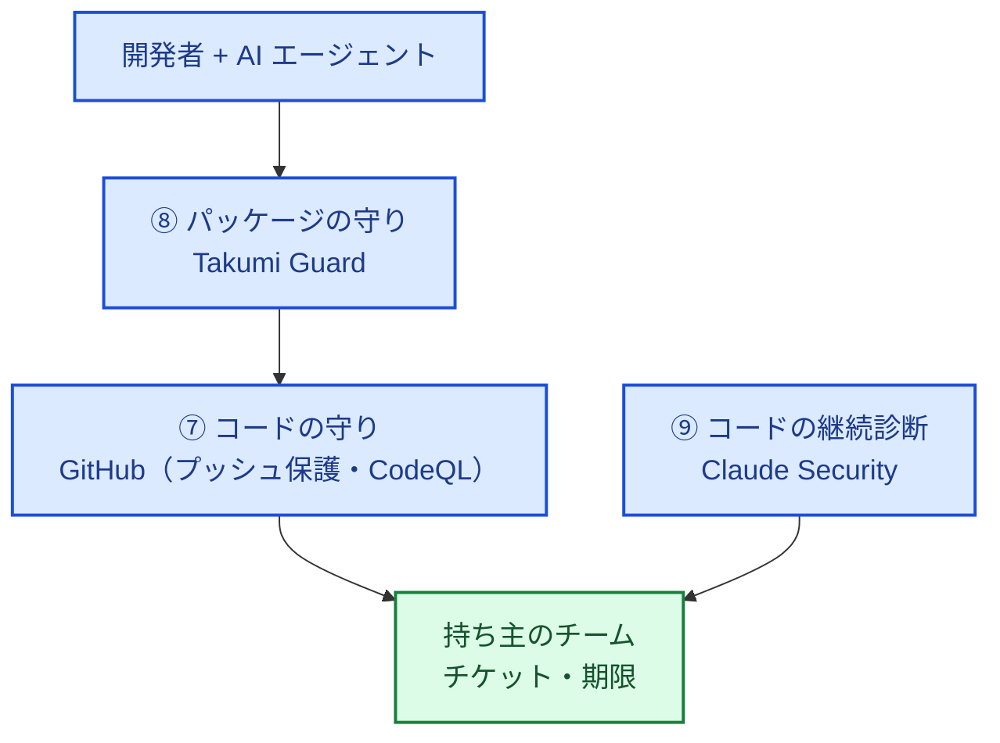
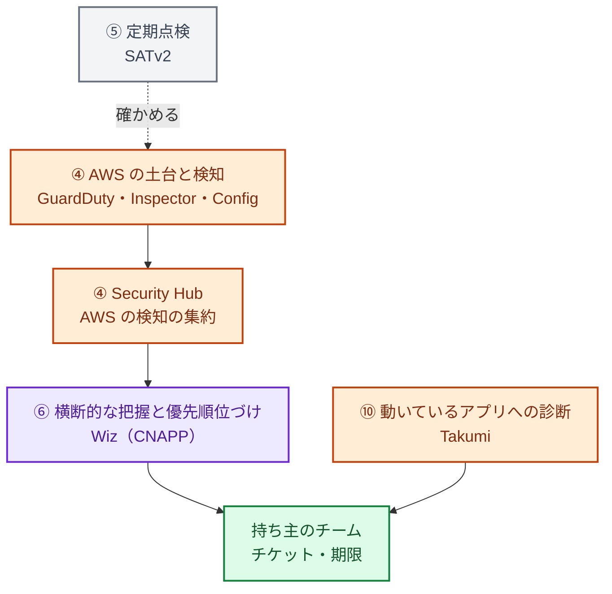

:::message
**最近のニュースから**

**アスクル（2025 年 10 月）** の調査報告によると、攻撃者は侵入後に EDR などの対策ソフトを無効化し、サーバー間を移動したうえでランサムウェアを展開しました。報告書は原因の 1 つとして、侵害されたデータセンターのサーバーに EDR が入っていなかったことを挙げています。

対策ツールは、入っているだけでは機能しません。全体に行き渡っているか、止められたら気づけるか、誰が見ているかが問われます（誰が見るかは 15 章で扱います）。
:::

続く第 3 部では社内 IT、第 4 部では AWS・コード・AI の守り方を扱います。その前にこの章で、**ツールの全体の地図** を描いておきます。

ツールがまだ少ない会社では、何をどの順番で入れるかが課題になります。ひととおり入っている会社では、「入れたのに、強くなった実感がない」という状態によく陥ります。どちらの場合も、効果を左右するのはツールの性能より、組み合わせ方と運用です。

## ツールが効果を出さない典型

まず、ツールがあるのに効果が出ない典型を見ておきます。これから入れる会社にとっては、避けるべき落とし穴の一覧です。

| # | 症状 | 原因 |
|---|---|---|
| 1 | アラートが数千件あり、誰も見ていない | 検知結果を誰が・いつ・どの順で見るかが決まっていない |
| 2 | 同じ問題が、複数のツールから別々に報告される | ツールの役割が重なっていて、どれを正とするか決めていない |
| 3 | 一部の端末やアカウント、リポジトリにしか入っていない | 新しい環境に自動で行き渡る仕組みがない |
| 4 | 見つかった問題が直らない | 直すのは開発チームなのに、持ち主に届いていない、期限もない |
| 5 | 経営に成果を説明できない | 前と比べてどう良くなったかを測っていない |

ツールを増やしても、この 5 つは解決しません。逆に、ツールが増えるほど 1 と 2 は悪化します。

## 11 の役割と、この本での組み合わせ

セキュリティの道具は、製品の名前ではなく **役割** で考えると整理しやすくなります。この本では、道具の役割を「社内 IT」「開発・クラウド」と、両方に共通する「見張り」の 3 つに分けて説明します。別の製品を使っている場合は、「この本の例」の列を自社の製品に置き換えて読んでください。

### 社内 IT（第 3 部）

社内 IT の道具は、多くの会社がすでに何かしらを使っていて、選択肢も多いので、製品名ではなく種類で書きます。

| 役割 | この本の例 | 同じ役割の選択肢 | 章 |
|---|---|---|---|
| ① ID の集約と認証 | IdP（Entra ID / Google Workspace / Okta など）、パスワードマネージャー | 業務で使っているグループウェアの ID 管理の機能 | 7 |
| ② 端末の守り | EDR、MDM | ウイルス対策ソフト（最低限）。EDR と MDM の機能を 1 つにまとめた製品もある | 8 |
| ③ メールとネットワークの守り | 送信ドメイン認証（SPF・DKIM・DMARC）、UTM・ファイアウォール | メールのセキュリティ製品、ゼロトラスト型のアクセスの製品 | 8 |

### 開発・クラウド（第 4 部）

| 役割 | この本の例 | 同じ役割の選択肢 | 章 |
|---|---|---|---|
| ④ AWS の土台と脅威の検知 | AWS 標準（Organizations、IAM Identity Center、CloudTrail、Config、GuardDuty、Inspector、Security Hub） | AWS を使うなら、まずは AWS 標準の機能 | 9 |
| ⑤ AWS 全体の定期点検 | SATv2 | Prowler などの OSS、外部の診断サービス | 10 |
| ⑥ クラウドのリスクの横断的な把握と優先順位づけ | Wiz | CNAPP（クラウドの資産、設定ミス、脆弱性、権限、データ、実行時の脅威を横断的に可視化する製品）。最初は Security Hub の「露出」の検出（攻撃につながる組み合わせの検出。9 章）で代用できる | 11 |
| ⑦ コードと開発プロセスの守り | GitHub（Secret Protection、Code Security、Dependabot、ルールセット） | GitLab などの同等の機能、SAST / SCA の製品 | 12 |
| ⑧ 悪性パッケージのブロック | Takumi Guard | パッケージのファイアウォールやプロキシの製品 | 13 |
| ⑨ コードの継続的な診断と修正 | Claude Security | AI によるコード診断の製品、従来の SAST | 13 |
| ⑩ 動いているアプリへの診断 | Takumi（ブラックボックス診断） | DAST、AI ペネトレーションテスト（AWS Security Agent など）、外部の診断会社 | 13 |

AWS Security Agent（AI によるペネトレーションテスト。2026 年夏からは AWS Continuum の一部）には 13 章で触れます。

### 共通: 見張り（第 5 部）

| 役割 | この本の例 | 同じ役割の選択肢 | 章 |
|---|---|---|---|
| ⑪ 知らせを集め、夜間・休日も見る | 共有のチャットのチャンネル、MDR、AWS Security Incident Response（AWS 部分の一次対応） | 社内の当番、MSSP・SOC のサービス、SIEM（Lv3 以降） | 15・17 |

## まだ入っていないときの順番

ツールがまだほとんど入っていない会社でも、すべてを一度にそろえる必要はありません。次の順番をおすすめします。

1. **無料か少額の標準機能から（Lv1）**: 社内 IT では、全員の MFA、OS の自動更新、ウイルス対策。開発・クラウドでは、AWS の CloudTrail・GuardDuty、GitHub のシークレットスキャン・プッシュ保護・Dependabot、SATv2 による健康診断、Takumi Guard（ブロックの機能は無料）。重大な知らせは、決まったチャンネルに届くようにする。効果は大きい
2. **回す仕組みを作る（Lv1〜Lv2）**: 週次レビュー、持ち主への割り振り、対応期限。この章の後半の「運用で決めること」。あわせて、IdP への集約と SSO、MDM で端末を一覧にすること、Security Hub で検知結果を 1 か所に集めること（Lv2）
3. **有料の道具は、回す仕組みができてから（Lv2〜Lv3）**: EDR を全端末に、外部の監視サービス（⑪）、CNAPP（⑥）、GitHub Code Security、AI による継続診断（⑨⑩）。検知結果を処理する人と仕組みがないうちに入れると、アラートが積み上がるだけになります（3 章「飛び級しない」）。ただし、オフィスのネットワークの境界に機器がない会社では、★3 のために EDR を Lv2 で入れます（8 章）

標準機能も、すべてが無料ではありません。AWS の GuardDuty や Security Hub は、ログの量やリソースの数に応じた従量課金です。どちらにも、アカウント・リージョンごとに 30 日間の無料試用があり（[GuardDuty の料金](https://aws.amazon.com/guardduty/pricing/)、[Security Hub の料金](https://aws.amazon.com/security-hub/pricing/)。Security Hub の試用は Essentials プランが対象で、Threat Analytics などの追加機能は含まれません）、その間に、全アカウントに広げたときの月額の見込みを確かめられます。IdP や MDM の機能も、契約しているプランによって使えるものが違います。経営に「無料」と説明すると後で困るので、見込み額を添えて報告します。

すでに入っている会社は、逆に「入っているのに、全体に行き渡っていない・回っていない」ことが多いはずです。その場合は、この章の最後の「棚卸し」から始めてください。

## 流れで見る

**社内 IT**: 社員の ID と端末から、見張りまで

**開発側**: コードを書いてから、リポジトリに入るまで

**クラウド側**: 動いている環境の検知と、優先順位づけ

色の意味: 黄＝社内 IT、青＝開発、オレンジ＝クラウド、紫＝見張り・優先順位づけ、緑＝人・チーム、灰色＝定期点検。番号は上の表の役割です。

開発・クラウドの流れでは、検知結果は最後に「持ち主のチーム」へ期限つきで届きます。ツールはそこに至るまでの「見つける」「絞る」部分を担当します。社内 IT の流れでは、知らせの多くが「いま起きているかもしれない攻撃」なので、行き先はまず判断する人です（15 章）。なお、GuardDuty の重大な検知のように、クラウド側にも同じ種類の知らせがあります。それらも ⑪ の見張りに集めます。

## 重なりを整理する

役割が重なっている部分は、**どちらを正とするか** を決めておきます。決めておかないと、同じ問題を 2 回処理したり、どちらも見ていなかったりします。

| 重なり | この本での決め方 |
|---|---|
| MDM と EDR（端末の一覧） | 会社の端末の一覧は MDM を正にする。EDR の一覧と突き合わせて、EDR が入っていない端末を見つける（8 章） |
| EDR とウイルス対策ソフト | 使っている EDR にウイルス対策の機能が含まれているかを確かめ、重ねて入れるかを決める。端末の種類（PC、サーバー）ごとに、どれを正とするかを書いておく |
| 社内と外部の監視サービス（EDR・IdP の知らせ） | 外部に見てもらうなら、どの知らせを外部が見て、どれを社内が見るかを分ける。両方が「相手が見ている」と思い込むのが一番危ない（15 章） |
| Security Hub と Wiz（クラウドの設定ミス・脆弱性） | 優先順位づけと開発チームへの割り振りは Wiz を正にする。Security Hub は AWS の検知の集約と、GuardDuty の脅威検知・自動修復の起点として使う |
| GuardDuty と Wiz Defend（実行時の脅威の検知） | 両方の知らせを見張り（15 章）に流してよいが、重複を誰がまとめるかを決める。最初は GuardDuty の重大度「高」だけを流し、Wiz Defend は慣れてから足す（11 章） |
| Inspector と Wiz（ワークロードの脆弱性） | 一覧と優先順位は Wiz で見る。Inspector は Security Hub 側の情報源として残す |
| CodeQL と Claude Security / Takumi（コードの脆弱性） | PR ごとの定型チェックは CodeQL、パターンにない脆弱性（認可の不備、業務ロジック）の発見は Claude Security / Takumi と分ける |
| Claude Security と Takumi（AI による診断） | コードを読む継続診断は Claude Security、動いているアプリへの診断（ブラックボックス）と報告書は Takumi と分ける（13 章） |
| Dependabot と Takumi Guard（依存パッケージ） | 既知の脆弱性は Dependabot、悪性パッケージのブロックは Takumi Guard |
| SATv2 と Security Hub / Wiz（AWS の設定点検） | 常時の点検は Security Hub / Wiz。SATv2 は別の目による定期点検と、改善の推移を示すための記録 |

この表は、製品の組み合わせが違っても作れます。重なりごとに、正とするものを 1 つ決めて書いておけば十分です。この表を社内の Wiki に置き、新しいツールを入れるたびに更新します。

## 抜けを確かめる

逆に、どのツールもカバーしていない領域もあります。ツールでは埋まらない部分は、ルールと運用で埋めます。

| 領域 | 抜けやすいこと | 埋め方 | 章 |
|---|---|---|---|
| ID | IdP 側の設定（MFA の方式）、退職者や委託先のアカウント、SSO できないサービス | 入社・退職の手順、権限の棚卸し | 7・9 |
| 端末 | 紛失、私物のスマートフォン、EDR が入っていない端末 | MDM と BYOD のルール、端末一覧の突き合わせ | 8 |
| SaaS | 業務で使っている SaaS の設定と共有 | SaaS の一覧と、委託先管理 | 5・8 |
| 人 | フィッシング、AI への機密情報の入力 | 教育、AI 利用ガイドライン | 5・14 |
| 夜間・休日 | 誰も見ていない時間帯の知らせ | 当番、外部の監視サービス、道具による自動の隔離 | 15 |
| 復旧 | バックアップから本当に戻せるか（AWS、PC、SaaS） | 復旧テスト、訓練 | 8・9・16 |
| 調査 | すでに入られていないかの確認、事件後に何が起きたかを調べるためのログ | ログの長期保管、平時の侵害調査、調査会社の事前選定 | 17 |
| 外への説明 | 取引先への回答、★や ISMS | 規程と証跡の整備 | 3・5 |

## 運用で決めること

ツールの組み合わせが決まったら、最低限、次の 3 つを決めます。これがないと、どんなに良いツールでも「入れたのに回らない」に戻ります。

1. **週次レビュー**: 毎週 30 分、新しく出た重大な検知結果を見る時間を、カレンダーに固定する。見る画面は、社内 IT は端末と ID の管理画面（更新されていない端末、EDR が入っていない端末、MFA のない ID）、クラウドは 1 つ（Security Hub か CNAPP）、コードは 1 つ（GitHub、AI 診断を使っていればその画面）に絞る
2. **持ち主と期限**: 検知結果は、AWS アカウントやリポジトリ、端末の持ち主のチームに割り振り、重大度別の期限（5 章の SLA）をつける
3. **四半期の測定**: 4 章のチェックシートと SATv2 の件数推移で、前の四半期と比べる。結果を経営に 1 枚で報告する

週次レビューは「直すべき問題」を見る場です。不審なサインインや EDR の検知のような「いま起きているかもしれない攻撃」の知らせは、週次レビューを待たずに、届いたらすぐ見ます（15 章）。

## 使っているツールを「棚卸し」する

最後に、いま使っている（またはこれから入れる）ツールの使われ方を点検する表です。ツールごとに埋めてみると、どこが「入れただけ」になっているかが分かります。まだ入っていない役割の列は、空欄のままで構いません。

**社内 IT**

| 確認項目 | IdP | EDR・MDM | メール・ネットワーク機器 |
|---|---|---|---|
| 対象の全体（全社員 / 全端末 / 全拠点）に入っているか | | | |
| 新しい社員や端末に自動で入るか | | | |
| 知らせを見る人と頻度が決まっているか | | | |
| 止められたら気づけるか | | | |
| 他のツールとの重なりを整理したか | | | |

**開発・クラウド**

| 確認項目 | AWS 標準 | SATv2 | Wiz | GitHub | Takumi | Claude Security |
|---|---|---|---|---|---|---|
| 対象の全体（全アカウント / 全リポジトリ）に入っているか | | | | | | |
| 新しい環境に自動で入るか | | | | | | |
| 結果を見る人と頻度が決まっているか | | | | | | |
| 結果が持ち主に届くか | | | | | | |
| 期限と達成率を測っているか | | | | | | |
| 他のツールとの重なりを整理したか | | | | | | |

「いいえ」が多いツールから、第 3 部・第 4 部の該当する章を読んでください。知らせを見る人が決まっていなければ、15 章から読んでください。
