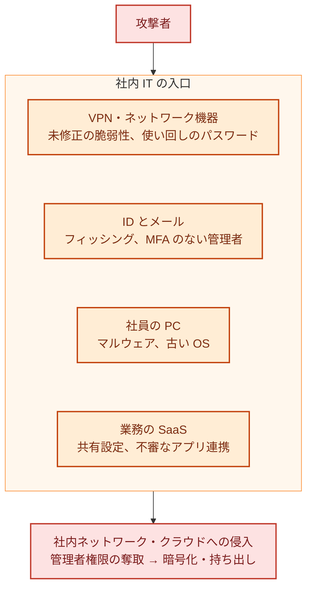

:::message
**最近のニュースから**

**ランサムウェアの入口は、社内 IT にあることが多い**: 警察庁の 2026 年上半期の報告によると、被害組織へのアンケートで、ランサムウェアの侵入経路は VPN 機器が約 5 割を占めました。攻撃者は、未修正の脆弱性や漏えいした認証情報を使って入り込み、管理者権限を奪い、セキュリティ対策を無効にし、バックアップを探してから暗号化します。

アスクルの事案では、業務委託先に付与していた **管理者アカウントに、例外的に多要素認証が適用されていなかった** ことが侵入につながりました。アサヒグループの事案では、攻撃者は拠点のネットワーク機器を経由してデータセンターに侵入したとされています。

どれも、自社サービスのコードではなく、社員や委託先が使う ID、VPN、ネットワーク機器といった **社内 IT** が入口です。
:::

第 3 部では、守りを固める具体的な方法を扱います。最初に取り上げるのは、AWS でもコードでもなく、**社内 IT** です。社員の ID、PC、メール、VPN やネットワーク機器、業務で使う SaaS（Microsoft 365 / Google Workspace、チャット、ストレージなど）のことです。

自社サービスを開発している会社でも、ランサムウェアの入口になりやすいのはこちらです。数十〜数百名の会社の一人目の担当者は、多くの場合、社内 IT も見ることになります。この章では、専任チームがなくても押さえられる要点を、領域ごとに整理します。製品の細かい設定は扱わず、何を決め、何を確かめればよいかに絞ります。

## 社内 IT の入口

色の意味: 赤＝攻撃者と被害、オレンジ＝社内 IT の入口。この章では、4 つの入口をそれぞれどう守るかを扱います。

## ID

ID（アカウント）は、社内 IT でもクラウドでも、最初に狙われる入口です。

| やること | ポイント |
|---|---|
| ID を 1 か所に集める | 社員の ID を IdP（Entra ID / Google Workspace / Okta など）に集約し、主要な SaaS と AWS、GitHub には SSO でログインする。退職したときに 1 か所で止められる |
| MFA を全員に必須にする | 例外を作らない。アスクルの事案のように、例外として MFA を外したアカウントが入口になる。委託先に渡すアカウントも同じ |
| フィッシングに強い MFA を使う | SMS や認証コードの入力は、偽のログイン画面で盗まれることがある。パスキー（FIDO2）などのフィッシングに強い方式を、管理者から順に入れる |
| 管理者アカウントを分ける | 日常の作業と管理作業でアカウントを分け、管理者権限を持つ人の一覧を作る |
| 入退社と連動させる | 入社・異動・退職に合わせて、アカウントの発行・権限の変更・削除をする手順を決める。委託先のアカウントは期限つきにする |
| パスワードマネージャーを配る | SSO できないサービスや、どうしても残る共有アカウントのパスワードは、会社が契約したパスワードマネージャーで管理する。共有アカウントは、誰が使えるかを一覧にし、担当者が抜けたらパスワードを変える |
| 緊急用のアカウントを用意する | IdP の障害や設定ミスで全員が入れなくなったときのために、IdP を通らない緊急用の管理者アカウント（break-glass）を少数用意する。強い MFA をかけ、認証情報は厳重に保管し、使われたら通知が来るようにする |

## 社員の PC

| やること | ポイント |
|---|---|
| OS とソフトを最新に保つ | 自動更新を有効にし、更新されていない端末を一覧で把握する。IPA の 6 か条の 1 つめでもある |
| ウイルス対策と EDR | ウイルス対策ソフトは最低限。不審な動きを検知して止める EDR があると、侵入後の動きに気づける。EDR を止められたら通知が来るようにしておく（アスクルの事案では、攻撃者が EDR などを無効化した） |
| 端末を管理する（MDM） | 会社の端末を一覧で把握し、設定（画面ロック、ディスクの暗号化、OS の更新）を配る。紛失したときに遠隔で消去できるようにする |
| ディスクを暗号化する | 紛失・盗難に備える |
| 社員に管理者権限を持たせない | 必要なときだけ申請して使う |
| スマートフォンも対象にする | メールやチャットをスマートフォンで見るなら、それも会社のデータを持つ端末。私物を使わせるか（BYOD）を決め、使わせるなら画面ロックや OS の更新を条件にし、会社のデータだけを消せる仕組み（MDM のアプリ管理など）を使う |

## メール

| やること | ポイント |
|---|---|
| 送信ドメイン認証を設定する | 自社のドメインに SPF・DKIM・DMARC を設定し、自社になりすましたメールを受け取り側が見分けられるようにする。Gmail は 2024 年 2 月から、1 日 5,000 通を超えて送る送信者に、この 3 つの設定を求めている |
| DMARC のポリシーを段階的に強める | 最初は `p=none`（監視だけ）で始め、レポートで正規の送信元を確かめてから、`quarantine`、`reject` に進める |
| ビジネスメール詐欺に備える | 振込先の変更や急な送金の依頼は、メール以外の手段（電話など）で確認する手順を経理と決めておく。10 大脅威の組織編にも入っている |
| メールの自動転送を制限する | 乗っ取られたアカウントで、外部への自動転送が設定されることがある。外部への自動転送は原則禁止にする |

## VPN・ネットワーク機器

警察庁の報告では、ランサムウェアの侵入経路の約半分が VPN 機器でした。VPN 機器やファイアウォール、ルーターは、インターネットに直接さらされているのに、**誰が管理しているかあいまいで、更新が後回しになりがち** です。

| やること | ポイント |
|---|---|
| 機器の一覧と管理者を決める | 拠点ごとの VPN 機器、ファイアウォール、ルーター、リモートデスクトップの入口を洗い出し、それぞれの管理者（社内か委託先か）を決める |
| 更新を期限内に当てる | 重大な脆弱性の修正は、リリースから 14 日以内に当てる（SCS 評価制度 ★3 の評価基準。インターネットとの境界の機器も対象）。悪用が確認されている脆弱性は、もっと早く |
| MFA を必須にする | VPN のログインにも MFA を使う。委託先の保守用アカウントも例外にしない |
| 管理画面を外に出さない | 機器の管理画面をインターネットに公開しない。接続元を絞る |
| 使っていないものを止める | 使われていない VPN のアカウント、古い機器、開けたままのリモートデスクトップを止める |
| 長期的には置き換えを検討する | 社内ネットワークに入れる VPN から、ID と端末の状態で 1 つずつアクセスを許すゼロトラスト型のアクセス（17 章）への移行を、機器の更新時期に合わせて検討する |

注意喚起で VPN 機器の脆弱性が悪用されていると分かったら、**修正を当てる前に入られていなかったか** も確かめます（15 章）。

## 業務の SaaS

| やること | ポイント |
|---|---|
| SaaS の一覧と管理者 | 部署ごとに契約しているものも含めて一覧にし、それぞれの管理者を決める（5 章の委託先管理） |
| 共有設定を見直す | 「リンクを知っている全員」への共有や、社外への共有の既定値を見直す。IPA の 6 か条の「共有設定を見直そう！」にあたる |
| アプリ連携を管理する | 社員が勝手に同意した OAuth アプリ（外部のアプリに、メールやファイルへのアクセスを許すもの）を点検し、同意できるアプリを管理者が制限する |
| SaaS のデータも守る | SaaS に置いたデータは、SaaS 側の障害や誤削除、乗っ取りで失われることがある。重要なデータは、保持の設定やバックアップの手段を確かめる |
| SaaS が止まったときの代わりを決める | メール配信やチャットが止まったときの代わりの手段（14 章の事業継続） |
| 退職時の持ち出しに気づく | 内部不正による情報漏えいは 10 大脅威の 7 位。退職が決まった人の大量ダウンロードや、個人のアカウントへの共有を、SaaS の監査ログやアラートで確かめられるようにする |

## レベル別の進め方

| レベル | やること |
|---|---|
| Lv1 | 全員に MFA（例外なし）、OS の自動更新、ウイルス対策、VPN 機器の一覧と最新化、退職者アカウントの点検、振込先変更の確認手順 |
| Lv2 | IdP への集約と SSO、管理者アカウントの分離、パスワードマネージャーと共有アカウントの管理、スマートフォンのルール、MDM とディスクの暗号化、SPF・DKIM・DMARC（`p=none` から）、境界の機器の更新を 14 日以内、SaaS の一覧と共有設定の見直し |
| Lv3 | 管理者からパスキーなどのフィッシングに強い MFA、EDR を全端末に（止められたら通知）、DMARC を `quarantine` 以上に、OAuth アプリの同意の制限、委託先アカウントの期限管理、緊急用アカウント、退職時の持ち出しの確認 |
| Lv4 | 端末の状態を条件にしたアクセス制御、VPN からゼロトラスト型のアクセスへの移行、SaaS の設定を継続的に点検する仕組み |

細かい判定は、4 章のチェックシート（B. ID と社内 IT）を使います。

## よくある落とし穴

- **「例外」の放置**: 役員だけ、委託先だけ、古いシステムだけ MFA を外す、といった例外が入口になります。例外は期限つきにし、一覧で管理します。
- **ネットワーク機器の持ち主がいない**: 導入した委託先との保守契約が切れ、誰も更新していない機器がよくあります。一覧を作る段階で、持ち主を決めます。
- **社内 IT と開発を別々に見る**: 社員の ID が乗っ取られれば、そこから GitHub や AWS にも入られます。ID は社内 IT と開発の共通の入口として、1 か所で管理します。
