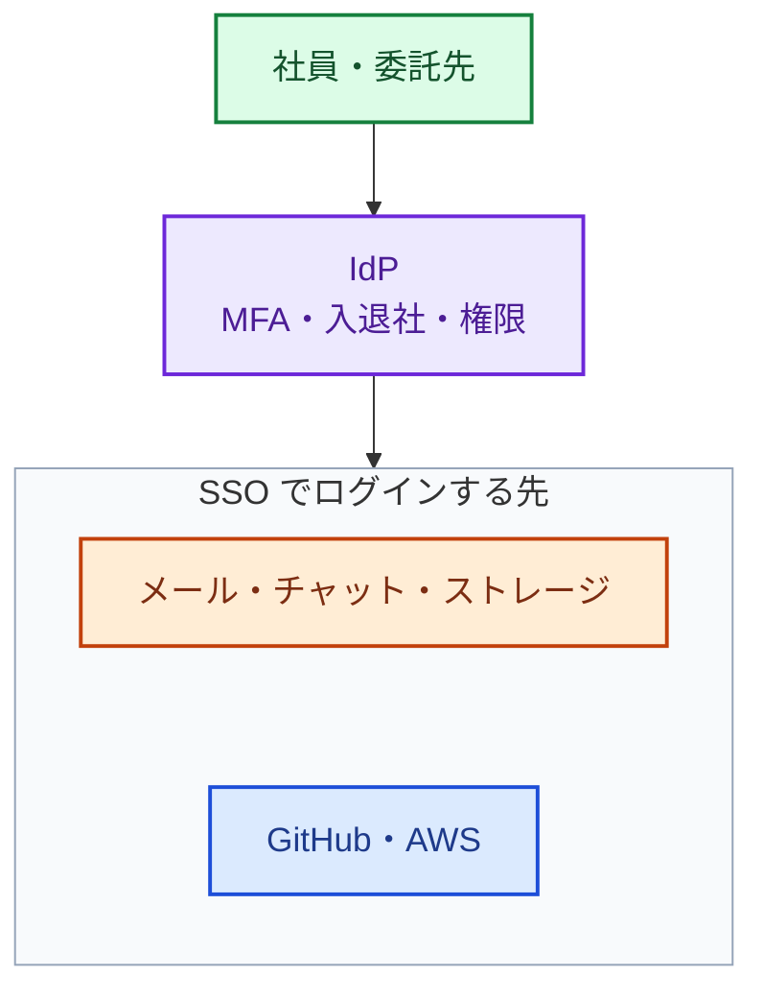

:::message
**最近のニュースから**

**アスクル（2025 年 10 月）** の調査報告によると、侵入に使われたのは、業務委託先に付与していた管理者アカウントの ID とパスワードでした。このアカウントには、**例外的に多要素認証が適用されていませんでした**。

攻撃者は、ソフトウェアの脆弱性だけでなく、MFA のない ID、退職者や委託先の消し忘れた ID、使い回されたパスワードを狙います。正しい ID とパスワードでログインされると、多くの対策は「正規の利用者」として素通りさせてしまいます。
:::

第 3 部では、**社内 IT** の守り方を 2 つの章で扱います。社員の ID、PC、メール、VPN やネットワーク機器、業務で使う SaaS（Microsoft 365 / Google Workspace、チャット、ストレージなど）のことです。

自社サービスを開発している会社でも、ランサムウェアの入口になりやすいのはこちらです。数十〜数百名の会社の一人目の担当者は、多くの場合、社内 IT も見ることになります。2 つの章では、専任チームがなくても押さえられる要点を、領域ごとに整理します。製品の細かい設定は扱わず、何を決め、何を確かめればよいかに絞ります。

| 章 | 扱うもの |
|---|---|
| 7 章（この章） | 社員・管理者・委託先の ID とアカウント |
| 8 章 | 社員の PC とスマートフォン、メール、VPN・ネットワーク機器、業務の SaaS |

最初に ID を取り上げるのは、ID が社内 IT でもクラウドでも、最初に狙われる入口だからです。社員の ID が乗っ取られれば、メールや SaaS だけでなく、そこから GitHub や AWS にも入られます。

## ID を 1 か所に集める

色の意味: 緑＝人、紫＝ID の集約、オレンジ・青＝ログインする先。SSO できないサービスや共有アカウントは、下の表のとおりパスワードマネージャーで管理します。

| やること | ポイント |
|---|---|
| ID を 1 か所に集める | 社員の ID を IdP（Entra ID / Google Workspace / Okta など）に集約し、主要な SaaS と AWS、GitHub には SSO でログインする。退職したときに 1 か所で止められる |
| パスワードマネージャーを配る | SSO できないサービスや、どうしても残る共有アカウントのパスワードは、会社が契約したパスワードマネージャーで管理する。共有アカウントは、誰が使えるかを一覧にし、担当者が抜けたらパスワードを変える |
| SSO できないサービスを一覧にする | SSO に対応していない、または上位のプランでしか対応していない SaaS は、退職時の止め忘れが起きやすい。一覧にして、退職の手順に個別に書いておく（8 章の SaaS の一覧と一緒に管理する） |

## 認証を強くする

| やること | ポイント |
|---|---|
| MFA を全員に必須にする | 例外を作らない。アスクルの事案のように、例外として MFA を外したアカウントが入口になる。委託先に渡すアカウントも同じ |
| フィッシングに強い MFA を使う | SMS や認証コードの入力は、偽のログイン画面で盗まれることがある。パスキー（FIDO2）などのフィッシングに強い方式を、管理者から順に入れる |
| パスワードのルールを決める | 初期パスワードの変更、推測されやすい語と使い回しの禁止を、社内ルールとして周知する。MFA を使えないものは、試行回数でアカウントをロックする（SCS 評価制度 ★3 の 4-1-5） |

## 管理者のアカウント

管理者の ID は、乗っ取られたときの被害が桁違いに大きくなります。数は少なくても、扱いを分けます。

| やること | ポイント |
|---|---|
| 管理者アカウントを分ける | 日常の作業と管理作業でアカウントを分け、管理者権限を持つ人の一覧を作る。権限は必要な範囲に絞る |
| IdP の管理者を特に守る | IdP の管理者は、全社員の ID と SSO の先をまとめて操れる。人数を最小にし、フィッシングに強い MFA を最初に入れる |
| 緊急用のアカウントを用意する | IdP の障害や設定ミスで全員が入れなくなったときのために、IdP を通らない緊急用の管理者アカウント（break-glass）を少数用意する。強い MFA をかけ、認証情報は厳重に保管し、使われたら通知が来るようにする（考え方は Microsoft の「[緊急アクセス用アカウントの管理](https://learn.microsoft.com/entra/identity/role-based-access-control/security-emergency-access)」が詳しい） |

AWS の管理者権限の扱いは 9 章、GitHub の組織のオーナーの扱いは 11 章で扱います。

## 入社・異動・退職

ID の事故の多くは、作るときではなく **変えるときと消すとき** に起きます。異動しても古い権限が残る、退職しても SSO できない SaaS のアカウントが残る、といった形です。

| タイミング | やること |
|---|---|
| 入社 | 申請・承認にもとづいて ID を発行し、役割に必要な権限だけを付ける。ID は共有しない |
| 異動 | 新しい権限を付けるだけでなく、前の部署の権限を外す |
| 退職 | IdP のアカウントを止め、SSO できないサービスのアカウントも一覧に沿って止める。共有アカウントのパスワードを変える。会社の端末を回収する（8 章） |
| 定期的（半年に 1 回など） | ID と権限の一覧を、各部署の責任者に確かめてもらう。使われていない ID と不要な権限を削除する |

発行・変更・削除の申請と承認、定期的な棚卸しの結果は、記録として残します。SCS 評価制度 ★3 でも求められる記録です（5 章の「★3 のための文書と記録」）。

## 委託先・外部の人のアカウント

委託先や業務委託の人に渡すアカウントは、社員のアカウントより管理が甘くなりがちです。アスクルの事案でも、入口は委託先の管理者アカウントでした。

| やること | ポイント |
|---|---|
| 例外にしない | MFA、パスワードのルール、ログの記録は、社員と同じにする |
| 期限をつける | 契約の期間に合わせて有効期限を設定し、更新しなければ止まるようにする |
| 一覧にして持ち主を決める | 委託先ごとに、誰にどのアカウントを渡しているか、社内の誰が責任を持つかを一覧にする。契約の終了を、アカウントを止めるきっかけにする |
| 共有させない | 委託先の中で 1 つのアカウントを使い回させない。個人ごとに発行する |

委託先の管理全体（契約、機密情報の扱い、インシデント時の役割分担）は、5 章で扱います。

## 乗っ取りに気づく

MFA を入れても、乗っ取りはゼロにはなりません。IdP には、次のような異常を知らせる機能があることが多いので、通知の届け先を決めておきます。

- 見慣れない国や端末からのサインイン、短い時間に離れた場所からのサインイン
- MFA の再登録、管理者権限の付与
- 緊急用アカウントの使用

通知を誰が、いつ見るかは 14 章、乗っ取りが疑われるときに何を調べるかは 16 章で扱います。

## レベル別の進め方

| レベル | やること |
|---|---|
| Lv1 | 全員に MFA（例外なし。委託先も）、退職者アカウントの点検、管理者権限を持つ人の把握 |
| Lv2 | IdP への集約と SSO、ID とアクセス権の申請・承認制と定期的な棚卸し、パスワードのルール、管理者アカウントの分離、パスワードマネージャーと共有アカウントの管理、SSO できないサービスの一覧 |
| Lv3 | 管理者からパスキーなどのフィッシングに強い MFA、委託先アカウントの期限管理、緊急用アカウント、IdP のサインインの異常の通知 |
| Lv4 | 端末の状態を条件にしたアクセス制御（8 章）、人以外の ID（CI/CD、AI エージェント）の一覧と最小権限 |

細かい判定は、4 章のチェックシート（B. ID と社内 IT）を使います。

## よくある落とし穴

- **「例外」の放置**: 役員だけ、委託先だけ、古いシステムだけ MFA を外す、といった例外が入口になります。例外は期限つきにし、一覧で管理します。
- **退職の手順が IdP で終わっている**: SSO できない SaaS や共有アカウントが残ります。一覧に沿って止めます。
- **社内 IT と開発を別々に見る**: 社員の ID が乗っ取られれば、そこから GitHub や AWS にも入られます。ID は社内 IT と開発の共通の入口として、1 か所で管理します。
