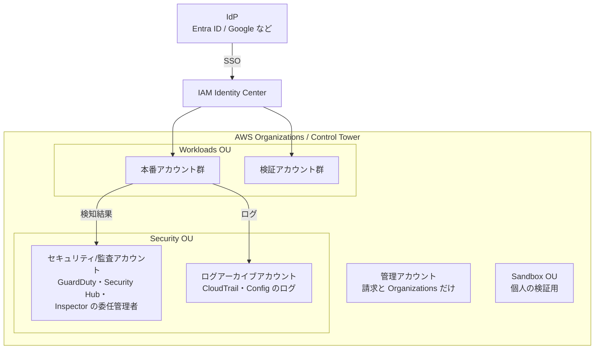

:::message
**最近のニュースから**

**IDC フロンティア（2026 年 10 月）** の IDCF クラウドでは、顧客向けポータルの認証で使われていたオープンソースソフトウェアの脆弱性が悪用され、**仮想化基盤の管理者権限** が奪われました。東日本リージョン 1 の仮想サーバーが暗号化され、495 の企業・自治体に影響が出ています。

クラウドの基盤そのものが攻撃されることもある、という事例です。利用者として守れるのは、自分のアカウントの **管理の権限（ルートユーザー、管理者の ID）を固く守ること** と、**クラウド事業者やリージョンが止まっても戻せるバックアップ** を持つことです。この章では、その土台を AWS で作ります。
:::

この章では、AWS 上のセキュリティを Lv1 → Lv2 → Lv3 に上げるための具体的な手順を、AWS セキュリティ成熟度モデルの順番に沿って整理します。

## 全体像

ポイントは次の 3 つです。

1. **アカウントを分ける**: 本番・検証・個人の検証用を別アカウントにし、被害の範囲（ブラスト半径）を小さくする
2. **人は SSO で入る**: IAM ユーザーとアクセスキーをなくし、IdP → IAM Identity Center 経由に統一する
3. **ログと検知は専用アカウントに集める**: 本番アカウントが乗っ取られても、ログと検知の仕組みは壊されないようにする

## Lv1: Quick Wins（まず 2 週間でやること）

AWS セキュリティ成熟度モデルの Quick Wins に相当する対策です。すべてのアカウントで実施します。

| # | やること | 理由 |
|---|---|---|
| 1 | **ルートユーザーに MFA**、アクセスキーを削除 | ルートが乗っ取られると全てを失う。Organizations 配下なら「ルートアクセスの一元管理」でメンバーアカウントのルート認証情報を削除できる |
| 2 | **代替連絡先（セキュリティ）を登録** | AWS からの不正利用の連絡を確実に受け取る |
| 3 | **CloudTrail を有効化**（組織の証跡） | 何が起きたか後から調べるための最低限の記録 |
| 4 | **GuardDuty を全リージョンで有効化** | 不審な API 呼び出し、マイニング、認証情報の悪用などを検知する |
| 5 | **S3 のパブリックアクセスブロック**（アカウント単位） | 情報漏えいで最も多い原因をふさぐ |
| 6 | **EBS のデフォルト暗号化** と、スナップショットの公開ブロック | うっかり公開を防ぐ |
| 7 | **IAM Access Analyzer** を有効化 | 外部に公開されているリソースを見つける |
| 8 | **請求アラート**（AWS Budgets / Cost Anomaly Detection） | 乗っ取られてマイニングされたとき、最初に気づけるのは請求額のことが多い |
| 9 | 使っていない IAM ユーザー・アクセスキーの削除 | 漏れて困るものを減らす |
| 10 | **SATv2 で健康診断**（9 章） | 上の項目の漏れを一気に点検する |

:::message
**GuardDuty の通知先を決めることまでが Quick Win です。** 有効にしただけで誰も見ていなければ、検知していないのと同じです。最低限、重大度「高」の検知を EventBridge 経由でチャット（Slack / Teams）に通知し、通知を受けた人が何をするか（14 章の初動手順）を決めておきます。
:::

## Lv2: Foundational（基盤）

### 1. マルチアカウント構成と Control Tower

- **AWS Organizations** で全アカウントを 1 つの組織にまとめる
- **AWS Control Tower** で、ログアーカイブアカウントと監査アカウントを作り、標準のガードレール（コントロール）を全アカウントに適用する
- アカウントの作成は **Account Factory**（または Account Factory for Terraform）に統一し、新しいアカウントにも自動で標準設定が入るようにする

既存のアカウントがバラバラに作られている場合は、まず Organizations に招待し、OU（組織単位）に整理してから Control Tower の管理下に登録します。

### 2. SCP（サービスコントロールポリシー）

SCP は、アカウントの中でどんなに強い権限を持っていても実行できない操作を、組織として禁止する仕組みです。最初に入れておきたい SCP の例です。

- 使わないリージョンの利用を禁止する
- CloudTrail、GuardDuty、Config、Security Hub の停止・削除を禁止する
- ルートユーザーの利用を禁止する
- 組織からの離脱を禁止する

あわせて、**RCP（リソースコントロールポリシー）** を使うと、S3 や KMS などのリソースに対して「組織の外からのアクセスを禁止する」といったデータ境界（Data Perimeter）を組織全体に設定できます。

### 3. ID とアクセス

- IdP（Entra ID / Google Workspace / Okta など）と **IAM Identity Center** を連携し、人のアクセスは SSO に統一する
- 権限セット（Permission Set）を「閲覧」「開発者」「管理者」などに標準化し、本番の管理者権限は人数を絞る
- CI/CD（GitHub Actions）から AWS へのアクセスは **OIDC** で一時的な認証情報を使う（11 章）
- アプリケーションの認証情報は **Secrets Manager** に置き、コードや環境変数に直書きしない

### 4. ログと検知の集約

| サービス | 役割 | 集約先 |
|---|---|---|
| CloudTrail（組織の証跡） | API 操作の記録 | ログアーカイブアカウントの S3（オブジェクトロック推奨） |
| AWS Config | リソースの設定と変更履歴 | 監査アカウントでアグリゲーター |
| GuardDuty | 脅威の検知 | 監査アカウントを委任管理者に |
| Amazon Inspector | EC2・ECR・Lambda の脆弱性スキャン | 監査アカウントを委任管理者に |
| **Security Hub** | 上記の検知結果を集約し、優先順位をつける | 監査アカウントを委任管理者に |

#### Security Hub の現在の姿（2026 年時点）

Security Hub は 2025 年末に大きく刷新され、GuardDuty・Inspector・CSPM（設定チェック）などの結果を相関分析し、**「露出（Exposure）」** として攻撃につながる組み合わせを示すようになりました。2026 年には次のような更新がありました。

- **AI インベントリ**（2026 年 7 月）: Amazon Bedrock、Bedrock AgentCore、SageMaker の AI 資産を組織全体で自動的に一覧化し、関連する検知結果と結びつける（Essentials プランに追加料金なしで含まれる）
- **Microsoft Azure 対応**（2026 年 7 月）: マルチクラウドの一部を Security Hub で見られるように
- **GuardDuty の Runtime Monitoring が Security Hub の Threat Analytics プランに統合**（2026 年 10 月）: Security Hub を有効にしているアカウントでは、Runtime Monitoring の GuardDuty 料金が別途かからなくなった
- **GuardDuty AI Protection** の一般提供と、**AI を使った調査機能**（プレビュー）

CSPM のチェック基準としては、まず **AWS Foundational Security Best Practices（FSBP）** を有効にし、必要に応じて CIS AWS Foundations Benchmark を追加します。

### 5. データ保護とバックアップ

- 重要なデータを分類し（例: 機密 / 社外秘 / 公開）、保管場所を把握する
- S3・RDS・EBS などは KMS で暗号化する（多くはデフォルトで暗号化される）
- **AWS Backup** でバックアッププランを組織全体に配布する
- ランサムウェア対策として、バックアップを **別アカウント** の、**ボールトロック**（削除・変更できない設定）をかけたボールトにコピーする（Lv3）
- **復旧を試す**: バックアップは、戻せることを確かめて初めて意味がある

### 6. ネットワーク

- インターネットに直接公開するのは、ロードバランサーや CloudFront など最小限にする
- 管理用の SSH / RDP は開けず、**Systems Manager Session Manager** を使う
- 公開する Web アプリには **AWS WAF** を入れる
- EC2 のインスタンスメタデータは **IMDSv2 を必須** にする

## Lv3: Efficient（仕組み化）

| やること | 道具の例 |
|---|---|
| IaC のセキュリティスキャンを PR ごとに | Checkov、Trivy、Wiz Code、GitHub Code Security |
| 重大な設定ミスの自動修復 | Security Hub の自動化ルール + EventBridge + Lambda / SSM Automation |
| 検知結果からチケットを自動起票 | Security Hub と Jira / Backlog などの連携 |
| 未使用の権限の削減 | IAM Access Analyzer の未使用アクセス検出 |
| 一時的な権限付与 | IAM Identity Center + 申請ワークフロー |
| インシデント初動の自動化 | 侵害されたキーの無効化、インスタンスの隔離などのプレイブック |
| 脆弱性診断（ペネトレーションテスト） | Takumi のブラックボックス診断、AWS Security Agent（12 章）、外部の専門会社 |

## Lv4: Optimized（最終形）

- すべての変更がパイプライン経由になり、本番環境への人の手による変更がない
- 脅威モデリングが新しいサービスの設計に組み込まれている（AWS Security Agent の設計レビューも使える）
- GameDay（障害・攻撃を想定した訓練）を定期的に実施している
- セキュリティ指標（Security Hub のスコア推移、SLA 達成率など）でダッシュボードを作り、経営に報告している

## よくある落とし穴

- **Security Hub のスコアを上げること自体が目的になる**: スコアは目安です。自社にとって意味の小さいチェックに時間を使うより、ルートの保護や公開設定など、影響の大きいものから直します。
- **全部のアラートを Slack に流す**: 通知が多すぎると誰も見なくなります。チャットには重大度「高」以上だけを流し、残りは週次のレビューで見ます。
- **管理アカウントでワークロードを動かす**: 管理アカウントは請求と Organizations の管理だけに使い、それ以外のリソースは置きません。
