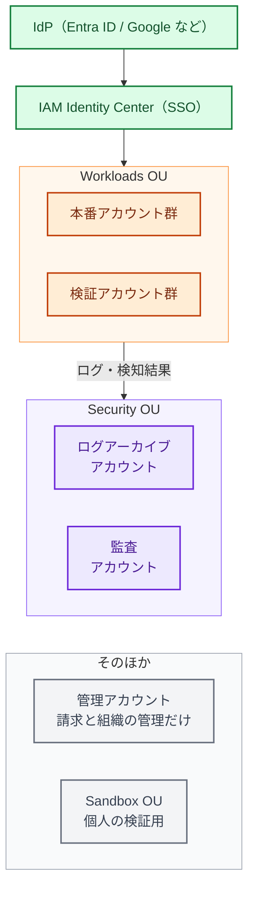

:::message
**最近のニュースから**

**IDC フロンティア（2026 年 10 月）** の IDCF クラウドでは、顧客向けポータルの認証で使われていたオープンソースソフトウェアの脆弱性が悪用され、仮想化基盤の管理者権限が奪われました。東日本リージョン 1 の仮想サーバーが暗号化され、495 の企業・自治体に影響が出ています。

クラウドの基盤そのものが攻撃されることもある、という事例です。利用者として守れるのは、自分のアカウントの **管理の権限（ルートユーザー、管理者の ID）を固く守ること** と、クラウド事業者やリージョンが止まっても戻せるバックアップを持つことです。この章では、その土台を AWS で作ります。

**持っているデータが被害を大きくする（2026 年 9〜10 月）**: タイムズカーの情報漏えいでは、運転免許証などの本人確認書類を長く保管していたことが、被害を大きくした一因と報じられました。持っていないデータは漏れません。不要なデータを消すことも、クラウドの土台づくりの一部です。
:::

この章では、AWS 上のセキュリティを Lv1 → Lv2 → Lv3 に上げるための具体的な手順を、AWS セキュリティ成熟度モデルの順番に沿って整理します。

## 全体像

色の意味: 緑＝ID（人の入口）、オレンジ＝ワークロード、紫＝ログと検知を集めるアカウント（監査アカウントは GuardDuty・Security Hub・Inspector の委任管理者）、灰色＝そのほか。すべて AWS Organizations / Control Tower の中にあります。

ポイントは次の 3 つです。

1. **アカウントを分ける**: 本番・検証・個人の検証用を別アカウントにし、被害の範囲（ブラスト半径）を小さくする
2. **人は SSO で入る**: IAM ユーザーとアクセスキーをなくし、IdP → IAM Identity Center 経由に統一する
3. **ログと検知は専用アカウントに集める**: 本番アカウントが乗っ取られても、ログと検知の仕組みは壊されないようにする

## Lv1: Quick Wins（まず 2 週間でやること）

AWS セキュリティ成熟度モデルの Quick Wins に相当する対策です。すべてのアカウントで実施します。

| # | やること | 理由 |
|---|---|---|
| 1 |ルートユーザーに MFA、アクセスキーを削除 | ルートが乗っ取られると全てを失う。Organizations 配下なら「ルートアクセスの一元管理」でメンバーアカウントのルート認証情報を削除できる |
| 2 |代替連絡先（セキュリティ）を登録| AWS からの不正利用の連絡を確実に受け取る |
| 3 |CloudTrail を有効化（組織の証跡） | 何が起きたか後から調べるための最低限の記録 |
| 4 |GuardDuty を全リージョンで有効化| 不審な API 呼び出し、マイニング、認証情報の悪用などを検知する |
| 5 |S3 のパブリックアクセスブロック（アカウント単位） | 情報漏えいで最も多い原因をふさぐ |
| 6 |EBS のデフォルト暗号化と、スナップショットの公開ブロック | うっかり公開を防ぐ |
| 7 |IAM Access Analyzer を有効化 | 外部に公開されているリソースを見つける |
| 8 |請求アラート（AWS Budgets / Cost Anomaly Detection） | 乗っ取られてマイニングされたとき、最初に気づけるのは請求額のことが多い |
| 9 | 使っていない IAM ユーザー・アクセスキーの削除 | 漏れて困るものを減らす |
| 10 |SATv2 で健康診断（9 章） | 上の項目の漏れを一気に点検する |

:::message
**GuardDuty の通知先を決めることまでが Quick Win です。** 有効にしただけで誰も見ていなければ、検知していないのと同じです。最低限、重大度「高」の検知を EventBridge 経由でチャット（Slack / Teams）に通知し、通知を受けた人が何をするか（14 章の初動手順）を決めておきます。
:::

## Lv2: Foundational（基盤）

### 1. マルチアカウント構成と Control Tower

- **AWS Organizations** で全アカウントを 1 つの組織にまとめる
- **AWS Control Tower** で、ログアーカイブアカウントと監査アカウントを作り、標準のガードレール（コントロール）を全アカウントに適用する
- アカウントの作成は Account Factory（または Account Factory for Terraform）に統一し、新しいアカウントにも自動で標準設定が入るようにする

既存のアカウントがバラバラに作られている場合は、まず Organizations に招待し、OU（組織単位）に整理してから Control Tower の管理下に登録します。

### 2. SCP（サービスコントロールポリシー）

SCP は、アカウントの中でどんなに強い権限を持っていても実行できない操作を、組織として禁止する仕組みです。最初に入れておきたい SCP の例です。

- 使わないリージョンの利用を禁止する
- CloudTrail、GuardDuty、Config、Security Hub の停止・削除を禁止する
- ルートユーザーの利用を禁止する
- 組織からの離脱を禁止する

あわせて、**RCP（リソースコントロールポリシー）** を使うと、S3 や KMS などのリソースに対して「組織の外からのアクセスを禁止する」といったデータ境界（Data Perimeter）を組織全体に設定できます。

### 3. ID とアクセス

- IdP（Entra ID / Google Workspace / Okta など）と IAM Identity Center を連携し、人のアクセスは SSO に統一する
- 権限セット（Permission Set）を「閲覧」「開発者」「管理者」などに標準化し、本番の管理者権限は人数を絞る
- CI/CD（GitHub Actions）から AWS へのアクセスは OIDC で一時的な認証情報を使う（11 章）
- アプリケーションの認証情報は Secrets Manager に置き、コードや環境変数に直書きしない

### 4. ログと検知の集約

| サービス | 役割 | 集約先 |
|---|---|---|
| CloudTrail（組織の証跡） | API 操作の記録 | ログアーカイブアカウントの S3（消されないための設定は、この章の「ログとバックアップを『消されない場所』に置く」） |
| AWS Config | リソースの設定と変更履歴 | 監査アカウントでアグリゲーター |
| GuardDuty | 脅威の検知 | 監査アカウントを委任管理者に |
| Amazon Inspector | EC2・ECR・Lambda の脆弱性スキャン | 監査アカウントを委任管理者に |
|Security Hub| 上記の検知結果を集約し、優先順位をつける | 監査アカウントを委任管理者に |

#### Security Hub の現在の姿（2026 年時点）

Security Hub は 2025 年末に大きく刷新され、GuardDuty・Inspector・CSPM（設定チェック）などの結果を相関分析し、**「露出（Exposure）」** として攻撃につながる組み合わせを示すようになりました。2026 年には次のような更新がありました。

- **AI インベントリ**（2026 年 7 月）: Amazon Bedrock、Bedrock AgentCore、SageMaker の AI 資産を組織全体で自動的に一覧化し、関連する検知結果と結びつける（Essentials プランに追加料金なしで含まれる）
- **Microsoft Azure 対応**（2026 年 7 月）: マルチクラウドの一部を Security Hub で見られるように
- **GuardDuty の Runtime Monitoring が Security Hub の Threat Analytics プランに統合**（2026 年 10 月）: Security Hub を有効にしているアカウントでは、Runtime Monitoring の GuardDuty 料金が別途かからなくなった
- **GuardDuty AI Protection** の一般提供と、AI を使った調査機能（プレビュー）

CSPM のチェック基準としては、まず **AWS Foundational Security Best Practices（FSBP）** を有効にし、必要に応じて CIS AWS Foundations Benchmark を追加します。

### 5. データ保護とバックアップ

- 重要なデータを分類し（例: 機密 / 社外秘 / 公開）、保管場所を把握する
- **保管期間を決め、不要になったデータは消す**（S3 のライフサイクルルールなど）。特に本人確認書類やパスワードのような、漏れたときの影響が大きいデータは、持たない・すぐ消す設計にする
- S3・RDS・EBS などは KMS で暗号化する（多くはデフォルトで暗号化される）
- **AWS Backup** でバックアッププランを組織全体に配布する
- ランサムウェア対策として、バックアップを別アカウントの、ボールトロック（削除・変更できない設定）をかけたボールトにコピーする（詳しくはこの章の「ログとバックアップを『消されない場所』に置く」）
- **復旧を試す**: バックアップは、戻せることを確かめて初めて意味がある

### 6. ネットワーク

- インターネットに直接公開するのは、ロードバランサーや CloudFront など最小限にする
- 管理用の SSH / RDP は開けず、Systems Manager Session Manager を使う
- 公開する Web アプリには AWS WAF を入れる
- EC2 のインスタンスメタデータは IMDSv2 を必須にする

## Lv3: Efficient（仕組み化）

この本の Lv3 には、専任チームのない会社でも手が届き、効果の大きいものを選んでいます。AWS の成熟度モデルでは、設定の逸脱の自動修正と一時的な権限昇格は Optimized に分類されているので、Lv3 の中では後半に回しても構いません。

| やること | 道具の例 |
|---|---|
| IaC のセキュリティスキャンを PR ごとに | Checkov、Trivy、Wiz Code、GitHub Code Security |
| 重大な設定ミスの自動修復 | Security Hub の自動化ルール + EventBridge + Lambda / SSM Automation |
| 検知結果からチケットを自動起票 | Security Hub と Jira / Backlog などの連携 |
| 未使用の権限の削減 | IAM Access Analyzer の未使用アクセス検出 |
| 一時的な権限付与 | IAM Identity Center + 申請ワークフロー |
| インシデント初動の自動化 | 侵害されたキーの無効化、インスタンスの隔離などのプレイブック |
| 夜間・休日も含めた検知の一次対応 |AWS Security Incident Response（GuardDuty の検知のトリアージ、AI による調査、AWS の専門家への 24 時間のエスカレーション。15 章） |
| 脆弱性診断（ペネトレーションテスト） | Takumi のブラックボックス診断、AWS Security Agent（AWS Continuum。12 章）、外部の専門会社 |

## Lv4: Optimized（最終形）

- すべての変更がパイプライン経由になり、本番環境への人の手による変更がない
- 脅威モデリングが新しいサービスの設計に組み込まれている（AWS Security Agent の設計レビューも使える）
- GameDay（障害・攻撃を想定した訓練）を定期的に実施している
- セキュリティ指標（Security Hub のスコア推移、SLA 達成率など）でダッシュボードを作り、経営に報告している

## ログとバックアップを「消されない場所」に置く

ランサムウェアの攻撃者は、暗号化の前に **ログを消し、検知を止め、バックアップを消します**。アスクルの調査報告でも、EDR などの対策ソフトが無効化され、バックアップファイルが削除されていました（2 章）。ログが残っていなければ、何が起きたかを調べられず、影響範囲を絞れないので、すべてを「漏えいのおそれ」として扱うことになります（15 章）。バックアップが消されれば、身代金を払う以外に戻す手段がなくなります。

守り方の考え方は、ログもバックアップも同じです。

1. **別の場所に置く**: 本番のアカウントとは別のアカウント（できれば別のリージョン）に置く。本番の管理者権限を奪われても届かないようにする
2. **消せない設定にする**: 一定期間、管理者でも削除・上書きできない設定（WORM: 一度書いたら変えられない）にする
3. **誰も入れないようにする**: 保管先のアカウントには、ふだん誰もログインしない。入るときは緊急用の手順と多要素認証を使い、入ったこと自体を通知する
4. **戻せることを確かめる**: ログは検索できるか、バックアップは期限内に戻せるかを、定期的に試す

### ログを守る

| やること | 方法 | 補足 |
|---|---|---|
| 組織全体の操作を記録する | CloudTrail の組織の証跡を、全リージョン・全アカウントで有効にする | コンソールのイベント履歴は 90 日分しか残らない（15 章） |
| ログを別アカウントに集める | Control Tower のログアーカイブアカウントの S3 に集める | Control Tower は、自分が作った証跡とログ用バケットの変更・削除を SCP で禁止する（必須のコントロール） |
| 改ざんに気づけるようにする | CloudTrail のログファイルの整合性検証を有効にする | 1 時間ごとに、ログのハッシュ値を並べて署名したダイジェストファイルが作られる。ログが変更・削除されていないことを後から証明できる |
| 消せないようにする | ログ用バケットに S3 オブジェクトロックをかける | バージョニングが前提。下のモードの違いに注意 |
| 記録を止められないようにする | SCP で `cloudtrail:StopLogging`、`cloudtrail:DeleteTrail`、GuardDuty の無効化（`guardduty:DeleteDetector` など）、Config の停止を禁止する | Control Tower を使わずに作った証跡は、自分で SCP を書いて守る |
| 費用を抑える | S3 のライフサイクルルールで、古いログを安いストレージクラス（Glacier 系）に移す | 調査のときに取り出す時間と費用も確かめておく |

**S3 オブジェクトロックの 2 つのモード**

- **ガバナンスモード**: 特別な権限（`s3:BypassGovernanceRetention`）を持つ人だけが、保持期間中でも削除や設定変更をできる。まずはこちらで試す
- **コンプライアンスモード**: 保持期間中は、ルートユーザーを含め誰も削除・短縮できない。期限前に消す方法は、アカウントの削除しかない。保持期間を長く設定しすぎると、その分の保管費用が確実にかかり続ける

最初はガバナンスモードで保持期間（例: 1 年）を決めて運用し、問題がなければコンプライアンスモードに切り替える、という順番が安全です。

**AWS 以外のログも同じ考え方で**

- **GitHub**: Enterprise では、監査ログ（Git のイベントを含む）を S3 などにストリーミングできる。GitHub の中では、監査ログは 180 日、Git のイベントは 7 日しか残らない（15 章）
- **IdP（Entra ID / Google Workspace / Okta）**: サインインログの保持期間はプランによって短い。SIEM や S3 に転送する
- **SaaS**: 重要な SaaS は、監査ログのエクスポート方法と保持期間を確かめ、定期的に取り出す。取り出したログも、上と同じ消せない場所に置く

### バックアップを守る

| やること | 方法 | 補足 |
|---|---|---|
| 組織全体でバックアップを取る |AWS Backup のバックアッププランを、Organizations で全アカウントに配布する | 対象・頻度・保持期間を決める（SCS 評価制度 ★3 の評価基準でもある） |
| 別アカウント・別リージョンにコピーする | バックアップ専用のアカウントのボールトに、クロスアカウント・クロスリージョンでコピーする | 重要な機密情報は遠隔地にもバックアップを置くことが、★3 で求められている |
| 消せないようにする | コピー先のボールトに AWS Backup ボールトロックをかける | ガバナンスモードとコンプライアンスモードがある。コンプライアンスモードは、最低 3 日の猶予期間（グレースタイム）が過ぎると、誰も（AWS も）ロックを外せない |
| さらに切り離す |論理的にエアギャップされたボールト（logically air-gapped vault）を使う | コンプライアンスモードのロックがかかった専用のボールト。元のアカウントに入れなくなっても、複数人の承認（Multi-party approval）や AWS RAM での共有を通じて、別のアカウントから復元できる |
| 暗号化キーも分ける | バックアップの暗号化に使う KMS キーを、本番アカウントの管理者が消せない場所に置く | キーを消されると、バックアップが残っていても戻せない |
| 戻せることを確かめる | AWS Backup の復元テスト（restore testing）で、定期的に自動で戻してみる | 戻すのにかかった時間を記録し、目標復旧時間（RTO）に収まるかを確かめる。テストで戻したリソースは自動で削除される |

あわせて、**リストア手順書** をバックアップの対象ごとに作ります（これも ★3 の評価基準です）。手順書には、どのアカウントのどのボールトから、誰が、どの権限で戻すかまで書いておきます。インシデントのときは、ふだんの管理者アカウントが使えないかもしれないからです。

**「3-2-1 ルール」をクラウドで考える**: バックアップは「3 つのコピーを、2 種類の媒体に、1 つは離れた場所に」が古くからの原則です。クラウドでは「本番のデータ、同じアカウントのバックアップ、別アカウント・別リージョンの、消せないバックアップ」と読み替えると分かりやすくなります。大事なのは数ではなく、本番の管理者権限を奪われても届かない場所に 1 つあることです。

### レベル別の進め方

| レベル | ログ | バックアップ |
|---|---|---|
| Lv1 | CloudTrail を全リージョンで有効にし、90 日を超えて S3 に残す | 重要なデータのバックアップがある |
| Lv2（★3 相当） | 組織の証跡をログアーカイブアカウントに集め、整合性検証を有効にし、SCP で記録の停止を禁止する。1 年以上保管する | AWS Backup を組織全体に配布し、別アカウント・別リージョンにコピーする。リストア手順書を作り、一度は戻してみる |
| Lv3 | ログ用バケットにオブジェクトロックをかける。GitHub・IdP・主要 SaaS のログも同じ場所に集める | コピー先のボールトにボールトロックをかけ、暗号化キーを分ける。復元テストを定期的に自動で回す |
| Lv4 | 調査に必要なログが揃っているかを、机上訓練（14 章）で確かめる | 論理的にエアギャップされたボールトを使い、本番アカウントを失っても別アカウントから戻せることを訓練で確かめる |

## よくある落とし穴

- **Security Hub のスコアを上げること自体が目的になる**: スコアは目安です。自社にとって意味の小さいチェックに時間を使うより、ルートの保護や公開設定など、影響の大きいものから直します。
- **全部のアラートを Slack に流す**: 通知が多すぎると誰も見なくなります。チャットには重大度「高」以上だけを流し、残りは週次のレビューで見ます。
- **管理アカウントでワークロードを動かす**: 管理アカウントは請求と Organizations の管理だけに使い、それ以外のリソースは置きません。
