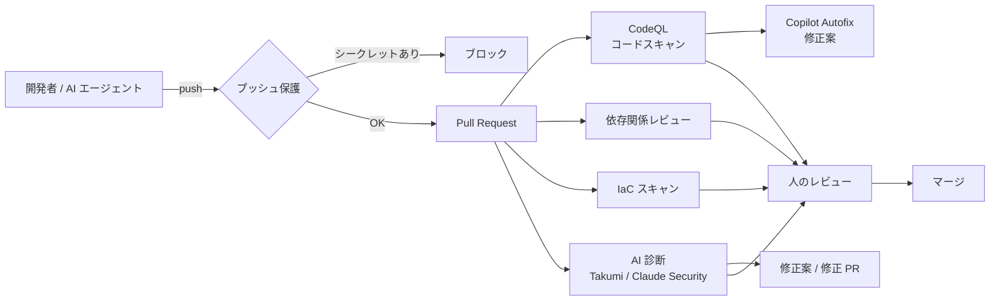

:::message
**最近のニュースから**

**npm のサプライチェーン攻撃（2026 年）** では、自己増殖型のマルウェアが新しい波として相次ぎました。2026 年 4 月 29 日には「Mini Shai-Hulud」と呼ばれるキャンペーンが始まりました。6 月 1 日には、乗っ取られた開発者の GitHub アカウントからコードレビューを回避してコミットが押し込まれ、ある名前空間の少なくとも 32 のパッケージが侵害されました。悪性コードは、インストール中にわざと失敗する依存関係（`optionalDependencies`）の裏で実行される仕組みでした（Unit 42 の報告）。手口は、メンテナーへのフィッシング、認証情報の窃取、CI/CD の悪用などです。

開発者の PC と CI が持つ **認証情報** が、会社全体への入口になる時代です。この章では、GitHub を中心に、コードと開発プロセスの守り方を扱います。
:::

ソースコードとその開発プロセスは、AWS と並ぶ重要な資産です。GitHub が乗っ取られると、コードの盗難だけでなく、**CI/CD を通じて本番環境まで** 侵入される可能性があります。また、依存パッケージを狙ったサプライチェーン攻撃（IPA 10大脅威の 2 位）は、開発者の PC と CI の両方が標的になります。

## 近年の事例から分かること

- **GitHub Actions のサードパーティアクションの改ざん**（2025 年の tj-actions/changed-files など）: 広く使われていたアクションが書き換えられ、多数のリポジトリで CI のシークレットがログに漏れた
- **npm エコシステムでの自己増殖型マルウェア**（2025 年の「Shai-Hulud」など）: 乗っ取った開発者の認証情報で、別のパッケージにも悪性コードを仕込んで広がった
- **AI コーディングエージェントを狙った攻撃**: リポジトリ内のファイルや Issue に命令を紛れ込ませ、エージェントにシークレットを外に送らせる（11 章）

共通するのは、**開発者と CI が持つ認証情報が狙われる** ことです。対策も、認証情報を「持たない・漏らさない・すぐ無効にできる」ようにすることが中心になります。

## GitHub のセキュリティ製品（2026 年時点）

GitHub Advanced Security は 2025 年 4 月に 2 つの製品に分かれ、GitHub Team プランでも購入できるようになりました。

| 製品 | 主な機能 | 価格（2025 年発表時） |
|---|---|---|
| **GitHub Secret Protection** | シークレットスキャン、**プッシュ保護**、AI によるシークレット検出、カスタムパターン、検出したシークレットが有効かの確認 | アクティブなコミッター 1 人あたり月 19 ドル |
| **GitHub Code Security** | CodeQL によるコードスキャン、**Copilot Autofix**（修正案の自動生成）、依存関係レビュー、セキュリティキャンペーン | アクティブなコミッター 1 人あたり月 30 ドル |

- 課金対象の「アクティブなコミッター」は、有効にしたリポジトリに直近 90 日以内にコミットをプッシュした人です。
- **Dependabot**（依存関係の脆弱性アラートと更新 PR）は、追加料金なしで使えます。
- パブリックリポジトリでは、シークレットスキャンやコードスキャンを無料で使えます。
- 2026 年には、AI によるスキャンやエージェント型の Autofix、プッシュ保護での AI 検出など、**使った分だけ課金される AI 機能** が追加されています。料金体系の変化が速いので、契約前に公式の料金ページを確認してください。

## Lv1: まずやること

| # | やること | 場所 |
|---|---|---|
| 1 | 組織のメンバーに **2 段階認証を必須** にする | Organization settings → Authentication security |
| 2 | **シークレットスキャンとプッシュ保護** を全リポジトリで有効にする | Organization settings → Code security → Configurations |
| 3 | **Dependabot アラート** を全リポジトリで有効にする | 同上 |
| 4 | 組織の **基本権限（Base permissions）** を「なし」または「読み取り」にする | Organization settings → Member privileges |
| 5 | 退職者・不要な外部コラボレーターを削除する | People / Outside collaborators |
| 6 | 組織にインストールされている GitHub App と、承認済みの OAuth App を点検する | Third-party access |

:::message
**セキュリティ構成（Security configurations）を使う**: 組織の設定で、GitHub が推奨するセキュリティ構成（GitHub-recommended）を全リポジトリに一括で適用できます。新しいリポジトリにも自動で適用されるようにしておくと、設定漏れが起きません。
:::

### シークレットが漏れたときのルール

シークレットスキャンでアラートが出たら、**「コミットを消す」ではなく「キーを無効にする」** が最優先です。Git の履歴から消しても、すでにコピーされているかもしれないからです。

1. 漏れたキーを発行元（AWS、外部 API など）で無効化・ローテーションする
2. そのキーで何が行われたかをログ（CloudTrail など）で確認する
3. 必要なら履歴から削除する

## Lv2: 標準化する

### ID の統合

- GitHub Enterprise Cloud を使っている場合は、IdP と **SAML SSO** で連携し、退職時に GitHub へのアクセスも自動で止まるようにする（Enterprise Managed Users にすると、アカウント自体を会社が管理できる）
- 個人アクセストークン（PAT）は **細かい権限のトークン（fine-grained PAT）** に寄せ、組織として承認制・有効期限つきにする。従来型の PAT は制限する

### ブランチとリリースの保護

- **ルールセット（Rulesets）** で、デフォルトブランチへの直接プッシュ禁止、レビュー必須、ステータスチェック必須、強制プッシュ禁止を組織全体に適用する
- 本番デプロイは GitHub Actions の **Environments** を使い、承認者と保護ルールを設定する
- CODEOWNERS で、重要なディレクトリ（IaC、認証まわりなど）のレビュー担当を決める

### GitHub Actions の安全な使い方

| 対策 | 理由 |
|---|---|
| AWS へのアクセスは **OIDC**（`aws-actions/configure-aws-credentials` + IAM ロール）にし、長期のアクセスキーをシークレットに置かない | 漏れても短時間で失効する |
| IAM ロールの信頼ポリシーで、**リポジトリとブランチ / 環境を限定** する | 他のリポジトリやフォークから使われないようにする |
| ワークフローの `permissions` を既定で `contents: read` にし、必要な権限だけ追加する | `GITHUB_TOKEN` の悪用を防ぐ |
| サードパーティのアクションは **コミット SHA で固定** し、Dependabot で更新する | タグの書き換えによる改ざんを防ぐ |
| `pull_request_target` と、PR の内容（タイトル、ブランチ名など）をスクリプトに直接埋め込む書き方を避ける | フォークからの PR でコードやコマンドを注入される |
| 使ってよいアクションを組織の設定で制限する | 野良アクションの利用を防ぐ |

## Lv3: 開発プロセスに組み込む

### PR ごとの自動チェック

- **CodeQL**: 既知のパターンの脆弱性（SQL インジェクション、XSS など）を検出する。デフォルト設定（default setup）なら数クリックで有効にできる
- **Copilot Autofix**: CodeQL の検出結果に対して、AI が修正案を出す
- **依存関係レビュー**: PR で追加・更新される依存パッケージに既知の脆弱性がないか確認し、重大なものはマージを止める
- **AI による診断**: CodeQL のようなパターンマッチでは見つけにくい、認可の不備やビジネスロジックの脆弱性を、Takumi や Claude Security で見つける（10 章）

### 溜まった脆弱性を片付ける

既存のコードに溜まった大量のアラートは、**セキュリティキャンペーン** で期限と担当を決めて計画的に片付けます。Copilot Autofix や Claude Security の修正案を使うと、少人数でも処理できる量が大きく増えます。

### パッケージのサプライチェーン対策

- 依存パッケージのロックファイルを必ずコミットし、CI では `npm ci` のようにロックファイル通りにインストールする
- 公開直後のパッケージをすぐに使わない（クールダウン期間を設ける）
- 悪性パッケージをインストール時にブロックする仕組みを入れる（10 章の **Takumi Guard** など）
- コンテナのベースイメージは、脆弱性の少ない最小構成のイメージを使う（Takumi Images などの選択肢もある）

## Lv4: 最終形

- 新機能の設計時に脅威モデリングを行い、その結果をセキュリティ要件として Issue に落とす
- SBOM を生成し、リリースごとに保管する。ビルドの来歴（Artifact attestations）を記録する
- 開発チームごとに **セキュリティチャンピオン** を置き、アラートの一次対応をチーム内で完結させる
- 監査ログを SIEM などに送り、不審な操作（大量のクローン、権限変更など）を検知する
