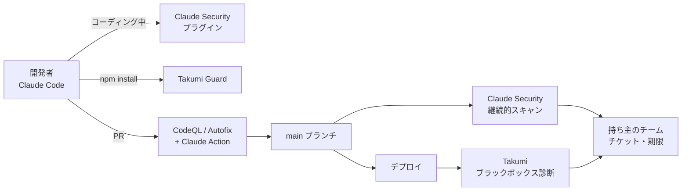

:::message
**最近のニュースから**

**Claude Mythos と Project Glasswing（2026 年 4〜5 月）**: Anthropic が限られた防御側に提供した Claude Mythos Preview によって、1 万件を超える重大な脆弱性が見つかりました。一方で、**修正が追いついていない** ことも報告されています。国内でも 3 メガバンクが限定利用を確保したと報じられ、専門家からは「脆弱性の嵐」に備えるべきだという提言が出ました。

AI によって脆弱性が見つかる速さは、桁違いに上がりました。攻撃者も同じ能力を手にすると考えれば、防御側に必要なのは **見つける速さと、直す速さの両方** です。この章では、少人数でもそれを実現する方法を扱います。

**攻撃者も AI でアプリを解析している（2026 年 10 月）**: JPCERT/CC は、国内で相次いだ不正アクセスについて、攻撃者が **AI を使って既知の脆弱性をスキャンし、公開されている Android アプリを解析して API を特定し、攻撃していた** ことを公表しました。海外でも 10 月は、AI エージェントが見つけた PHP などの重大な脆弱性が悪用され、「Black October」と呼ばれました。

攻撃者が AI で自社のアプリを解析するなら、防御側も **公開しているアプリと API を、攻撃者と同じ目線で先に診断する** 必要があります。
:::

AWS の設定（6〜8 章）と GitHub の設定（9 章）を固めても、**自社が書いたアプリケーションのコードの脆弱性** は残ります。従来、これを見つけるには外部の脆弱性診断会社に依頼するしかなく、1 回あたり数百万円・数週間かかるのが普通でした。専任チームのない会社では、年 1 回、主要なサービスだけ診断できればよいほうだったはずです。

2025〜2026 年に、この前提が大きく変わりました。**AI エージェントが、セキュリティ研究者のようにコードを読み、脆弱性を見つけ、再現手順と修正案まで出す** ようになったからです。この章では、Takumi byGMO と Claude Security を組み合わせて、少人数でも診断を回し続ける方法を扱います。

## 何が変わったのか

| 従来のツール（SAST / DAST） | AI エージェントによる診断 |
|---|---|
| 既知のパターンに一致するものを検出する | データの流れや、認可・業務ロジックの意図を理解して、パターンにない脆弱性も見つける |
| 誤検知が多く、人が一件ずつ確かめる | 再現手順や確信度を添えて報告し、AI 自身が検証（トリアージ）する |
| 修正は人が考える | 修正案（パッチや PR）まで出す |
| 年 1 回などの「点」の診断 | コードの変更に合わせた **継続的な診断** |

一方で、冒頭のコラムのとおり、**攻撃者も同じ AI を使える** 時代になりました。脆弱性が見つかってから悪用されるまでの時間は、今後さらに短くなると考えるべきです。

GMO Flatt Security が 2026 年 10 月に公開したホワイトペーパー「AI によるセキュリティ診断・ペネトレーションテストの現在地 v2026.10」も、防御側が AI の速度に合わせて環境と運用のプロセスを作り直す必要があると指摘しています。

## Takumi byGMO

GMO Flatt Security が提供する、国産のセキュリティ AI エージェントです。2025 年に提供が始まり、2026 年に機能が大きく広がりました。

| 機能 | 内容 |
|---|---|
| ホワイトボックス診断（SAST） | ソースコードを読んで脆弱性を見つけ、トリアージする |
| ブラックボックス診断（DAST） | 動いているアプリケーションに外から診断する |
| **自動修正**（2026 年 2 月） | 見つけた脆弱性の修正案を作る |
| **Guard**（2026 年 3 月） | npm レジストリと開発者の間に入り、ダウンロード時にパッケージが悪性かどうかを確かめ、悪性ならブロックする。コマンド 1 つで導入でき、既存のコードやワークフローを変えずに使える。2026 年 5 月には 1 日 2,000 万ダウンロードを超えた |
| **Takumi Images** | セキュリティリスクを最小化したコンテナイメージ |
| 国内推論オプション | データを国内で処理する選択肢。データの保管・取り扱いのルールで最先端のモデルを使いにくかった企業向け |

GMO Flatt Security は 2026 年 10 月に、AI を使った攻撃者視点のペネトレーションテスト「不正アクセス抜き打ちテスト byGMO」も始めています。

## Claude Security

Anthropic が提供する、Claude を使ったコードの脆弱性診断です。

| 時期 | できごと |
|---|---|
| 2025 年 8 月 | Claude Code に `/security-review` コマンドと、PR を診断する GitHub Action が登場 |
| 2026 年 2 月 | **Claude Code Security** として Enterprise / Team 向けに研究プレビュー |
| 2026 年 4 月末 | **Claude Security** として Enterprise 向けにパブリックベータ。各検出結果に確信度・重大度・影響・再現手順がつく |
| 2026 年 7 月 | Claude Code 用の **Claude Security プラグイン**（ベータ）を全 Claude Code ユーザーに提供。ターミナルの中で複数のエージェントが診断し、選んだ検出結果をパッチにする |
| 2026 年 10 月 | **継続的スキャン**（コードの変更に追従）、**修正の自動追跡**、**チームで編集できる脅威モデル**（何を検出対象にするかを決める）、API（チケット管理ツールとの連携、Webhook）を追加 |

:::message alert
Claude Security プラグインは、開発者の手元の Claude Code セッションの中で動き、そのセッションの権限でリポジトリを読みます。プラグインの説明には、プラグイン独自の隔離の仕組みは書かれていません。**自社で管理していないコード**（外部から受け取ったコードなど）を診断するときは、Claude Code のサンドボックス機能（Bash のコマンドのファイル・ネットワークへのアクセスを OS のレベルで制限する）やコンテナの中で実行してください（11 章）。
:::

## 2 つをどう分担するか

Takumi も Claude Security も「AI で脆弱性を見つけて直す」道具なので、役割が重なります。この本では、5 章の方針どおり **得意な持ち場で分けます**。

| 持ち場 | 主に使う道具 | 理由 |
|---|---|---|
| 開発者の手元（コーディング中） | **Claude Security プラグイン**、`/security-review` | 開発者がすでに Claude Code を使っているので、追加の手間なく使える |
| パッケージのインストール | **Takumi Guard** | 悪性パッケージの「ブロック」は Guard にしかできない役割 |
| PR ごと | CodeQL + Copilot Autofix（9 章）＋ Claude Code の GitHub Action | 定型のチェックは CodeQL、パターンにないものは Claude |
| リポジトリ全体の継続診断 | **Claude Security**（継続的スキャン、修正の自動追跡） | コードの変更に追従し、直ったかどうかまで追える |
| 動いているアプリへの診断 | **Takumi**（ブラックボックス診断） | 認証や設定を含めた、実際の挙動を外から確かめる |
| 公開しているモバイルアプリと API | **Takumi**（外からの診断）＋ **Claude Security**（API 側のコード） | 攻撃者は公開アプリを解析して内部 API を突いてくる。アプリが使う API も診断の対象に含める |
| 取引先・監査に出す報告 | **Takumi** の診断結果 | 日本語での報告や、国内の運用に合わせやすい |
| 設計段階のリスク洗い出し | **Claude Security** のチームで編集できる脅威モデル | Lv4 の脅威モデリングの土台にする |

### 補足: AWS Security Agent

AWS も、アプリケーションセキュリティのための AI エージェント **AWS Security Agent** を提供しています。設計のレビュー、コードのレビュー、ペネトレーションテストを扱い、**オンデマンドのペネトレーションテストは 2026 年 3 月に一般提供** になりました（東京を含む 6 リージョン、新規利用者には 2 か月の無料トライアルあり）。AWS 以外のクラウドやオンプレミスのアプリケーションも対象にできます。

この本の組み合わせでは、Takumi のブラックボックス診断と役割が重なるため、**大きなリリースの前に別の目でペネトレーションテストをしたいとき** の選択肢として位置づけます。

## 段階的な広げ方

| レベル | やること |
|---|---|
| Lv1〜Lv2 | **Takumi Guard** を全開発者と CI に入れる。開発者に Claude Code の `/security-review` や Claude Security プラグインを使ってもらう |
| Lv2 → Lv3 | 最も重要なプロダクト 1 つで **Claude Security の継続的スキャン** と **Takumi のブラックボックス診断** を回し、検出件数・誤検知の割合・修正までの時間を測る |
| Lv3 | 対象を全プロダクトに広げる。検出結果を持ち主のチームに自動で起票し、SLA で管理する |
| Lv4 | AI が見つけ・直し・人が承認する流れを定着させる。外部の診断会社には、AI が苦手な部分（複雑な業務ロジック、物理的・社会的な攻撃など）を依頼する |

### 効果を測る指標

| 指標 | 意味 |
|---|---|
| 検出件数（重大度別） | どれだけ見つけているか |
| 誤検知の割合 | 人の確認の手間がどれだけかかっているか |
| 検出から修正までの日数 | 直す速さ。最も大事な指標 |
| AI の修正案がそのまま採用された割合 | 自動化がどれだけ効いているか |
| 対象リポジトリ / アプリのカバー率 | 抜けがないか |

## AI 診断を使うときの注意

- **人が最終判断をする**: AI の報告にも誤りはあります。特に「重大」とされたものは、再現手順を人が確かめてから優先度を決めます。修正 PR も必ずレビューします。
- **診断は許可をとって行う**: ブラックボックス診断やペネトレーションテストは、対象のシステムと期間を明確にし、関係者（クラウド事業者の規約、委託先、運用チーム）に事前に伝えます。本番環境で破壊的なテストをしない設定を確かめます。
- **直す仕組みを先に作る**: AI は大量の脆弱性を見つけます。重大度別の対応期限（12 章）と持ち主への割り振りがないと、検出結果が積み上がるだけになります。
- **データの扱いを確かめる**: ソースコードがどこで処理され、学習に使われないかを契約で確認します。国内での処理が必要なら、Takumi の国内推論オプションなどを検討します。
- **診断結果は機密情報として扱う**: 未修正の脆弱性の一覧は、攻撃者にとって最も価値のある情報です。
