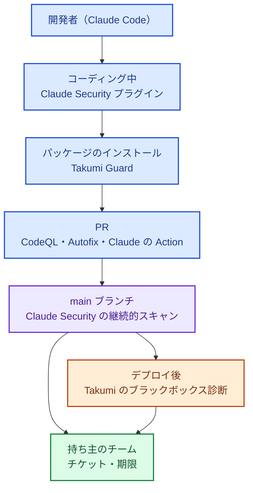

:::message
**最近のニュースから**

**Claude Mythos と Project Glasswing（2026 年 4〜5 月）**: 2 章で見たとおり、AI によって 1 万件を超える重大な脆弱性が見つかる一方で、修正が追いついていないことが報告されました。

AI によって脆弱性が見つかる速さは、桁違いに上がりました。攻撃者も同じ能力を手にすると考えれば、防御側は見つける速さと直す速さの両方を上げる必要があります。

**攻撃者も AI でアプリを解析している（2026 年 10 月）**: JPCERT/CC は、国内で相次いだ不正アクセスについて、攻撃者が AI を使って既知の脆弱性をスキャンし、公開されている Android アプリを解析して API を特定し、攻撃していたことを公表しました。海外でも 10 月は、AI を使った調査で見つかった PHP などの重大な脆弱性の公表と修正が相次ぎ、「Black October」と呼ばれました。

攻撃者が AI で自社のアプリを解析するなら、防御側も **公開しているアプリと API を、攻撃者と同じ目線で先に診断する** 必要があります。
:::

AWS の設定（8〜10 章）と GitHub の設定（11 章）を固めても、**自社が書いたアプリケーションのコードの脆弱性** は残ります。従来、これを見つけるには外部の脆弱性診断会社に依頼するのが一般的で、費用も期間もかかるため、専任チームのない会社では年 1 回、主要なサービスだけ診断するのがせいぜいでした。

2025〜2026 年に、この前提が大きく変わりました。**AI エージェントが、セキュリティ研究者のようにコードを読み、脆弱性を見つけ、再現手順と修正案まで出す** ようになったからです。この章では、Takumi byGMO と Claude Security の組み合わせを例に、少人数でも診断を回し続ける方法を扱います。

:::message
**AI 診断はいつ入れるか**: 有料の AI 診断は、見つかった脆弱性を期限つきで直す仕組み（5 章の SLA、持ち主への割り振り）ができてから広げるのがおすすめです。まだなら、無料で使える Takumi Guard と、開発者の手元での `/security-review` から始め、重要なプロダクト 1 つで試してから広げます（この章の「段階的な広げ方」）。
:::

## 何が変わったのか

| 従来のツール（SAST / DAST） | AI エージェントによる診断 |
|---|---|
| 既知のパターンに一致するものを検出する | データの流れや、認可・業務ロジックの意図を理解して、パターンにない脆弱性も見つける |
| 誤検知が多く、人が一件ずつ確かめる | 再現手順や確信度を添えて報告し、AI 自身が検証（トリアージ）する |
| 修正は人が考える | 修正案（パッチや PR）まで出す |
| 年 1 回などの「点」の診断 | コードの変更に合わせた継続的な診断|

一方で、冒頭のコラムのとおり、**攻撃者も同じ AI を使える** 時代になりました。脆弱性が見つかってから悪用されるまでの時間は、今後さらに短くなると考えるべきです。

GMO Flatt Security が 2026 年 10 月に公開したホワイトペーパー「AI によるセキュリティ診断・ペネトレーションテストの現在地 v2026.10」も、防御側が AI の速度に合わせて環境と運用のプロセスを作り直す必要があると指摘しています。

## Takumi byGMO

GMO Flatt Security が提供する、国産のセキュリティ AI エージェントです。2025 年に提供が始まり、2026 年に機能が大きく広がりました。

| 機能 | 内容 |
|---|---|
| ホワイトボックス診断（SAST） | ソースコードを読んで脆弱性を見つけ、トリアージする |
| ブラックボックス診断（DAST） | 動いているアプリケーションに外から診断する |
|自動修正（2026 年 2 月） | 見つけた脆弱性の修正パッチを作り、GitHub の PR にする |
|Guard（2026 年 3 月） | パッケージレジストリと開発者・CI の間に入り、ダウンロード時にパッケージが悪性かどうかを確かめ、悪性ならブロックする。npm、PyPI、RubyGems、Go、Packagist に対応。レジストリの設定を 1 行変えるだけで導入でき、ブロックの機能は無料で使える。検査するダウンロードは 2026 年 5 月に 1 日 2,000 万件、8 月には 5,000 万件を超えた |
|Takumi Images（2026 年 7 月） | 脆弱性のパッチ適用を支える、セキュリティリスクを最小化したコンテナイメージ |
| 国内推論オプション（2026 年 11 月 2 日に正式提供） | AI 脆弱性診断・自動修正・AI ペネトレーションテストの推論処理を国内で完結させる有償オプション。ソースコードや認証情報を含む入力データが国外に転送されない。データの保管・取り扱いのルールで最先端のモデルを使いにくかった企業向け |

同社が 2026 年 9 月に公開した「ソフトウェアサプライチェーン 脅威レポート 2026」によると、Guard が半年（2026 年 2〜8 月）で検出した悪性パッケージは約 3 万 1,000 件で、悪性パッケージが見つからない日は 1 日もありませんでした。悪性バージョンの公開から約 2 分でブロックした事例も紹介されています。

GMO Flatt Security は 2026 年 10 月に、AI を使った攻撃者視点のペネトレーションテスト「不正アクセス抜き打ちテスト byGMO」も始めています。

## Claude Security

Anthropic が提供する、Claude を使ったコードの脆弱性診断です。

| 時期 | できごと |
|---|---|
| 2025 年 8 月 | Claude Code に `/security-review` コマンドと、PR を診断する GitHub Action が登場 |
| 2026 年 2 月 |Claude Code Security として Enterprise / Team 向けに研究プレビュー |
| 2026 年 4 月末 |Claude Security として Enterprise 向けにパブリックベータ。各検出結果に確信度・重大度・影響・再現手順がつく |
| 2026 年 7 月 | Claude Code 用の Claude Security プラグイン（ベータ）を全 Claude Code ユーザーに提供。ターミナルの中で複数のエージェントが診断し、選んだ検出結果をパッチにする |
| 2026 年 10 月 |継続的スキャン（コードの変更に追従）、修正の自動追跡、チームで編集できる脅威モデル（何を検出対象にするかを決める）、API（チケット管理ツールとの連携、Webhook）を追加 |

:::message alert
Claude Security プラグインは、開発者の手元の Claude Code セッションの中で動き、そのセッションの権限でリポジトリを読みます。プラグインの説明には、プラグイン独自の隔離の仕組みは書かれていません。**自社で管理していないコード**（外部から受け取ったコードなど）を診断するときは、Claude Code のサンドボックス機能（Bash のコマンドのファイル・ネットワークへのアクセスを OS のレベルで制限する）やコンテナの中で実行してください（13 章）。
:::

## 2 つをどう分担するか

Takumi も Claude Security も「AI で脆弱性を見つけて直す」道具なので、役割が重なります。この本では、6 章の方針どおり **得意な持ち場で分けます**。

| 持ち場 | 主に使う道具 | 理由 |
|---|---|---|
| 開発者の手元（コーディング中） |Claude Security プラグイン、`/security-review` | 開発者が Claude Code を使っていれば、追加の手間なく使える |
| パッケージのインストール |Takumi Guard| 悪性パッケージの「ブロック」は Guard にしかできない役割 |
| PR ごと | CodeQL + Copilot Autofix（11 章）＋ Claude Code の GitHub Action | 定型のチェックは CodeQL、パターンにないものは Claude |
| リポジトリ全体の継続診断 |Claude Security（継続的スキャン、修正の自動追跡） | コードの変更に追従し、直ったかどうかまで追える |
| 動いているアプリへの診断 |Takumi（ブラックボックス診断） | 認証や設定を含めた、実際の挙動を外から確かめる |
| 公開しているモバイルアプリと API |Takumi（外からの診断）＋ Claude Security（API 側のコード） | 攻撃者は公開アプリを解析して内部 API を突いてくる。アプリが使う API も診断の対象に含める |
| 取引先・監査に出す報告 |Takumi の診断結果 | 日本語での報告や、国内の運用に合わせやすい |
| 設計段階のリスク洗い出し |Claude Security のチームで編集できる脅威モデル | Lv4 の脅威モデリングの土台にする |

色の意味: 青＝開発の流れ、紫＝継続的なスキャン、オレンジ＝動いている環境への診断、緑＝持ち主のチーム。

### 補足: AWS Security Agent（AWS Continuum）

AWS も、アプリケーションセキュリティのための AI エージェント **AWS Security Agent** を提供しています。設計のレビュー、コードのレビュー、脅威モデリング、ペネトレーションテストを扱い、オンデマンドのペネトレーションテストは 2026 年 3 月に一般提供になりました（東京を含む 6 リージョンで開始。料金はタスク時間あたりの従量課金で、新規利用者には 2 か月の無料トライアルあり）。AWS 以外のクラウド、オンプレミス、SaaS の環境も対象にできます。

2026 年の夏からは、AWS Security Agent は **AWS Continuum** という製品群の一部になり、ペネトレーションテストは「AWS Continuum for Penetration Testing」と呼ばれています。10 月には、CI/CD パイプラインに組み込んでデプロイのたびにペネトレーションテストを行う機能がパブリックプレビューになりました。名前と提供範囲が短い期間で変わっているので、使うときは公式ドキュメントで最新の状態を確かめてください。

この本の組み合わせでは、Takumi のブラックボックス診断と役割が重なるため、**大きなリリースの前に別の目でペネトレーションテストをしたいとき** の選択肢として位置づけます。

## 診断の前に: 公開しているアプリと API の基本の守り

2 章の 2026 年 10 月の事例では、会員情報を取得する API が不正に使われ、公開アプリの解析で見つかった API や内部 API が突かれました。診断で見つけるのは大事ですが、作るときに次の基本を押さえておけば、見つかる問題そのものが減ります。OWASP の「[API Security Top 10 2023](https://owasp.org/API-Security/editions/2023/en/0x11-t10/)」が、API に特有のリスクの一覧として参考になります。

**API の守り**

| やること | ポイント |
|---|---|
| データごとに認可を確かめる | ログインしているかだけでなく、「この利用者が、この ID のデータを見てよいか」を API ごとに確かめる。URL やリクエストの ID を書き換えるだけで他人のデータが取れる問題は、OWASP API Security Top 10 の 1 位（API1:2023 Broken Object Level Authorization）に挙げられている |
| ID が推測できる前提で作る | 連番の ID は順に試されれば取られる。推測しにくい ID にするのはよいが、それだけに頼らず、必ず認可で守る |
| 返すデータを絞る | 画面に出さない項目（パスワードのハッシュ、内部のフラグなど）を API が返していないか確かめる。アプリ側で隠しても、API の応答は見られる |
| 回数を制限する | 利用者ごと・IP ごとのレート制限と、1 回で取れる件数の上限を設ける（[AWS WAF のレートベースのルール](https://docs.aws.amazon.com/waf/latest/developerguide/waf-rule-statement-type-rate-based.html)、[API Gateway のスロットリング](https://docs.aws.amazon.com/apigateway/latest/developerguide/api-gateway-request-throttling.html)など） |
| 内部 API を外に出さない | 管理用や社内向けの API、BI ツールを、インターネットから届く場所に置かない。置くなら接続元を絞り、認証をかける |
| アプリに秘密を入れない | モバイルアプリや Web のフロントエンドに埋め込んだ API キーは、解析すれば誰でも読める。秘密を持たせない設計にする |
| 記録を残す | 誰が、どの API で、どのデータを取ったかを記録し、大量取得に気づけるようにする（15 章） |

**利用者アカウントの守り**

自社サービスの利用者のアカウントは、他のサービスから漏れた ID とパスワードを順に試す **パスワードリスト攻撃** で狙われます。

- ログインの試行回数を制限し、同じ IP や同じアカウントへの大量の試行を検知する
- 利用者に MFA やパスキーを提供する（管理者や、決済・個人情報を扱う操作では必須にする）
- 新しい端末や場所からのログイン、メールアドレスやパスワードの変更を、利用者に通知する
- 本人確認書類のような影響の大きいデータは、保管期間を決めて消す（8 章）

## 段階的な広げ方

| レベル | やること |
|---|---|
| Lv1〜Lv2 |Takumi Guard を全開発者と CI に入れる。開発者に Claude Code の `/security-review` や Claude Security プラグインを使ってもらう |
| Lv2 → Lv3 | 最も重要なプロダクト 1 つで Claude Security の継続的スキャンと Takumi のブラックボックス診断を回し、検出件数・誤検知の割合・修正までの時間を測る |
| Lv3 | 対象を全プロダクトに広げる。検出結果を持ち主のチームに自動で起票し、SLA で管理する |
| Lv4 | AI が見つけ・直し・人が承認する流れを定着させる。外部の診断会社には、AI が苦手な部分（複雑な業務ロジック、物理的・社会的な攻撃など）を依頼する（診断会社は、IPA の情報セキュリティサービス基準適合サービスリストも参考になる） |

### 効果を測る指標

| 指標 | 意味 |
|---|---|
| 検出件数（重大度別） | どれだけ見つけているか |
| 誤検知の割合 | 人の確認の手間がどれだけかかっているか |
| 検出から修正までの日数 | 直す速さ。最も重視する指標 |
| AI の修正案がそのまま採用された割合 | 自動化がどれだけ効いているか |
| 対象リポジトリ / アプリのカバー率 | 抜けがないか |

## AI 診断を使うときの注意

- **人が最終判断をする**: AI の報告にも誤りはあります。特に「重大」とされたものは、再現手順を人が確かめてから優先度を決めます。修正 PR も必ずレビューします。
- **診断は許可をとって行う**: ブラックボックス診断やペネトレーションテストは、対象のシステムと期間を明確にし、関係者（クラウド事業者の規約、委託先、運用チーム）に事前に伝えます。本番環境で破壊的なテストをしない設定を確かめます。
- **直す仕組みを先に作る**: AI は大量の脆弱性を見つけます。重大度別の対応期限（5 章）と持ち主への割り振りがないと、検出結果が積み上がるだけになります。
- **データの扱いを確かめる**: ソースコードがどこで処理され、学習に使われないかを契約で確認します。国内での処理が必要なら、Takumi の国内推論オプションなどを検討します。
- **診断結果は機密情報として扱う**: 未修正の脆弱性の一覧は、攻撃者にとって最も価値のある情報です。
