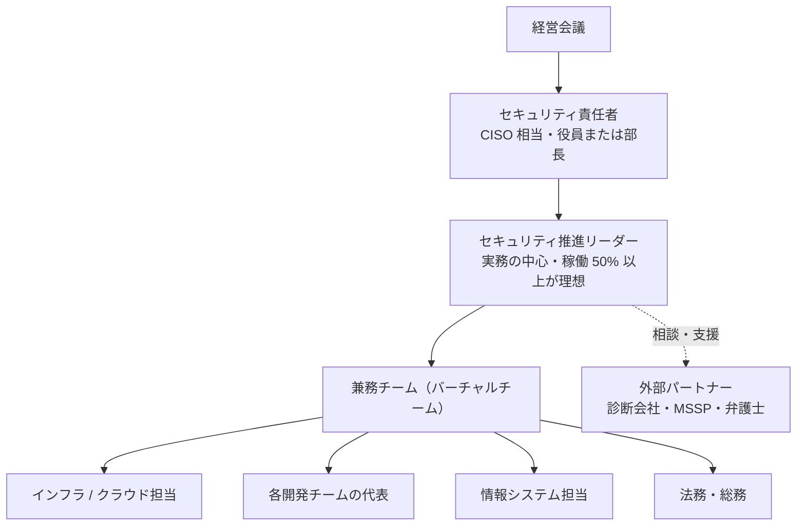

:::message
**最近のニュースから**

**能動的サイバー防御（2026 年 10 月）**: 関連法の中核部分が施行され、基幹インフラ事業者にはインシデントの報告が義務づけられました。

**ブラストメールの停止（2026 年 10 月）**: メール配信 SaaS が不正アクセスを受けて止まり、利用していた団体のメールマガジンも止まりました。**使っている SaaS が止まったときの代わりの手段** も、自社の事業継続の一部です。

報告義務への備えも、止まった SaaS の代わりの手段も、ツールではなく **体制とルール** の話です。この章では、それを専任チームなしで用意する方法を扱います。
:::

ツールをいくら入れても、**誰が責任を持ち、誰が見て、誰が直すか** が決まっていなければ、セキュリティは良くなりません。この章では、専任チームのない会社が現実的に作れる体制とルールを整理します。

## 体制: 専任チームなしで始める形

### 最初の形（Lv1〜Lv2）

| 役割 | 担うこと |
|---|---|
| **セキュリティ責任者**（CISO 相当） | 方針と予算を決め、経営に報告し、リスクの受容を判断する。経営ガイドラインの「経営者が指示する相手」 |
| **推進リーダー** | ロードマップを作り、チェックシートで現在地を測り、兼務チームを動かす。**この本の読者** |
| **兼務チーム** | 各領域の対策の実行と、検知結果の一次対応 |
| **外部パートナー** | 脆弱性診断、24 時間の監視（MSSP / MDR、AWS 部分は AWS Security Incident Response も選択肢）、インシデント時の調査、法的な助言 |

### 決めておくべきこと

- **稼働の確保**: 兼務者の稼働を「空いた時間で」にすると、必ず後回しになります。「毎週火曜の午後はセキュリティの時間」のように、時間で確保して経営の承認をとります。
- **週次のレビュー**: 30 分でよいので、Security Hub / Wiz / GitHub の新しい重大な検知結果を見る場を毎週持ちます。
- **意思決定のルール**: 「Critical の脆弱性が見つかったら、誰の判断でリリースを止められるか」を決めておきます。

### 最終形（Lv4）

数百名規模の会社では、次のような形が現実的な最終形です。

- 専任のセキュリティ担当が **2〜4 名**（クラウド / プロダクト / コーポレート IT の各領域）
- 各開発チームに **セキュリティチャンピオン**（兼務）がいて、チーム内の一次対応を担う
- 検知のトリアージや修正案の作成は **AI エージェント** が担い、人は判断・例外対応・改善に集中する
- 24 時間の監視や高度な調査は **外部パートナー** に任せる

専任者が数十人いる大企業のような組織を目指す必要はありません。

## ルール（規程）

一から書かず、IPA の「中小企業の情報セキュリティ対策ガイドライン」付録の規程サンプルを自社向けに直すのが早道です。

| 文書 | 内容 | 目標レベル |
|---|---|---|
| 情報セキュリティ基本方針 | 会社としての方針。経営が承認する（1 ページ） | Lv2 |
| AI 利用ガイドライン | 11 章のひな型 | Lv1〜Lv2 |
| アクセス管理規程 | アカウントの発行・削除、権限、MFA | Lv2 |
| インシデント対応手順 | 13 章 | Lv2 |
| クラウド利用規程 | AWS の標準構成、SaaS の導入手順 | Lv2 |
| 委託先管理規程 | 委託先・SaaS の評価と契約 | Lv3 |
| 脆弱性管理規程 | 重大度別の対応期限（SLA）と例外の扱い | Lv3 |

:::message
**規程は短く、守れるものだけを書く**: 守れない規程は、監査や事故のときに「規程があったのに守っていなかった」という不利な証拠になります。最初は短く書き、運用しながら育てます。
:::

## 脆弱性管理の SLA

Lv3 では、見つかった脆弱性や設定ミスに **重大度別の対応期限** を決めます。例です。

| 重大度 | 例 | 対応期限 |
|---|---|---|
| Critical | インターネットから悪用できる、既に悪用が確認されている（CISA KEV に載っているなど） | 72 時間以内（緩和策を含む） |
| High | 認証後に悪用できる重大な脆弱性、機密データにつながる設定ミス | 14 日以内 |
| Medium | 条件つきで悪用できるもの | 60 日以内 |
| Low | 影響が小さいもの | 次の定期対応 / 受容を検討 |

期限内に直せないものは、**例外申請**（理由、緩和策、期限、承認者）として記録します。これが 16 章の「受容の記録」です。

## 委託先・SaaS の管理

自社がサプライチェーンの一部として評価される（SCS 評価制度）のと同じく、自社も委託先や SaaS を評価する必要があります。

- **導入時**: 取り扱うデータの重要度に応じて、確認の深さを変える。重要なデータを預けるなら、第三者認証（ISMS、SOC 2 など）、SCS 評価制度の★、セキュリティチェックシートで確認する
- **契約**: 事故時の報告義務、データの返却・削除、再委託の制限を入れる
- **定期**: 年 1 回、重要な委託先と SaaS を見直す。使っていない SaaS は解約し、アカウントを削除する

## 教育

- **全社員**: 年 1 回の教育（フィッシング、AI 利用ルール、事故時の報告）と、標的型メール訓練
- **開発者**: セキュアコーディングと、AI コーディングエージェントの安全な使い方
- **経営層**: 年 1 回、10 大脅威と自社の現在地の報告をかねた勉強会

## 経営への報告

四半期ごとに、次の 1 枚で報告します。

| 項目 | 内容 |
|---|---|
| 現在地 | 4 章のチェックシートの領域別レベル（前回比） |
| 主な成果 | 今期上げたレベルと、その中身 |
| 指標 | 重大な検知結果の件数と推移、SLA 達成率、SATv2 / Security Hub の推移 |
| インシデント | 発生件数と概要 |
| 次の四半期 | 次の一手（上げるレベルと、やること） |
| 経営に決めてほしいこと | 予算、人員、リスクの受容 |
