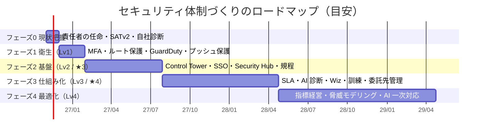
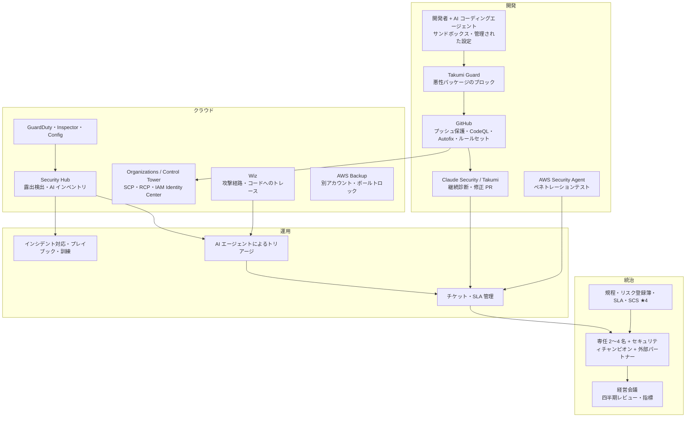

この章では、ここまでの章をまとめて、**Lv0 から Lv4（最終形）までのロードマップ** を描きます。期間は、兼務チームで進める場合の目安です。

## 全体の流れ

| フェーズ | 期間の目安 | ゴール | 外への説明 |
|---|---|---|---|
| 0. 現状把握 | 1 か月 | 現在地が分かり、経営が責任者を任命した | 「現状を把握し、計画を立てた」 |
| 1. 衛生 | 2 か月 | 全領域が Lv1 | 「致命的な穴はふさいだ」 |
| 2. 基盤 | 6 か月 | 全領域が Lv2 | 「SCS ★3 相当の対策ができている」 |
| 3. 仕組み化 | 9 か月 | 全領域が Lv3 | 「SCS ★4 相当。第三者評価に耐えられる」 |
| 4. 最適化 | 12 か月〜（継続） | Lv4 | 「セキュリティを継続的に改善し、開示している」 |

## フェーズ 0: 現状把握（1 か月）

| やること | 章 |
|---|---|
| セキュリティ責任者と推進リーダーを経営に任命してもらう | 12 |
| AWS アカウント・GitHub 組織・主要 SaaS の一覧を作る | 6 |
| **SATv2** で全 AWS アカウントを診断する | 7 |
| IPA の「5 分でできる！自社診断」と、5 章のチェックシートで現在地を測る | 3・5 |
| インシデント時の連絡先（社内・外部）を決める | 12 |
| 結果と、フェーズ 1〜2 の計画を経営に報告する | 12 |

**成果物**: 現在地チェックシート、SATv2 の結果サマリー、ロードマップ、経営への報告資料

## フェーズ 1: 衛生 ― Lv1（2 か月）

| 領域 | やること | 章 |
|---|---|---|
| ID | 全サービスで MFA 必須、ルートユーザーの保護、退職者アカウントの点検 | 6 |
| AWS | CloudTrail・GuardDuty を全アカウント・全リージョンで有効化、S3 パブリックアクセスブロック、連絡先の登録 | 6 |
| 検知 | GuardDuty の重大度「高」をチャットに通知 | 6 |
| 開発 | GitHub の 2 段階認証必須、シークレットスキャンとプッシュ保護、Dependabot | 9 |
| AI | 使ってよい AI サービスと、入力してはいけない情報を決めて周知 | 11 |
| 組織 | SATv2 の Critical / High のうち、インターネットから到達できるものを直す | 7 |

**費用の目安**: ほぼ AWS と GitHub の標準機能の範囲。GuardDuty などの従量課金が中心

## フェーズ 2: 基盤 ― Lv2 / ★3（6 か月）

| 領域 | やること | 章 |
|---|---|---|
| 組織 | 兼務チームと稼働の確保、基本方針・主要規程の制定、リスク登録簿 | 12 |
| ID | IdP への集約と SSO、IAM Identity Center、IAM ユーザーの廃止 | 6 |
| AWS | Organizations / Control Tower、ログアーカイブ・監査アカウント、SCP、Config、AWS Backup | 6 |
| 検知 | Security Hub と Inspector を全アカウントに展開し、**週次レビュー** を始める | 6 |
| 開発 | ルールセット、Actions の OIDC 化、**Takumi Guard** によるパッケージの保護、開発者による Claude Code の `/security-review` / Claude Security プラグインの利用 | 9・10 |
| AI | AI 利用ガイドラインの文書化、AI コーディングエージェントの標準設定 | 11 |
| 対応 | インシデント対応の基本手順、バックアップからの復旧テスト | 12 |
| 外部 | **SCS 評価制度 ★3 の要求事項で自己評価** し、ギャップを埋める | 3 |

**費用の目安**: Security Hub / Inspector などの従量課金、GitHub Secret Protection、Takumi（Guard）などの SaaS

## フェーズ 3: 仕組み化 ― Lv3 / ★4（9 か月）

| 領域 | やること | 章 |
|---|---|---|
| 組織 | 脆弱性管理の SLA、委託先管理、全社教育と標的型メール訓練 | 12 |
| ID | 権限の棚卸し、未使用権限の削減、管理者のパスキー化、一時的な権限付与 | 6 |
| AWS | IaC スキャン、自動修復、バックアップのボールトロック | 6 |
| 検知 | 文脈による優先順位づけ（必要なら **Wiz** を PoC → 導入）、チケットの自動起票 | 8 |
| 開発 | CodeQL + Copilot Autofix、**Claude Security / Takumi による継続診断**、**AWS Security Agent** によるリリース前のペネトレーションテスト | 9・10 |
| AI | AI エージェントのサンドボックス化、AI 機能のリスク評価、Security Hub の AI インベントリ | 11 |
| 対応 | シナリオ別プレイブック、年 1 回の机上訓練 | 12 |
| 外部 | **SCS 評価制度 ★4 のギャップ分析** と、第三者評価の準備 | 3 |

**費用の目安**: このフェーズでツール費用が大きく増えます（Wiz、AI 診断、GitHub Code Security）。フェーズ 2 で作った「週次レビューで処理する筋肉」と SLA があることを確かめてから契約します。

## フェーズ 4: 最適化 ― Lv4 / 最終形（12 か月〜）

- セキュリティ指標のダッシュボードと、経営による定期レビュー
- 新しいプロダクトや機能の設計段階での脅威モデリング（Claude Security のプロジェクトごとの脅威モデル、AWS Security Agent の設計レビューなども活用）
- AI エージェントによる一次対応（トリアージ、修正 PR）を全プロダクトに広げる
- 定期的な外部ペネトレーションテスト・レッドチーム演習、AI 機能のレッドチーミング
- トラストセンター（セキュリティの取り組みを公開するページ）の公開
- 専任者の配置（2〜4 名規模）とセキュリティチャンピオン制度

## 最終形の全体像

最終形のポイントは次の 3 つです。

1. **見つける → 直す → 確かめる** が、人の手をなるべく介さずに回っている
2. **人は判断と改善に集中** している（何を受容するか、どこに投資するか、新しいリスクにどう備えるか）
3. **外に説明できる**（SCS 評価制度の★、トラストセンター、経営への定期報告）

## ツールの導入順のまとめ

| ツール | 入れるタイミング | 主な目的 |
|---|---|---|
| SATv2 | フェーズ 0 | 現状把握（以後、四半期ごとの定期点検） |
| GuardDuty / CloudTrail | フェーズ 1 | 最低限の検知と記録 |
| GitHub シークレットスキャン・プッシュ保護・Dependabot | フェーズ 1 | シークレット漏えいと既知の脆弱性 |
| Control Tower / IAM Identity Center / Security Hub / Inspector | フェーズ 2 | 基盤と検知の集約 |
| Takumi Guard | フェーズ 2 | パッケージのサプライチェーン対策 |
| Claude Code `/security-review`・Claude Security プラグイン | フェーズ 2 | 開発者の手元での診断 |
| GitHub Code Security（CodeQL・Autofix） | フェーズ 2〜3 | PR ごとの静的解析と修正 |
| Claude Security（継続スキャン）/ Takumi（診断） | フェーズ 3 | AI による継続的なアプリ診断 |
| AWS Security Agent | フェーズ 3 | ペネトレーションテスト |
| Wiz | フェーズ 3（必要なら） | 攻撃経路による優先順位づけ、マルチクラウド |

## 計画を見直すタイミング

- **四半期ごと**: 5 章のチェックシートで測り直し、次の四半期の「次の一手」を決める
- **大きなできごとがあったとき**: インシデント、新しいプロダクトの立ち上げ、買収・統合、取引先からの新しい要求（SCS 評価制度の★の要求など）
- **年 1 回**: IPA の 10 大脅威の新しい版が出たら（毎年 1〜2 月）、優先順位を見直す。この本の内容も更新する
