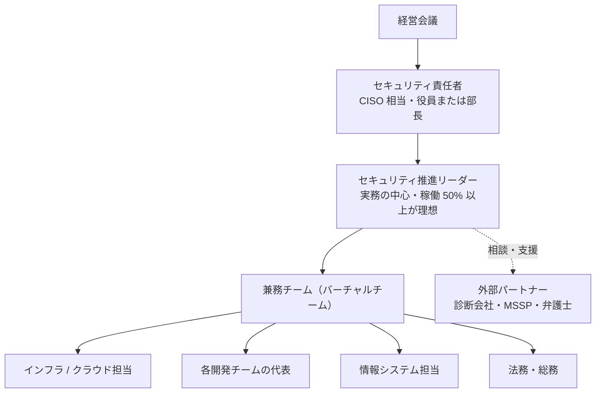
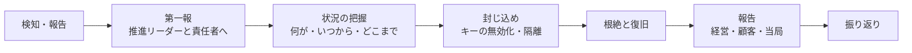

:::message
**最近のニュースから**

**アサヒとアスクルの対応（2025 年）**: アサヒグループは、システムが止まった後も **紙やファクスで受注を続け**、事業を止めない道を選びました。アスクルは、攻撃の手口や初動対応を **時系列でまとめた報告書を公表** し、多要素認証の全面適用、全サーバーへの EDR 導入と 24 時間監視、バックアップの強化などの再発防止策を示しました。

**能動的サイバー防御（2026 年 10 月）**: 関連法の中核部分が施行され、基幹インフラ事業者にはインシデントの報告が義務づけられました。

どちらも、ツールではなく **体制と手順** の話です。止まったときに何で代替し、誰が判断し、誰に何を報告するか。この章では、それを専任チームなしで用意する方法を扱います。

**GMO インターネットの事案（2026 年 10 月）**: 「お名前.com デスクトップクラウド」への不正アクセスでは、攻撃者を名乗る者が SNS などで犯行声明を出し、身代金を要求し、個人情報の公開を予告しました。真偽の分からない情報が拡散するなかで、企業がどう発信するかが問われました。同社は要求に応じないことを表明し、経営トップが謝罪しています。

**ブラストメールの停止（2026 年 10 月）**: メール配信 SaaS が不正アクセスを受けて止まり、利用していた団体のメールマガジンも止まりました。**使っている SaaS が止まったときの代わりの手段** も、自社の事業継続の一部です。
:::

ツールをいくら入れても、**誰が責任を持ち、誰が見て、誰が直すか** が決まっていなければ、セキュリティは良くなりません。この章では、専任チームのない会社が現実的に作れる体制とルールを整理します。

## 体制: 専任チームなしで始める形

### 最初の形（Lv1〜Lv2）

| 役割 | 担うこと |
|---|---|
| **セキュリティ責任者**（CISO 相当） | 方針と予算を決め、経営に報告し、リスクの受容を判断する。経営ガイドラインの「経営者が指示する相手」 |
| **推進リーダー** | ロードマップを作り、チェックシートで現在地を測り、兼務チームを動かす。**この本の読者** |
| **兼務チーム** | 各領域の対策の実行と、検知結果の一次対応 |
| **外部パートナー** | 脆弱性診断、24 時間の監視（MSSP / MDR）、インシデント時の調査、法的な助言 |

### 決めておくべきこと

- **稼働の確保**: 兼務者の稼働を「空いた時間で」にすると、必ず後回しになります。「毎週火曜の午後はセキュリティの時間」のように、時間で確保して経営の承認をとります。
- **週次のレビュー**: 30 分でよいので、Security Hub / Wiz / GitHub の新しい重大な検知結果を見る場を毎週持ちます。
- **意思決定のルール**: 「Critical の脆弱性が見つかったら、誰の判断でリリースを止められるか」を決めておきます。

### 最終形（Lv4）

数百名規模の会社では、次のような形が現実的な最終形です。

- 専任のセキュリティ担当が **2〜4 名**（クラウド / プロダクト / コーポレート IT の各領域）
- 各開発チームに **セキュリティチャンピオン**（兼務）がいて、チーム内の一次対応を担う
- 検知のトリアージや修正案の作成は **AI エージェント** が担い、人は判断・例外対応・改善に集中する
- 24 時間の監視や高度な調査は **外部パートナー** に任せる

専任者が数十人いる大企業のような組織を目指す必要はありません。

## ルール（規程）

一から書かず、IPA の「中小企業の情報セキュリティ対策ガイドライン」付録の規程サンプルを自社向けに直すのが早道です。

| 文書 | 内容 | 目標レベル |
|---|---|---|
| 情報セキュリティ基本方針 | 会社としての方針。経営が承認する（1 ページ） | Lv2 |
| AI 利用ガイドライン | 13 章のひな型 | Lv1〜Lv2 |
| アクセス管理規程 | アカウントの発行・削除、権限、MFA | Lv2 |
| インシデント対応手順 | 下記 | Lv2 |
| クラウド利用規程 | AWS の標準構成、SaaS の導入手順 | Lv2 |
| 委託先管理規程 | 委託先・SaaS の評価と契約 | Lv3 |
| 脆弱性管理規程 | 重大度別の対応期限（SLA）と例外の扱い | Lv3 |

:::message
**規程は短く、守れるものだけを書く**: 守れない規程は、監査や事故のときに「規程があったのに守っていなかった」という不利な証拠になります。最初は短く書き、運用しながら育てます。
:::

## 脆弱性管理の SLA

Lv3 では、見つかった脆弱性や設定ミスに **重大度別の対応期限** を決めます。例です。

| 重大度 | 例 | 対応期限 |
|---|---|---|
| Critical | インターネットから悪用できる、既に悪用が確認されている（CISA KEV に載っているなど） | 72 時間以内（緩和策を含む） |
| High | 認証後に悪用できる重大な脆弱性、機密データにつながる設定ミス | 14 日以内 |
| Medium | 条件つきで悪用できるもの | 60 日以内 |
| Low | 影響が小さいもの | 次の定期対応 / 受容を検討 |

期限内に直せないものは、**例外申請**（理由、緩和策、期限、承認者）として記録します。これが 3 章の「受容の記録」です。

## インシデント対応

### 最低限の初動手順（Lv1〜Lv2）

1. **第一報は早く、不完全でよい**: 「おかしい」と思ったら、確証がなくても 15 分以内に推進リーダーに連絡する。報告した人を責めない
2. **証拠を壊さない**: 慌ててインスタンスを削除しない。スナップショットを取り、ネットワークから隔離する
3. **認証情報を止める**: 漏えいが疑われるキー・トークン・パスワードを無効化する
4. **記録をとる**: 時刻と、誰が何をしたかを、チャットのスレッドなどに残す
5. **外部に相談する**: 自社だけで判断できないときは、契約している専門会社、IPA、JPCERT/CC に相談する
6. **発信の窓口を一本にする**: 攻撃者が SNS などで犯行声明や真偽不明の情報を流すことがあります。社外への発信は広報と責任者に一本化し、確認できた事実だけを、定期的に更新して出します。身代金の要求には、経営として応じない方針を平時に決めておきます
7. **報告義務を確認する**: 個人情報の漏えい（またはそのおそれ）がある場合、個人情報保護委員会への報告と本人への通知が必要になることがあります。取引先との契約上の報告義務も確認します

### 用意しておくプレイブック（Lv3）

| シナリオ | 初動の要点 |
|---|---|
| AWS の認証情報の漏えい | キーの無効化、CloudTrail で不正な操作の確認、作られたリソースの削除、請求の確認 |
| AWS アカウントの乗っ取り | ルートの保護、SCP による封じ込め、AWS サポートへの連絡 |
| ランサムウェア | ネットワークからの切り離し、バックアップの無事の確認、復旧の判断、警察・専門会社への相談 |
| GitHub のシークレット漏えい | キーの無効化、利用ログの確認、履歴からの削除 |
| 悪性パッケージの混入 | 影響したビルドと環境の特定、CI と開発者 PC の認証情報のローテーション |
| AI エージェントの暴走・乗っ取り | エージェントの停止、エージェントの認証情報の無効化、実行ログの確認 |
| 使っている SaaS の停止・侵害 | 代替手段への切り替え、SaaS に預けていたデータの影響確認、顧客への連絡 |
| 攻撃者による脅迫・情報公開の予告 | 発信窓口の一本化、警察・専門家への相談、公開された情報の真偽確認 |
| 社員アカウントの乗っ取り（フィッシング） | セッションの無効化、パスワードと MFA の再設定、メール転送ルールの確認 |

### 訓練

年 1 回、上のシナリオから 1 つ選んで **机上訓練**（シナリオを読み上げ、各自が何をするかを話し合う）を行います。1〜2 時間でできて、手順の穴（連絡先が古い、権限がなくて操作できない、など）がよく見つかります。

## 委託先・SaaS の管理

自社がサプライチェーンの一部として評価される（SCS 評価制度）のと同じく、自社も委託先や SaaS を評価する必要があります。

- **導入時**: 取り扱うデータの重要度に応じて、確認の深さを変える。重要なデータを預けるなら、第三者認証（ISMS、SOC 2 など）、SCS 評価制度の★、セキュリティチェックシートで確認する
- **契約**: 事故時の報告義務、データの返却・削除、再委託の制限を入れる
- **定期**: 年 1 回、重要な委託先と SaaS を見直す。使っていない SaaS は解約し、アカウントを削除する

## 教育

- **全社員**: 年 1 回の教育（フィッシング、AI 利用ルール、事故時の報告）と、標的型メール訓練
- **開発者**: セキュアコーディングと、AI コーディングエージェントの安全な使い方
- **経営層**: 年 1 回、10 大脅威と自社の現在地の報告をかねた勉強会

## 経営への報告

四半期ごとに、次の 1 枚で報告します。

| 項目 | 内容 |
|---|---|
| 現在地 | 6 章のチェックシートの領域別レベル（前回比） |
| 主な成果 | 今期上げたレベルと、その中身 |
| 指標 | 重大な検知結果の件数と推移、SLA 達成率、SATv2 / Security Hub の推移 |
| インシデント | 発生件数と概要 |
| 次の四半期 | 次の一手（上げるレベルと、やること） |
| 経営に決めてほしいこと | 予算、人員、リスクの受容 |

## 一人目の担当者の最初の 90 日

最後に、一人目の担当者として任されたときの、最初の 90 日の動き方の例です。ツールがすでにある程度入っている会社を想定しています。

### 最初の 30 日: 知る

| やること | 成果物 |
|---|---|
| 経営（責任者）と話し、期待と予算の感覚をつかむ。「何が起きたら一番困るか」を聞く | 守るものの優先順位のメモ |
| AWS アカウント・GitHub 組織・主要 SaaS・導入済みのセキュリティツールの一覧を作る | 資産とツールの一覧 |
| SATv2 で AWS 全体を診断する（9 章） | 診断結果のサマリー |
| 6 章のチェックシートで現在地を測る。7 章の「ツールの棚卸し」の表を埋める | 現在地チェックシート |
| インシデント時の連絡先と相談先を決める | 連絡網（1 枚） |

この期間は、**直すことより知ること** を優先します。いきなり設定を変えると、業務を止めたり、関係者の反発を招いたりします。

### 31〜60 日: 決める

| やること | 成果物 |
|---|---|
| 現在地と、3 か月・1 年の計画を経営に報告し、責任者の任命と兼務者の稼働の確保を正式に決めてもらう | 経営報告の資料、任命 |
| 7 章の「重なりの整理」の表を作り、ツールごとの持ち場を決める | ツールの役割分担表 |
| 週次レビューの時間をカレンダーに固定し、始める | 週次レビューの議事メモ |
| AI 利用ガイドライン（13 章）の最小版を出す | AI 利用ガイドライン v0.1 |

### 61〜90 日: 直し始める

| やること | 成果物 |
|---|---|
| SATv2 と Wiz の Critical のうち、インターネットに露出しているものから直す | 改善の記録 |
| 全体のレベルを下げている一番弱い領域を、Lv1 に上げる | チェックシートの更新 |
| 基本方針と、インシデント対応の基本手順を作る | 基本方針、手順書 |
| 90 日の振り返りを経営に報告し、次の四半期の「次の一手」を決める | 四半期報告 |

:::message
**最初の 90 日で一番大事なのは、味方を作ることです。** セキュリティは、一人目の担当者だけでは良くなりません。各開発チームのリーダー、インフラ担当、情報システム担当、法務と早めに話し、「困っていること」を聞きます。セキュリティの改善が、彼らの困りごと（取引先のチェックシートへの回答、監査対応、障害対応など）の解決にもつながることを示せると、協力を得やすくなります。
:::
