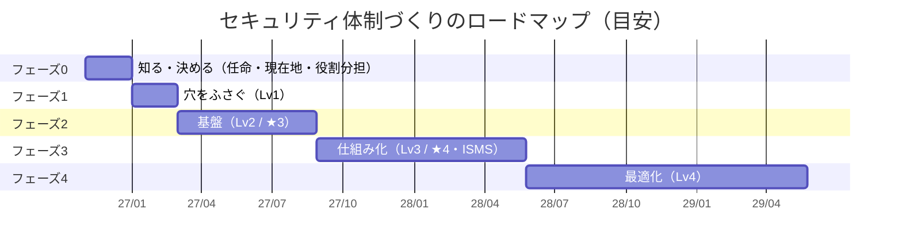
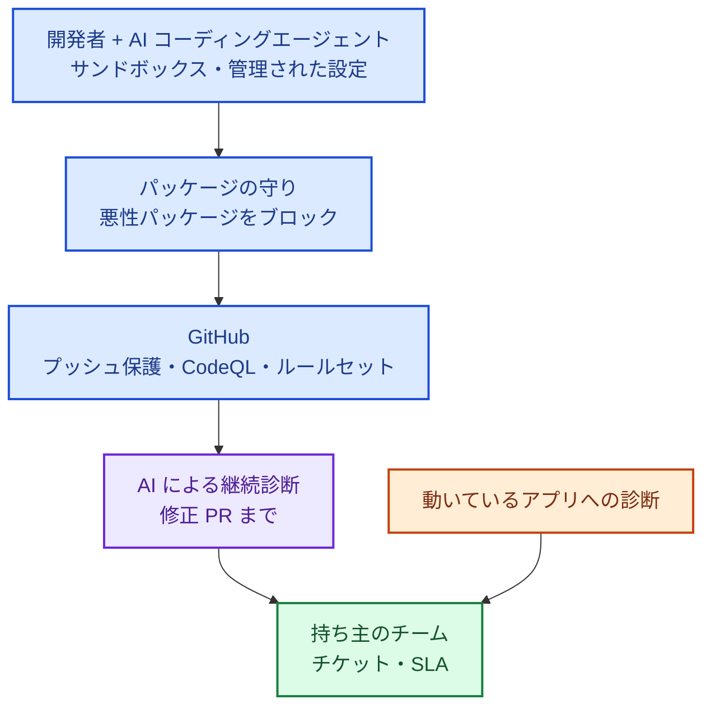
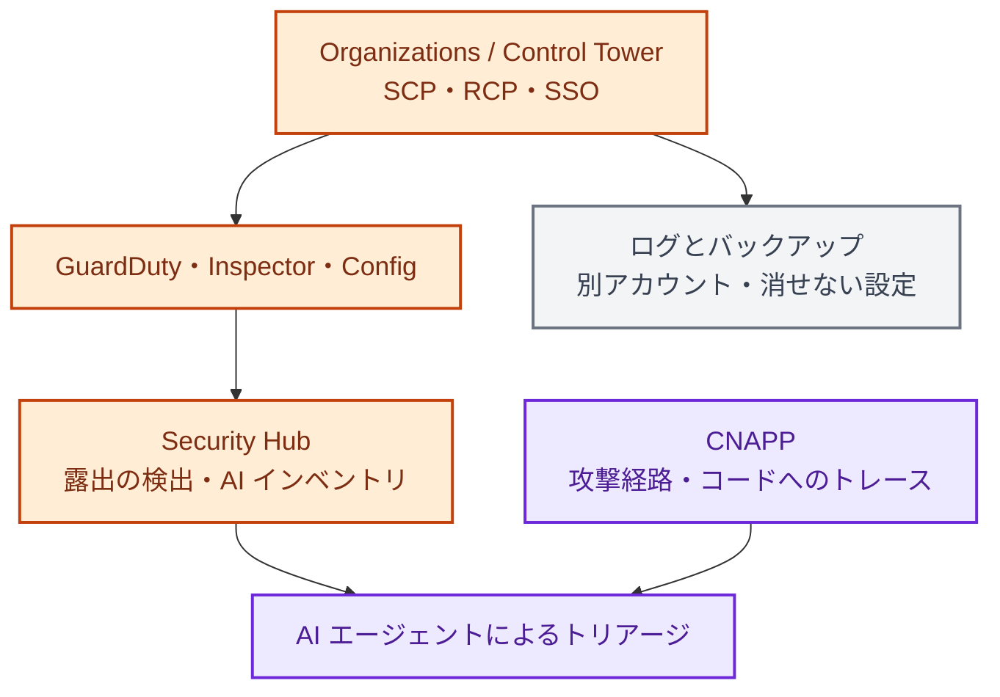
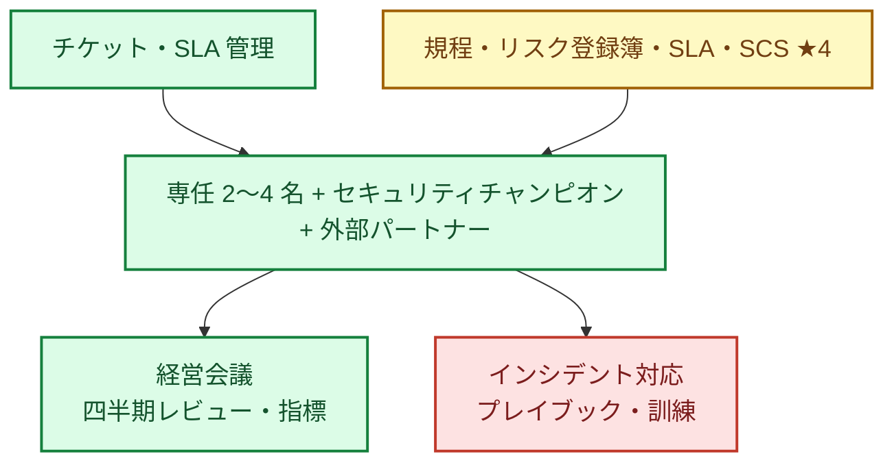

:::message
**最近のニュースから**

**2026 年は、外からの要求が一気に具体化した年です。** 経済産業省は SCS 評価制度の構築方針を公表し（★3・★4 は 2027 年 3 月に登録申請の受付開始の予定）、IPA は中小企業ガイドラインを第4.0版に改訂し、能動的サイバー防御の関連法も施行されました。

取引先から「★はいくつですか」「ISMS は」と聞かれる日は近づいています。この章では、それに答えられる状態までの道のりを、レベルとフェーズで描きます。
:::

この章では、ここまでの章をまとめて、**現在地から Lv4（最終形）までのロードマップ** を描きます。

出発点は会社ごとに違います。ツールがまだほとんどない会社もあれば、ひととおり入っているのに回っていない会社もあります。このロードマップは、どちらから始めても使えるように、各フェーズで「**入っていなければ入れる、入っていれば全体に行き渡らせて回す**」という書き方をしています。どちらの場合も、ツールを足すことより回す仕組み（週次レビュー、持ち主への割り振り、期限）を先に作るのが近道です。期間は、兼務チームで進める場合の目安です。

## 全体の流れ

| フェーズ | 期間の目安 | ゴール | 外への説明 |
|---|---|---|---|
| 0. 知る・決める | 2 か月 | 現在地が分かり、責任者・役割分担・週次レビューが決まった | 「現状を把握し、計画と体制を決めた」 |
| 1. 穴をふさぐ | 2 か月 | 全領域が Lv1。無料・標準の検知が全体に入り、行き渡った | 「致命的な穴はふさいだ」 |
| 2. 基盤 | 6 か月 | 全領域が Lv2 | 「SCS ★3 相当。ISMS 構築の土台ができた」 |
| 3. 仕組み化 | 9 か月 | 全領域が Lv3 | 「SCS ★4 相当。ISMS の認証審査に臨める」 |
| 4. 最適化 | 12 か月〜（継続） | Lv4 | 「セキュリティを継続的に改善し、開示している」 |

## フェーズ 0〜1 の前半: 一人目の担当者の最初の 90 日

フェーズ 0（2 か月）と、フェーズ 1 の最初の 1 か月を、一人目の担当者の動き方として日程に落としたものです。

### 最初の 30 日: 知る（フェーズ 0）

| やること | 章 | 成果物 |
|---|---|---|
| 経営（責任者）と話し、期待と予算の感覚をつかむ。「何が起きたら一番困るか」を聞く | 5 | 守るものの優先順位のメモ |
| AWS アカウント・GitHub 組織・主要 SaaS・VPN 機器などのネットワーク機器と、使っているセキュリティツールの一覧を作る（ツールがなければ、その欄は空でよい） | 6・7・8 | 資産とツールの一覧 |
|SATv2 で全 AWS アカウントを診断する。Security Hub や CNAPP を使っていれば、連携漏れも確かめる | 9 | 診断結果のサマリー |
| 4 章のチェックシートと、6 章の「ツールの棚卸し」で現在地を測る | 4・6 | 現在地チェックシート |
| 直近 1〜3 か月のログで、平時の侵害調査をする（すでに入られていないか） | 15 | 調査の記録 |
| インシデント時の連絡先（社内・外部）と相談先を決める | 14 | 連絡網（1 枚） |

この期間は、**直すことより知ること** を優先します。いきなり設定を変えると、業務を止めたり、関係者の反発を招いたりします。

### 31〜60 日: 決める（フェーズ 0）

| やること | 章 | 成果物 |
|---|---|---|
| 現在地と、3 か月・1 年の計画を経営に報告し、責任者と推進リーダーの任命と、兼務者の稼働の確保を正式に決めてもらう | 5 | 経営報告の資料、任命 |
| 6 章の「重なりの整理」の表を作り、ツールごとの持ち場を決める | 6 | ツールの役割分担表 |
|週次レビューの時間をカレンダーに固定し、始める（見る画面は、クラウドは Security Hub か CNAPP、コードは GitHub に絞る） | 6・10 | 週次レビューの議事メモ |
| AI 利用ガイドライン（13 章）の最小版を出す | 13 | AI 利用ガイドライン v0.1 |

### 61〜90 日: 直し始める（フェーズ 1 の最初の 1 か月）

| やること | 章 | 成果物 |
|---|---|---|
| SATv2 や Security Hub（CNAPP があればそれも）の Critical のうち、インターネットに露出しているものから直す | 9・10 | 改善の記録 |
| 全体のレベルを下げている一番弱い領域を、Lv1 に上げる | 4 | チェックシートの更新 |
| 基本方針と、インシデント対応の基本手順を作る | 5・14 | 基本方針、手順書 |
| 90 日の振り返りを経営に報告し、次の四半期の「次の一手」を決める | 5 | 四半期報告 |

:::message
**最初の 90 日で一番大事なのは、味方を作ることです。** セキュリティは、一人目の担当者だけでは良くなりません。各開発チームのリーダー、インフラ担当、情報システム担当、法務と早めに話し、「困っていること」を聞きます。セキュリティの改善が、彼らの困りごと（取引先のチェックシートへの回答、監査対応、障害対応など）の解決にもつながることを示せると、協力を得やすくなります。
:::

## フェーズ 1: 穴をふさぐ ― Lv1（2 か月）

最初の 1 か月は、上の「61〜90 日」にあたります。

| 領域 | やること | 章 |
|---|---|---|
| ID | 全サービスで MFA 必須（例外なし。委託先のアカウントも）、ルートユーザーの保護、退職者アカウントの点検 | 7・8 |
| 社内 IT | VPN 機器・ファイアウォールの一覧と最新化、PC の OS 自動更新とウイルス対策、振込先変更の確認手順 | 7 |
| AWS | CloudTrail・GuardDuty・S3 パブリックアクセスブロックを全アカウント・全リージョンに。持ち主のいないアカウントの整理 | 8・9 |
| 検知 | GuardDuty の重大度「高」をチャットに通知。Security Hub（CNAPP があればそれも）を全アカウントに | 8・10 |
| 開発 | GitHub のシークレットスキャン・プッシュ保護・Dependabot を全リポジトリに。Takumi Guard を全開発者と CI に | 11・12 |
| AI | 使ってよい AI サービスと、入力してはいけない情報を決めて周知 | 13 |
| 修正 | SATv2 や Security Hub の Critical のうち、インターネットに露出しているものを直す | 9・10 |

**費用の目安**: このフェーズで使うのは、無料・標準の機能（CloudTrail、GuardDuty、Security Hub、GitHub の基本機能、Takumi Guard、SATv2）が中心です。費用は、全アカウント・全リージョンに広げる分の従量課金が主になります。有料のツールがすでに入っている場合は、その対象範囲を全体に広げます

## フェーズ 2: 基盤 ― Lv2 / ★3（6 か月）

| 領域 | やること | 章 |
|---|---|---|
| 組織 | 基本方針・主要規程（守秘義務、情報の機密区分を含む）の制定、リスク登録簿、資産の一覧の維持、委託先との機密情報の取扱いとインシデント時の役割分担 | 5 |
| ID | IdP への集約と SSO、管理者アカウントの分離、IAM Identity Center、IAM ユーザーの廃止 | 7・8 |
| 社内 IT | MDM とディスクの暗号化、SPF・DKIM・DMARC、境界の機器の更新を 14 日以内、SaaS の一覧と共有設定の見直し | 7 |
| AWS | Control Tower の管理下にすべてのアカウントを入れる、ログアーカイブ・監査アカウント、SCP、Config、AWS Backup | 8 |
| 検知 | Security Hub と Inspector を全アカウントに。検知結果をチームと対応づけ、持ち主に割り振る（CNAPP を使うならそのプロジェクト単位で）。件数が多すぎて優先順位をつけられなければ、CNAPP の導入を検討する | 8・10 |
| 修正 | OS・ミドルウェア・ネットワーク機器の Critical / High の更新を、リリースから 14 日以内に当てる運用を始める（SCS ★3 の評価基準） | 5 |
| 開発 | ルールセット、Actions の OIDC 化、開発者の手元での AI 診断（`/security-review` など） | 11・12 |
| AI | AI 利用ガイドラインの文書化、AI コーディングエージェントの標準設定 | 13 |
| 対応 | インシデント対応の基本手順と関係者への説明・訓練、リストア手順書とバックアップからの復旧テスト、ログの別アカウントでの 1 年以上の保管と記録の停止の禁止、バックアップの別アカウント・別リージョンへのコピー、調査会社の候補決め | 8・14・15 |
| 外部 |SCS 評価制度 ★3 の要求事項で自己評価し、ギャップを埋める。ISMS を目指すなら、適用範囲を検討し始める | 3 |

## フェーズ 3: 仕組み化 ― Lv3 / ★4・ISMS（9 か月）

| 領域 | やること | 章 |
|---|---|---|
| 組織 | すべての検知結果に重大度別の SLA をつけて達成率を測る、委託先管理、全社教育と標的型メール訓練 | 5 |
| ID | 権限の棚卸し、未使用権限の削減、管理者のパスキー化、一時的な権限付与 | 7・8 |
| 社内 IT | EDR を全端末に、DMARC を quarantine 以上に、OAuth アプリの同意の制限、委託先アカウントの期限管理 | 7 |
| AWS | IaC スキャン、自動修復、ログのオブジェクトロックとバックアップのボールトロック、復元テストの自動化 | 8 |
| 検知 | 検知結果をチケットに自動起票し、チームごとの SLA 達成率を測る。CNAPP があれば、原因のコードまでたどる | 10 |
| 開発 | CodeQL + Copilot Autofix、AI による継続的なコード診断（Claude Security など）、動いているアプリへの診断（Takumi など）を、重要なプロダクトから全プロダクトへ。大きなリリース前は AWS Security Agent も選択肢に | 11・12 |
| AI | AI エージェントのサンドボックス化、AI 機能のリスク評価、AI 資産の把握 | 13 |
| 対応 | シナリオ別プレイブック、年 1 回の机上訓練（証拠を残すところまで）と復旧訓練、止まったときの代替手段の決定、注意喚起に連動した侵害調査、調査会社との事前契約 | 14・15 |
| 外部 |SCS 評価制度 ★4 のギャップ分析と第三者評価の準備。ISMS を目指すなら、リスクアセスメント・適用宣言書・内部監査を加えて認証審査に臨む | 3 |

**費用の目安**: 有料の道具（CNAPP、GitHub Code Security、AI 診断）を入れる、または対象を広げることで、費用が増えるフェーズです。フェーズ 1〜2 で作った「週次レビュー」「持ち主への割り振り」「SLA」が回っていることを確かめてから入れます。

## フェーズ 4: 最適化 ― Lv4 / 最終形（12 か月〜）

- セキュリティ指標のダッシュボードと、経営による定期レビュー
- 新しいプロダクトや機能の設計段階での脅威モデリング（Claude Security のチームで編集できる脅威モデルなどを活用）
- AI エージェントによる一次対応（Wiz の Green Agent による根本原因の調査と修正案、Claude Security の修正案など）を全プロダクトに広げる
- 定期的な外部ペネトレーションテスト・レッドチーム演習、AI 機能のレッドチーミング
- トラストセンター（セキュリティの取り組みを公開するページ）の公開
- 専任者の配置（2〜4 名規模）とセキュリティチャンピオン制度

## 最終形の全体像

最終形を、開発・クラウド・運用と統治の 3 つに分けて描きます。

**開発**: コードが書かれてから本番に出るまでに、問題が見つかり、持ち主に届く

**クラウド**: 検知と優先順位づけが組織全体で回り、ログとバックアップは消されない場所にある

**運用と統治**: 見つかった問題が期限つきで処理され、経営に報告される

色の意味: 青＝開発、オレンジ＝クラウド、紫＝優先順位づけ・分析、緑＝人・チーム・経営、黄＝ルール、赤＝インシデント対応、灰色＝保管。

最終形のポイントは次の 3 つです。

1. **見つける → 直す → 確かめる** が、人の手をなるべく介さずに回っている
2. **人は判断と改善に集中** している（何を受容するか、どこに投資するか、新しいリスクにどう備えるか）
3. **外に説明できる**（SCS 評価制度の★、トラストセンター、経営への定期報告）

## ツールごとの「使いこなし」の順番

ツールごとに、「まだなければいつ入れるか」と「入っていれば、いつ、どこまで使いこなすか」をまとめます。

| 役割（この本の例） | まだなければ | フェーズ 0〜1 | フェーズ 2 | フェーズ 3〜4 |
|---|---|---|---|---|
| AWS の土台と検知（AWS 標準） | フェーズ 0〜1 で入れる（標準機能） | GuardDuty・CloudTrail・Security Hub を全体に | Control Tower・SSO・Inspector | 自動修復、インシデント初動の自動化 |
| 定期点検（SATv2） | フェーズ 0 で使う（無料） | 全アカウントの診断、連携漏れの確認 | 四半期ごとの定期点検 | 推移を経営報告・ISMS / SCS の証跡に |
| 優先順位づけ（Wiz） | フェーズ 2〜3 で検討（有料） | Security Hub の露出検出で代用 | チームへの割り振り | チケット化と SLA、コードまでのトレース、エージェント |
| コードの守り（GitHub） | 基本機能はフェーズ 1 で入れる | プッシュ保護・Dependabot を全リポジトリに | ルールセット、OIDC | CodeQL + Autofix（Code Security）、セキュリティキャンペーン |
| パッケージの守り（Takumi Guard） | フェーズ 1 で入れる（無料） | 全開発者と CI に | — | — |
| アプリの診断（Takumi） | フェーズ 3 で検討（有料） | — | 重要なプロダクトで試す | 全プロダクトの定期診断、報告書を外部説明に |
| コードの継続診断（Claude Security） | 手元での診断はフェーズ 1〜2、継続診断はフェーズ 3 で検討 | 開発者の手元で `/security-review` | プラグインの標準化 | 継続的スキャン、修正の追跡、脅威モデル |

## 計画を見直すタイミング

- **四半期ごと**: 4 章のチェックシートで測り直し、次の四半期の「次の一手」を決める
- **大きなできごとがあったとき**: インシデント、新しいプロダクトの立ち上げ、買収・統合、取引先からの新しい要求（SCS 評価制度の★の要求など）
- **年 1 回**: IPA の 10 大脅威の新しい版が出たら（毎年 1〜2 月）、優先順位を見直す。この本の内容も更新する
