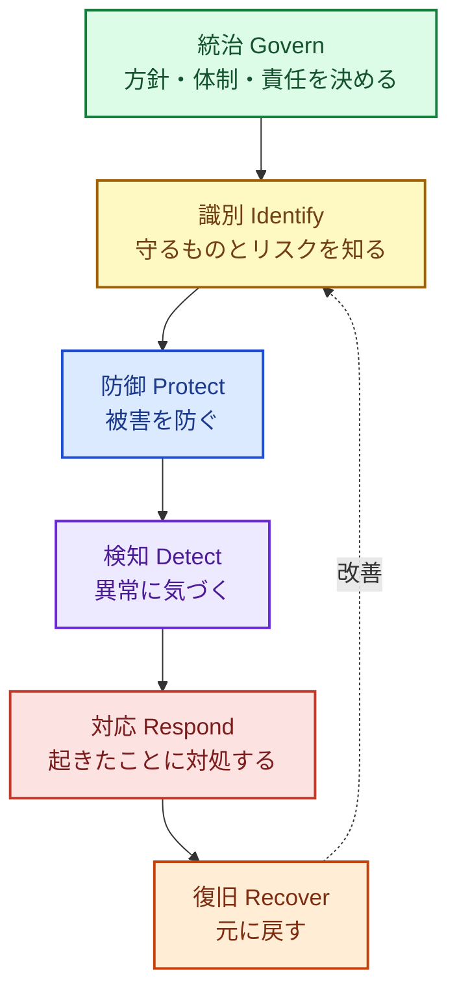

本文で使う考え方と用語を整理した付録です。本文を読んでいて分からない言葉や考え方が出てきたときに、参照してください。

## セキュリティで守るもの: CIA

情報セキュリティは、情報の次の 3 つの性質を守ることだと定義されます（頭文字をとって **CIA** と呼びます）。

| 性質 | 意味 | 損なわれた例 |
|---|---|---|
|機密性（Confidentiality） | 許可された人だけが情報を見られる | 顧客情報の漏えい、S3 バケットの公開設定ミス |
|完全性（Integrity） | 情報が正しく、勝手に書き換えられない | Web サイトの改ざん、依存パッケージへの悪性コードの混入 |
|可用性（Availability） | 必要なときに情報やシステムを使える | ランサムウェアによるシステム停止、DDoS 攻撃 |

事業会社では、**可用性**（業務やサービスが止まること）の被害が特に大きくなりがちです。ランサムウェアが 10 年近く脅威の 1 位であり続けているのは、このためです。

## リスクの考え方

セキュリティの「リスク」は、おおまかに次の掛け算で考えます。

```
リスク ＝ 資産の価値 × 脅威 × 脆弱性
```

- **資産**: 守る対象。顧客データ、ソースコード、AWS アカウント、社員の ID、業務の継続性など
- **脅威**: 資産に害を与えるもの。攻撃者、内部不正、設定ミス、自然災害など
- **脆弱性**: 脅威がつけ込める弱点。パッチ未適用、弱いパスワード、過剰な権限、公開設定など

リスクへの対応には、**低減**（対策する）、回避（その業務をやめる）、移転（保険や委託）、受容（あえて何もしない）の 4 つがあります。すべてのリスクをゼロにすることはできないので、「どれを、どこまで下げるか」を決めて記録することが、体制づくりの出発点になります。

:::message
**「受容」も立派な判断です。** ただし、誰が、いつ、どんな理由で受容したのかを記録しておかないと、それは判断ではなく「放置」になります。5 章で扱うリスク登録簿（リスクの一覧表）は、この記録のための道具です。
:::

## 対策の全体像: NIST CSF 2.0 の 6 つの機能

対策を漏れなく考えるための枠組みとして、米国 NIST の **サイバーセキュリティフレームワーク（CSF）2.0** がよく使われます。CSF 2.0 は、対策を次の 6 つの機能に分けています。



| 機能 | 何をするか | この本での例 |
|---|---|---|
|統治（Govern） | 方針・体制・役割・責任を決める | 責任者の任命、規程、リスク登録簿（3 章・5 章） |
|識別（Identify） | 守るものとリスクを把握する | AWS アカウント・資産の棚卸し、SATv2、Wiz（8〜10 章） |
|防御（Protect） | 被害を防ぐ | MFA、最小権限、暗号化、ブランチ保護（8 章・11 章） |
|検知（Detect） | 異常に気づく | GuardDuty、Security Hub、シークレットスキャン（8 章・11 章） |
|対応（Respond） | 起きたことに対処する | インシデント対応手順、連絡体制（14 章） |
|復旧（Recover） | 元に戻す | バックアップ、復旧訓練（8 章・14 章） |

専任チームのない会社では、**防御** にばかり目が行き、検知・対応・復旧が手薄になりがちです。「防げなかったときに、気づけるか・止められるか・戻せるか」を常にセットで考えるのが大事です。

## 押さえておきたい原則

### 多層防御

1 つの対策が破られても、次の対策で止められるように、複数の層で守る考え方です。たとえば、パスワードが漏れても MFA で止まり、MFA を突破されても権限が小さいので被害が限られ、それでも何かされたら GuardDuty で気づける、という具合です。

### 最小権限

人やシステムには、仕事に必要な最小限の権限だけを与えます。クラウドの事故の多くは、**必要以上に強い権限** が漏れたり悪用されたりして起きています。AI エージェントにも同じ原則が当てはまります（13 章）。

### ゼロトラスト

「社内ネットワークの中は安全」という前提を捨て、すべてのアクセスを毎回確かめる考え方です。クラウドとリモートワークが当たり前になった今は、**ID（誰か）とデバイス（どの端末か）** を守りの中心に置きます。

### 責任共有モデル

AWS などのクラウドでは、守る責任をクラウド事業者と利用者で分担します。AWS はデータセンターや基盤のセキュリティ（**クラウドの** セキュリティ）に責任を持ち、利用者は自分のアカウントの設定・ID・データ・アプリケーション（クラウドの中のセキュリティ）に責任を持ちます。設定ミスによる情報漏えいは、利用者側の責任です。

### シフトレフト

開発の後工程（リリース直前や本番運用中）で問題を見つけるより、**前工程（設計・コーディング中）で見つけるほうが安く直せる** という考え方です。GitHub のプッシュ保護や、AI による PR ごとの診断（11 章・12 章）は、この考え方を実現する道具です。

## いまの脅威: 情報セキュリティ10大脅威 2026

IPA が毎年公表している「情報セキュリティ10大脅威」の 2026 年版（2026 年 1 月 29 日公表）の組織編は次のとおりです。

| 順位 | 脅威 |
|---|---|
| 1 | ランサム攻撃による被害 |
| 2 | サプライチェーンや委託先を狙った攻撃 |
| 3 |AI の利用をめぐるサイバーリスク（初選出） |
| 4 | システムの脆弱性を悪用した攻撃 |
| 5 | 機密情報を狙った標的型攻撃 |
| 6 | 地政学的リスクに起因するサイバー攻撃（情報戦を含む） |
| 7 | 内部不正による情報漏えい等 |
| 8 | リモートワーク等の環境や仕組みを狙った攻撃 |
| 9 | DDoS 攻撃（分散型サービス妨害攻撃） |
| 10 | ビジネスメール詐欺 |

この順位から、優先すべき対策の方向が見えてきます。

- **1 位 ランサム攻撃** → バックアップと復旧（イミュータブルなバックアップ）、パッチ適用、ID の保護、検知
- **2 位 サプライチェーン** → 委託先の管理、依存パッケージの管理（11 章・12 章）、そして自社が取引先から見た「サプライチェーンの一部」であることへの対応（SCS 評価制度、3 章）
- **3 位 AI** → AI 利用のルールと、AI 機能・AI エージェントの安全な作り方（13 章）
- **4 位 脆弱性** → 脆弱性管理の仕組み化と、AI による診断（9〜12 章）

## 用語ミニ集

| 用語 | 意味 |
|---|---|
| CSPM | Cloud Security Posture Management。クラウドの設定ミスを検出する仕組み |
| CNAPP | Cloud-Native Application Protection Platform。CSPM、脆弱性管理、ワークロード保護などを統合した製品分野（Wiz など） |
| SAST / DAST | 静的解析（ソースコードを読んで診断）/ 動的解析（動いているアプリに外から攻撃を試して診断） |
| SCA | Software Composition Analysis。依存ライブラリの既知の脆弱性を調べること |
| SBOM | Software Bill of Materials。ソフトウェアの部品表 |
| CSIRT | Computer Security Incident Response Team。インシデント対応の担当チーム |
| EDR | Endpoint Detection and Response。PC やサーバーでの不審な動きを検知・対応する仕組み |
| SSO / MFA | シングルサインオン / 多要素認証 |
| IaC | Infrastructure as Code。Terraform や CloudFormation でインフラをコード管理すること |
| プロンプトインジェクション | AI への入力（Web ページやメールなど、AI が読む内容を含む）に命令を紛れ込ませて、AI を意図しない動作に誘導する攻撃 |

## 物差しの詳細（3 章の補足）

3 章で名前だけ挙げた物差しの中身です。

### ISMS（ISO/IEC 27001）

#### ISMS とは

**ISMS**（情報セキュリティマネジメントシステム）は、情報セキュリティを組織として管理する仕組みです。国際規格 ISO/IEC 27001（最新版は 2022 年版。日本では JIS Q 27001:2023）の要求を満たしていることを、第三者の審査機関が審査して認証します。

ISMS の特徴は、決まった対策の一覧を満たすことよりも、次のサイクルが回っていることを求める点です。

- 経営が方針を決め、適用範囲と責任を明確にする
- 情報資産とリスクを洗い出して評価し、対策を選ぶ（リスクアセスメント）
- 選んだ対策を運用し、記録を残す
- **内部監査** とマネジメントレビュー（経営による見直し）で改善する

対策の候補として、規格の附属書 A に **93 の管理策**（組織的・人的・物理的・技術的の 4 つに分類）が示されています。クラウドについては、追加の指針として ISO/IEC 27017 もあります。

#### SCS 評価制度との違い

| | SCS 評価制度 | ISMS（ISO/IEC 27001） |
|---|---|---|
| 性格 | サプライチェーン企業が満たすべき対策の水準を★で示す | 情報セキュリティを管理する仕組みがあることを認証する |
| 中身 | 代表的な脅威をもとに効果の高い対策を抜き出した、具体的な要求事項と評価基準（ベースラインアプローチ） | リスクに基づいて自社で対策を選ぶ |
| 評価 | ★3 は自己評価（専門家の確認を含む）、★4 は第三者評価 | 第三者の審査機関による審査（定期の審査あり） |
| 向いている使い方 | 取引先に「最低限の対策ができている」ことを示す | 全社的なセキュリティ管理の成熟を示す、海外取引 |

両者は対立するものではなく、**補い合う関係** です（経済産業省の FAQ も「相互補完的な制度」と位置づけています）。SCS 評価制度の要求事項で「やるべき対策」の抜けをなくし、ISMS の仕組みで「それを回し続ける」ことを示す、と考えると整理しやすくなります。

### NIST CSF 2.0 のティア

米国 NIST の **サイバーセキュリティフレームワーク（CSF）2.0** は、対策を「統治・識別・防御・検知・対応・復旧」の 6 つの機能に分けて整理する枠組みです（6 つの機能は、この章の前半で紹介しています）。CSF 2.0 には、組織のリスク管理の厳密さを示す 4 つのティア（段階）もあります。

| ティア | 名前 | 状態 |
|---|---|---|
| 1 | 部分的（Partial） | 場当たり的に対応している |
| 2 | リスク情報を活用（Risk Informed） | リスクを意識しているが、組織全体の方針にはなっていない |
| 3 | 繰り返し可能（Repeatable） | 方針が承認され、組織全体で一貫して運用されている |
| 4 | 適応（Adaptive） | 過去の経験や指標をもとに、継続的に改善している |

### OWASP SAMM

ソフトウェア開発のセキュリティに特化した成熟度モデルです。ガバナンス、設計、実装、検証、運用の 5 つの業務機能について、成熟度を 0〜3 で評価します。プロダクト開発のセキュリティ（11 章・12 章）を深めるときの物差しになります。

### CIS Controls v8.1 の実装グループ

米国 CIS が公開している、優先度つきの対策集です。組織の規模とリスクに応じて **IG1（最低限の衛生）→ IG2 → IG3** と段階が分かれています。IG1 は「どの組織でも最低限やるべき 56 の対策」とされ、Lv1 の確認に使えます。
